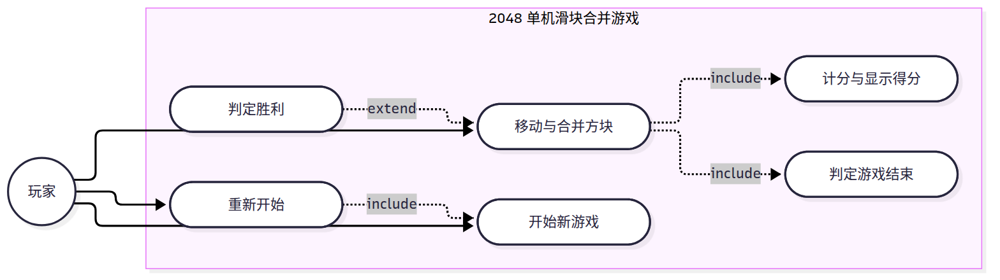

# 02 用例与用例叙述（实验二）

本文档依据《2048 项目建模规范（唯一口径）》第 2、4 节编写，内容包括参与者识别、用例图（图 1）、用例关系清单与 UC01~UC06 六份用例叙述。用例编号、用例名称、参与者与关系均取自规范第 4 节。

## 1. 参与者识别

识别参与者按实验指导书给出的三条判据进行：参与者是位于系统之外的某人或某物；只有使用系统、跟系统交互、跟系统交换信息的才是参与者；参与者会启动、参与用例。

- **玩家（Player）**：位于系统之外，通过方向键与“开始新游戏”“重新开始”操作与系统交换信息，启动并参与 UC01、UC02、UC06，是本系统唯一的参与者。
- 系统内部的随机生成方块、判定胜负、累计分数等行为发生在系统边界之内，不作为参与者；因此 UC03、UC04、UC05 的操作者记为“系统（由 UC02 触发）”，它们不与玩家建立关联，而是通过包含关系与扩展关系连接到 UC02。
- 无账号体系，不涉及注册、登录、密码、权限，因此不存在“注册用户”“管理员”一类的第二参与者。

**本系统参与者唯一。**

## 2. 用例图

用例图如图 1 所示。

图 1 用例图

图 1 的读法如下：

- 参与者“玩家”位于系统边界之外，与 UC01 开始新游戏、UC02 移动与合并方块、UC06 重新开始建立关联关系。
- 系统边界内共 6 个用例，即 UC01~UC06，与功能表 F01~F06 一一对应。
- UC02 通过 `«include»` 指向 UC03 与 UC05；UC06 通过 `«include»` 指向 UC01。
- UC04 通过 `«extend»` 指向 UC02，扩展点为“棋盘出现数值 2048 的方块”。
- 图中不出现泛化关系（见第 3.4 节）。

## 3. 用例关系清单

### 3.1 关联关系（3 条）

| 序号 | 关系 | 参与者 | 用例 | 说明 |
|---|---|---|---|---|
| 1 | 关联 | 玩家 | UC01 开始新游戏 | 玩家主动启动一局新的对局 |
| 2 | 关联 | 玩家 | UC02 移动与合并方块 | 玩家按方向键驱动每一次有效移动 |
| 3 | 关联 | 玩家 | UC06 重新开始 | 对局结束后玩家选择重新开始 |

UC03、UC04、UC05 的操作者为系统（由 UC02 触发），系统内部行为不是参与者，故这三条用例不与玩家建立关联。

### 3.2 包含关系 `«include»`（3 条）

| 序号 | 包含用例 | 被包含用例 | 说明 |
|---|---|---|---|
| 1 | UC02 移动与合并方块 | UC03 计分与显示得分 | 每次有效移动后必计分 |
| 2 | UC02 移动与合并方块 | UC05 判定游戏结束 | 每次有效移动后必判定是否还有可行移动 |
| 3 | UC06 重新开始 | UC01 开始新游戏 | 重新开始即执行一次开始新游戏 |

三条包含关系都是“每次执行都必然发生”的关系，被包含用例没有独立的执行条件，因此用包含而不用扩展。

### 3.3 扩展关系 `«extend»`（1 条）

| 序号 | 扩展用例 | 基用例 | 扩展点 | 说明 |
|---|---|---|---|---|
| 1 | UC04 判定胜利 | UC02 移动与合并方块 | 棋盘出现数值 2048 的方块 | 只有棋盘出现 2048 时才发生的附加行为 |

UC04 不是每次移动都发生，它在特定条件下才插入到 UC02 的流程中，因此用扩展而不用包含。

### 3.4 泛化关系（0 条）

本系统参与者唯一、用例之间不存在父子关系，故未使用泛化关系。

## 4. 用例叙述

以下 6 份用例叙述，每份按实验指导书模板的 12 栏记录：用例名称、用例标识符、参与者、用例简述、前置条件、后置条件、基本流程、例外流程、被泛化的用例、被包含的用例、被扩展的用例、修改历史。

### 4.1 UC01 开始新游戏

| 栏目 | 内容 |
|---|---|
| 用例名称 | 开始新游戏 |
| 用例标识符 | UC01 |
| 参与者 | 玩家 |
| 用例简述 | 玩家启动一局新的对局，系统清空棋盘并在随机空位生成两个初始方块（2 或 4） |
| 前置条件 | 系统已启动；当前没有进行中的对局，对局状态为“未开始”或“已结束” |
| 后置条件 | 4×4 共 16 格的棋盘已清空，棋盘上只有两个数值为 2 或 4 的初始方块；本局得分为 0；对局状态为“进行中”；棋盘与得分显示已刷新 |
| 基本流程 | 1) 玩家选择“开始新游戏” 2) 系统清空棋盘的 16 个格子 3) 系统在随机空位生成第一个初始方块，数值取 2 或 4 4) 系统在另一个随机空位生成第二个初始方块，数值取 2 或 4 5) 系统把本局得分置为 0，把对局状态置为“进行中” 6) 系统显示清空后的棋盘、两个初始方块与得分 0 |
| 例外流程 | 1) 若系统取到的随机数值不在 2 与 4 之内，系统放弃该数值并重新取值，直到取到 2 或 4 才放置方块，然后继续步骤 4) 2) 若玩家在步骤 2) 之前取消本次操作，系统不改变棋盘与对局状态，本用例结束，对局仍停留在“未开始”或“已结束”状态 |
| 被泛化的用例 | 无 |
| 被包含的用例 | 无（UC01 自身被 UC06 包含） |
| 被扩展的用例 | 无 |
| 修改历史 | 建立于实验二；用例名称与功能 F01 统一，未再修改 |

### 4.2 UC02 移动与合并方块

| 栏目 | 内容 |
|---|---|
| 用例名称 | 移动与合并方块 |
| 用例标识符 | UC02 |
| 参与者 | 玩家 |
| 用例简述 | 玩家按上/下/左/右方向键，系统将全部方块向该方向滑动，相邻同值方块合并为一个双倍数值方块，同一方块每步只合并一次 |
| 前置条件 | 对局状态为“进行中”，棋盘上至少有一个方块 |
| 后置条件 | 全部方块已向该方向完成滑动与合并；若本次为有效移动，随机空位已生成一个数值为 2 或 4 的新方块，得分已按合并数值累加；对局状态可能因 UC04 变为“胜利”或因 UC05 变为“失败”；棋盘与得分显示已刷新 |
| 基本流程 | 1) 玩家按下上/下/左/右方向键 2) 系统把全部方块向该方向滑动到最远的空位 3) 系统把滑动方向上相邻且数值相同的两个方块合并为一个双倍数值的方块，同一次移动中每个方块最多只参与一次合并 4) 系统按合并所得数值累加本局得分，并显示得分与最高分（包含 UC03） 5) 系统在随机空位生成一个数值为 2 或 4 的新方块 6) 系统判断棋盘是否已出现数值 2048 的方块，满足时执行 UC04 的判定胜利 7) 系统判断棋盘是否已满且任意方向都无法再移动，满足时执行 UC05 的判定游戏结束 8) 系统刷新棋盘显示，等待玩家下一次按键 |
| 例外流程 | 1) 若该方向上所有方块都无法滑动且没有任何方块可以合并，本次按键为无效移动：系统不合并、不计分、不生成新方块，棋盘保持不变，用例结束 2) 若本次有效移动后棋盘已无空位，系统跳过步骤 5)，不生成新方块，直接进入步骤 6) 与步骤 7) 的判定 3) 若步骤 6) 判定本局胜利，系统按 UC04 置状态为“胜利”并提示玩家，不再执行步骤 7)，也不再接受方向键输入 4) 若步骤 7) 判定本局失败，系统按 UC05 置状态为“失败”并提示玩家，不再接受方向键输入 |
| 被泛化的用例 | 无 |
| 被包含的用例 | UC03 计分与显示得分、UC05 判定游戏结束 |
| 被扩展的用例 | UC04 判定胜利（扩展点为“棋盘出现数值 2048 的方块”） |
| 修改历史 | 建立于实验二；初稿把计分写成 UC02 内部的一步，改为包含 UC03 后重写步骤 4) |

### 4.3 UC03 计分与显示得分

| 栏目 | 内容 |
|---|---|
| 用例名称 | 计分与显示得分 |
| 用例标识符 | UC03 |
| 参与者 | 系统（由 UC02 触发） |
| 用例简述 | 系统在每次合并后按合并所得数值累加本局得分，本局得分超过历史最高分时更新最高分记录 |
| 前置条件 | UC02 的一次有效移动已经完成合并，本次合并所得数值已确定 |
| 后置条件 | 本局得分已累加本次合并所得数值；若本局得分高于历史最高分，最高分记录已更新为本局得分；得分与最高分已显示在界面上 |
| 基本流程 | 1) 系统取得本次移动中所有合并所得数值之和 2) 系统把该和累加到本局得分 3) 系统读取最高分记录，与本局得分比较 4) 若本局得分高于最高分，系统把最高分更新为本局得分 5) 系统显示本局得分与最高分，返回 UC02 继续执行 |
| 例外流程 | 1) 若本次移动没有任何方块合并，系统取得的合并数值之和为 0，本局得分与最高分均不变化，只刷新显示后返回 UC02 2) 若最高分记录为空或不可读，系统以 0 作为最高分初值参与比较，并在本次比较完成后写回新的最高分 |
| 被泛化的用例 | 无 |
| 被包含的用例 | 无 |
| 被扩展的用例 | 无 |
| 修改历史 | 建立于实验二；用例名称取“计分与显示得分”，与功能 F03“计分与最高分”对应 |

### 4.4 UC04 判定胜利

| 栏目 | 内容 |
|---|---|
| 用例名称 | 判定胜利 |
| 用例标识符 | UC04 |
| 参与者 | 系统（由 UC02 触发） |
| 用例简述 | 棋盘出现数值 2048 的方块时，系统判定本局胜利并提示玩家 |
| 前置条件 | UC02 的一次有效移动已完成合并与计分；对局状态为“进行中” |
| 后置条件 | 棋盘出现数值 2048 时，对局状态为“胜利”，系统已提示玩家，且不再接受方向键输入；否则对局状态保持“进行中”，控制权返回 UC02 |
| 基本流程 | 1) 系统遍历棋盘的 16 个格子 2) 系统检查是否存在数值等于 2048 的方块 3) 存在时系统把对局状态置为“胜利” 4) 系统提示玩家本局胜利 5) 系统停止接受方向键输入，等待玩家选择重新开始（UC06） |
| 例外流程 | 1) 若遍历结束后不存在数值为 2048 的方块，系统不改变对局状态，返回 UC02 继续执行后续步骤 2) 若棋盘上同时存在多个数值为 2048 的方块，系统只判定一次胜利并只提示一次，不重复触发本用例 3) 若对局状态已为“胜利”或“失败”，系统不再执行本用例，直接返回 |
| 被泛化的用例 | 无 |
| 被包含的用例 | 无 |
| 被扩展的用例 | 无（UC04 自身扩展 UC02） |
| 修改历史 | 建立于实验二；初稿作为 UC02 的包含用例，因“只在出现 2048 时发生”改为扩展用例 |

### 4.5 UC05 判定游戏结束

| 栏目 | 内容 |
|---|---|
| 用例名称 | 判定游戏结束 |
| 用例标识符 | UC05 |
| 参与者 | 系统（由 UC02 触发） |
| 用例简述 | 一次有效移动后棋盘已满且任意方向都无法再移动时，系统判定本局失败并提示玩家 |
| 前置条件 | 一次有效移动已完成合并、计分与随机生成；对局状态为“进行中” |
| 后置条件 | 棋盘已满且任意方向都无法再移动时，对局状态为“失败”，系统已提示玩家，且不再接受方向键输入；否则对局状态保持“进行中” |
| 基本流程 | 1) 系统检查棋盘 16 个格子是否全部非空 2) 全部非空时，系统逐格检查上、下、左、右四个方向是否存在相邻且数值相同的方块 3) 四个方向都不存在相邻同值方块时，系统把对局状态置为“失败” 4) 系统提示玩家本局失败 5) 系统停止接受方向键输入，等待玩家选择重新开始（UC06） |
| 例外流程 | 1) 若棋盘仍有空格，系统判定仍可移动，对局状态保持“进行中”，返回 UC02，不提示失败 2) 若棋盘虽已填满但仍存在相邻且数值相同的方块，系统判定仍可移动，对局状态保持“进行中”，返回 UC02，不提示失败 3) 若本次有效移动后棋盘已无空位而未能生成新方块，系统直接以当前棋盘执行步骤 1) 的检查 4) 若对局状态已为“胜利”，系统跳过本用例，胜利优先于失败 |
| 被泛化的用例 | 无 |
| 被包含的用例 | 无 |
| 被扩展的用例 | 无 |
| 修改历史 | 建立于实验二；判定条件按规范第 1 节写为“已满且任意方向都无法移动”，未再修改 |

### 4.6 UC06 重新开始

| 栏目 | 内容 |
|---|---|
| 用例名称 | 重新开始 |
| 用例标识符 | UC06 |
| 参与者 | 玩家 |
| 用例简述 | 对局结束后玩家可清空棋盘并开始新的一局 |
| 前置条件 | 对局状态为“胜利”或“失败”，即对局已结束并已向玩家提示结果 |
| 后置条件 | 棋盘已清空并生成两个初始方块，本局得分为 0，对局状态为“进行中”，最高分记录保持不变 |
| 基本流程 | 1) 玩家在结果提示界面选择“重新开始” 2) 系统保留最高分记录的当前值 3) 系统执行 UC01 开始新游戏：清空棋盘、生成两个初始方块、本局得分置 0、对局状态置“进行中”（包含 UC01） 4) 系统显示新的棋盘，重新接受方向键输入 |
| 例外流程 | 1) 若玩家不选择“重新开始”而结束本次会话，系统不再执行本用例，对局状态停留在“胜利”或“失败”，最高分记录保持为最近一次更新后的值 2) 若对局状态为“未开始”，即玩家在开局之前就选择“重新开始”，系统不执行步骤 2)，直接按步骤 3) 执行 UC01 3) 若 UC01 在生成初始方块时取到不在 2 与 4 之内的随机数值，系统按 UC01 的例外流程重新取值，本用例的后续步骤顺序不变 |
| 被泛化的用例 | 无 |
| 被包含的用例 | UC01 开始新游戏 |
| 被扩展的用例 | 无 |
| 修改历史 | 建立于实验二；初稿把重新开始写成重复描述一遍开局步骤，改为包含 UC01 后精简为 4 步 |
