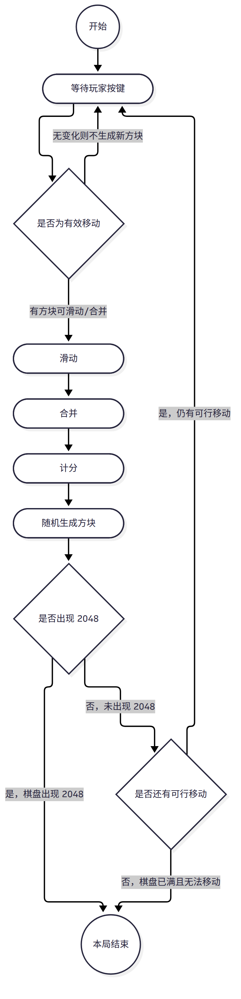
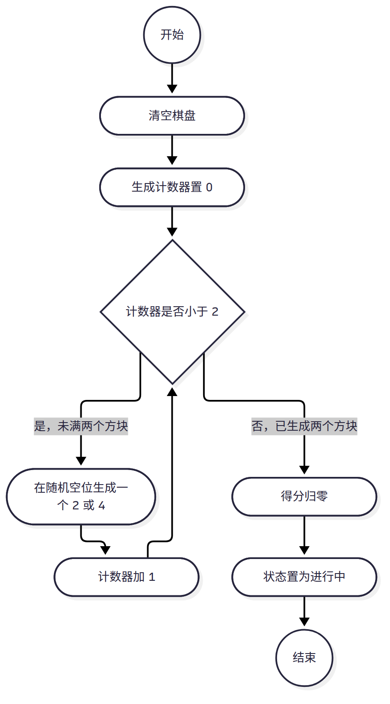
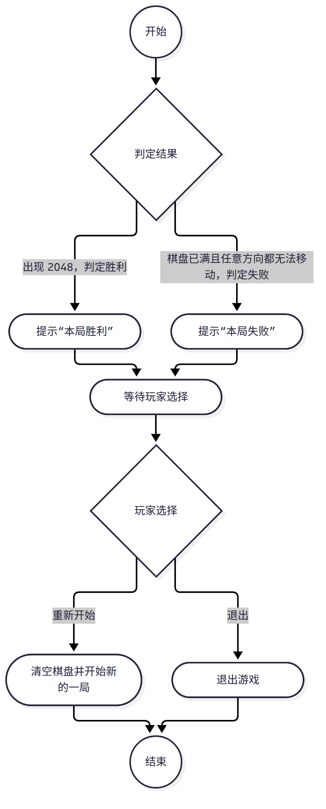

# 实验四 活动图

本文件给出 2048 项目的三张活动图 `ad-01`~`ad-03`。活动图强调**从活动到活动的控制流**（与交互图强调对象到对象的控制流相区别），因此本文件只描述流程的顺序、分支与回环，不描述对象之间的消息顺序（属实验六时序图），也不描述算法实现细节。图文件名与内容口径以 `docs/00-规范.md` 第 6 节为准。

- `ad-01`：一局主流程：按键→滑动→合并→计分→生成→判定。
- `ad-02`：开始新局：清空→生成两个方块→进入进行中。
- `ad-03`：结束处理：胜/负分支→提示→重新开始。
- 草稿：`models/drafts/ad-01.mmd`、`models/drafts/ad-02.mmd`、`models/drafts/ad-03.mmd`；导出图：`models/exports/ad-01.png`、`models/exports/ad-02.png`、`models/exports/ad-03.png`。

## 1 建模约定

### 1.1 使用的元素

三张图只使用指导书列出的基本元素，不使用高级建模元素（对象流、汇合描述、发送与接收信号、引脚、扩展区）：本系统的业务流程是单向控制流，不涉及跨对象的对象流。

| 元素 | 图形 | 草稿写法 | 含义 |
|---|---|---|---|
| 初始节点 | 实心圆（此处以圆表示流程入口） | `((开始))` | 流程的唯一入口，每张图只有一个 |
| 终止节点 | 圆内加实心圆（以圆表示流程出口） | `((结束))`、`((本局结束))` | 流程的出口 |
| 活动节点 | 圆角矩形 | `([活动名])` | 一次可执行的活动，用动宾短语命名 |
| 判断节点 | 菱形 | `{判断名}` | 一个进入转换、多个带监护条件的离开转换 |

转换一律使用带箭头的实线，箭头方向即控制流方向。**每个离开判断节点的转换都写明监护条件**，条件文字写在转换旁，不出现无标签的分支。

### 1.2 不使用泳道的理由

指导书要求“绘制时首先决定是否采用泳道：主要根据活动图中是否要体现出活动的不同实施者”。本项目**不采用泳道**：

1. 本系统**参与者唯一**，即玩家（`docs/00-规范.md` 第 2 节）。随机生成方块、判定胜负、累计分数均为系统内部行为，不构成参与者。
2. 泳道的作用是体现不同职责单位（不同实施者）之间的工作移交。本系统全部活动都由玩家的一次按键触发，并在同一对局内顺序完成，不存在跨实施者的职责移交；加泳道只是把同一个实施者的活动再框一次，不增加信息。
3. 因此三张图只画控制流。`docs/00-规范.md` 第 9 节已把“活动图不使用泳道：参与者唯一，无需体现不同实施者”列为既定取舍。

与此相关，草稿中也没有使用分区子图：分区只做视觉分组，既不表达实施者也不表达控制流，把它当作“泳道的替代”会让人误读为划分了职责，故三张图都是单列控制流。

## 2 一局主流程（ad-01）

### 2.1 该流程的边界与要素

**边界**：本图从玩家进入对局、等待第一次按键开始，到本局出现结果为止。它不包含棋盘清空与两个初始方块的生成（属 `ad-02` 开始新局），也不包含结果之后的提示、重新开始与退出（属 `ad-03` 结束处理）。因此本图的两端是“已开局”与“已出结果”，中间是一个带回环的按键循环。

| 要素 | 内容 |
|---|---|
| 初始节点 | 开始（一局已开始，棋盘上已有两个初始方块） |
| 终止节点 | 本局结束（胜利与失败收敛到同一个终止节点，结果的区分交给 `ad-03`） |
| 判断节点 | 是否为有效移动、是否出现 2048、是否还有可行移动，共 3 个 |
| 回环 | 2 处：“是否为有效移动”的“无变化”分支与“是否还有可行移动”的“仍有可行移动”分支都回到“等待玩家按键” |

**分支条件**（离开判断节点的 6 条转换各有一条条件）：

| 判断节点 | 监护条件 | 去向 |
|---|---|---|
| 是否为有效移动 | 有方块可滑动/合并 | 滑动 |
| 是否为有效移动 | 无变化则不生成新方块 | 等待玩家按键（回环） |
| 是否出现 2048 | 是，棋盘出现 2048 | 本局结束（终止节点） |
| 是否出现 2048 | 否，未出现 2048 | 是否还有可行移动 |
| 是否还有可行移动 | 是，仍有可行移动 | 等待玩家按键（回环） |
| 是否还有可行移动 | 否，棋盘已满且无法移动 | 本局结束（终止节点） |

### 2.2 图

一局主流程活动图如图 1 所示。

图 1 一局主流程活动图

### 2.3 要素说明

如图 1 所示，一局的主流程是“按键—滑动—合并—计分—生成—判定”的循环，循环由两个条件维持。

**活动节点**

| 活动 | 说明 | 对应功能 |
|---|---|---|
| 等待玩家按键 | 对局处于进行中，等待玩家按上/下/左/右方向键 | F02 |
| 滑动 | 全部方块向所按方向滑动到该方向最远的空位 | F02 |
| 合并 | 相邻同值方块合并为一个双倍数值方块，同一次移动中每个方块最多只参与一次合并 | F02 |
| 计分 | 按合并所得数值累加本局得分，并更新最高分 | F03 |
| 随机生成方块 | 在随机空位生成一个数值为 2 或 4 的新方块 | F01、F02 |

**转换的语义**

1. 玩家按键后先判断该方向是否为有效移动：有效则继续；**无效则不生成新方块**，回到等待按键，棋盘与得分都不变，流程不推进。
2. 滑动与合并相邻且顺序固定：先滑动到位，再在到位后的相邻关系上合并，以保证“同一方块每步只合并一次”。
3. 计分紧跟合并：得分只由合并所得数值决定，生成方块不产生分数，所以计分排在生成之前。
4. 生成之后先判“是否出现 2048”，只有未出现时才继续判“是否还有可行移动”。**两个判断串行而非并列**：出现 2048 时本局已胜利，无需再判失败，串行可避免同一局同时得出胜利与失败两个结论。
5. 判定后若有可行移动则回到“等待玩家按键”形成回环，否则到达终止节点。

**与用例的对应**：本图对应 UC02 移动与合并方块。“计分”是 UC02 `«include»` 的 UC03；“是否还有可行移动”是 UC02 `«include»` 的 UC05；“是否出现 2048”是 UC04 对 UC02 的 `«extend»`，扩展点为“棋盘出现数值 2048 的方块”。逐句对应表见 `docs/reports/lab04.md` 4.5 节。

**相对 UC02 用例叙述的两处简化**（如实记录，不改变本图口径）：

1. UC02 基本流程末句“系统刷新棋盘显示”是界面表现，本图不单列为活动节点；显示刷新随“计分”与“随机生成方块”两个活动一并完成。
2. UC02 例外流程 2“本次有效移动后棋盘已无空位则跳过生成新方块”未单列判断节点，本图按基本流程画出生成活动；空满与可移动性统一由“是否还有可行移动”判断承接。

## 3 开始新局（ad-02）

### 3.1 该流程的边界与要素

**边界**：本图只覆盖“进入一局新对局”的准备过程——从清空棋盘到把对局状态置为进行中，不包含玩家此后的按键操作（属 `ad-01`），也不包含从结果界面跳转过来的触发（属 `ad-03`）。

| 要素 | 内容 |
|---|---|
| 初始节点 | 开始（玩家启动一局新游戏，或上局结束后选择重新开始） |
| 终止节点 | 结束（棋盘已清空、已生成两个初始方块、得分已归零、状态为进行中，可进入主流程） |
| 判断节点 | 计数器是否小于 2，用于控制“生成两个方块”的循环 |
| 循环 | 判断节点“是”分支 → 生成一个方块 → 计数器加 1 → 回到判断节点 |

**分支条件**

| 判断节点 | 监护条件 | 去向 |
|---|---|---|
| 计数器是否小于 2 | 是，未满两个方块 | 在随机空位生成一个 2 或 4 |
| 计数器是否小于 2 | 否，已生成两个方块 | 得分归零 |

### 3.2 图

开始新局活动图如图 2 所示。

图 2 开始新局活动图

### 3.3 要素说明

如图 2 所示，开始新局是“清空—循环生成两个方块—归零—置状态”的直线流程，只有一处循环。

**活动节点**

| 活动 | 说明 |
|---|---|
| 清空棋盘 | 4×4 全部格子置为空，空格数恢复为 16 |
| 生成计数器置 0 | 把本次已生成方块数记为 0，作为循环初值 |
| 在随机空位生成一个 2 或 4 | 一次只生成一个方块，位置从当前空位中随机选取 |
| 计数器加 1 | 本次已生成方块数增加一个 |
| 得分归零 | 本局得分清零；最高分属于跨对局的记录，不随之清零 |
| 状态置为进行中 | 对局状态由“未开始”或“已结束”转入“进行中” |

**顺序说明**

1. 判断条件为“计数器是否小于 2”，因此固定生成两个方块；第二个方块生成时棋盘上已有第一个方块，不会落在同一格。
2. 得分归零排在循环之后，即棋盘数据先就绪、再清账，避免出现“已有方块而得分仍是上局值”的中间状态。
3. 状态置为进行中排在最后：棋盘与得分都就绪后，对局才对外表现为“进行中”，此后 `ad-01` 的“等待玩家按键”才成立。

**与用例的对应**：本图对应 UC01 开始新游戏（F01）；UC06 重新开始包含 UC01，故 `ad-03` 的“重新开始”分支进入本图的初始节点。

## 4 结束处理（ad-03）

### 4.1 该流程的边界与要素

**边界**：本图从 `ad-01` 已得出判定结果开始，到玩家选择重新开始或退出为止。它不含判定本身的计算过程（属 `ad-01` 的两个判断节点），也不含新一局的棋盘准备细节（属 `ad-02`）。

| 要素 | 内容 |
|---|---|
| 初始节点 | 开始（主流程已得出判定结果） |
| 终止节点 | 结束（玩家已选择退出，或已转入新一局） |
| 判断节点 | 判定结果（分出胜利、失败两支）、玩家选择（分出重新开始、退出两支） |
| 汇合 | 胜利与失败两个提示活动之后汇合到“等待玩家选择” |

**分支条件**

| 判断节点 | 监护条件 | 去向 |
|---|---|---|
| 判定结果 | 出现 2048，判定胜利 | 提示“本局胜利” |
| 判定结果 | 棋盘已满且任意方向都无法移动，判定失败 | 提示“本局失败” |
| 玩家选择 | 重新开始 | 清空棋盘并开始新的一局 |
| 玩家选择 | 退出 | 退出游戏 |

### 4.2 图

结束处理活动图如图 3 所示。

图 3 结束处理活动图

### 4.3 要素说明

如图 3 所示，结束处理由“判定结果分支—提示—玩家选择分支”两段菱形结构组成。

**活动节点**

| 活动 | 说明 | 对应功能 |
|---|---|---|
| 提示“本局胜利” | 棋盘出现数值 2048 的方块时提示本局胜利 | F04 |
| 提示“本局失败” | 棋盘已满且任意方向都无法移动时提示本局失败 | F05 |
| 等待玩家选择 | 对局停在结果界面，等待玩家选择重新开始或退出 | F06 |
| 清空棋盘并开始新的一局 | 转入 `ad-02` 的初始节点 | F06、F01 |
| 退出游戏 | 结束本次运行，不再进入新的一局 | — |

**分支说明**

1. “判定结果”是唯一入口判断，两支互斥：胜利对应“出现 2048”，失败对应“棋盘已满且任意方向都无法移动”。`ad-01` 已保证两个条件不会同时成立，故本图不需要优先级判断。
2. 两支各有一个提示活动，之后汇合到“等待玩家选择”，使胜利与失败两种结果下玩家看到同一种后续选择，后续流程不重复。
3. “玩家选择”再分两支：重新开始走 `ad-02`，退出直达终止节点。本图不设“继续游戏”，因为结果已定，继续操作没有语义。
4. 本图对应 UC04 判定胜利、UC05 判定游戏结束与 UC06 重新开始；UC06 包含 UC01，故“重新开始”分支指向 `ad-02`，不在本图内重复清空与生成。

## 5 三张图之间的关系

| 关系 | 说明 |
|---|---|
| `ad-02` → `ad-01` | `ad-02` 终止节点交出“棋盘已清空、两个初始方块已生成、得分已归零、状态进行中”，正是 `ad-01` 初始节点的前置条件 |
| `ad-01` → `ad-03` | `ad-01` 的两个判断节点（是否出现 2048、是否还有可行移动）的结果，就是 `ad-03`“判定结果”菱形的输入 |
| `ad-03` → `ad-02` | `ad-03` 的“重新开始”分支回到 `ad-02` 初始节点，三张图由此构成一局游戏的完整闭环 |
| 泳道 | 三张图均不使用泳道，理由见 1.2 节：参与者唯一 |

## 6 与规范的一致性核对

| 核对项 | 结果 |
|---|---|
| 图文件名与内容（第 6 节） | 一致：`ad-01` 一局主流程、`ad-02` 开始新局、`ad-03` 结束处理 |
| 参与者（第 2 节） | 一致：只出现玩家与系统内部行为，未引入其他参与者，无账号与权限相关活动 |
| 功能编号（第 3 节） | 一致：活动说明只引用 F01~F06，未编造功能 |
| 用例关系（第 4 节） | 一致：UC03、UC05 按 `«include»` 落在主流程内，UC04 按 `«extend»` 落在扩展点，UC06 通过包含 UC01 指向 `ad-02` |
| 泳道取舍（第 9 节） | 一致：三图均不使用泳道 |
| 写作规范（第 7 节） | 一致：中文书写，图号在本文件内从 1 连续编号，提到图时写明“如图 N 所示” |
