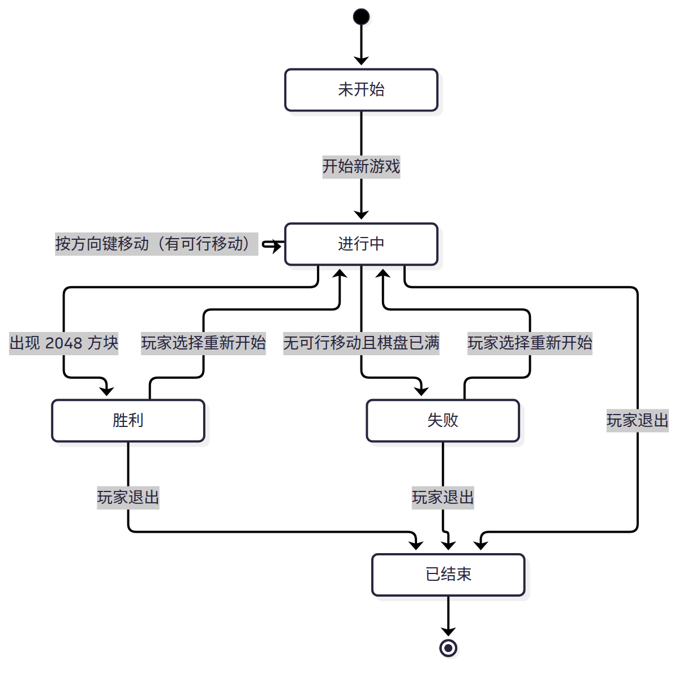
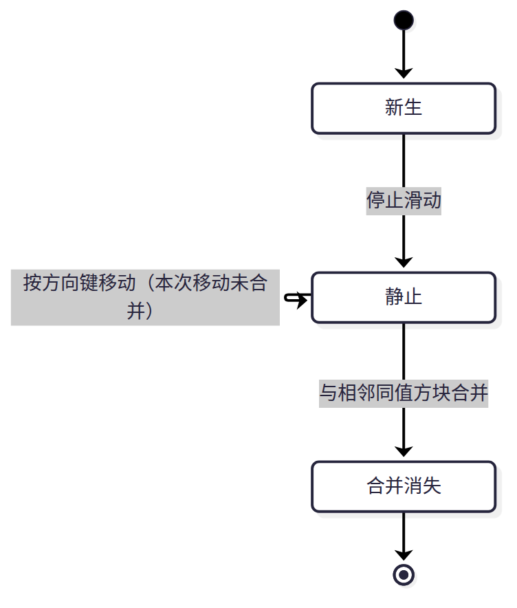

# 实验五 状态图

本文件记录 2048 项目中两个重要业务对象的状态建模结果：对局（`Game`）状态机 `st-01` 与方块（`Tile`）状态机 `st-02`，并记录依据状态图对类图 `cd-01` 所做的修订。对象、状态与事件的中文名称与 `docs/00-规范.md` 第 5 节的类清单、第 6 节的图文件清单一致。

## 1 状态图要素说明

状态图描述一个对象在生命期中响应事件所经历的状态序列。本项目的两张状态图只使用下列四类要素，每一类都对应到具体建模内容。

| 要素 | 含义 | 在本项目中的体现 |
|---|---|---|
| 状态 | 对象生命期中的一个条件或状况，在此期间对象满足某些条件、执行某些活动或等待某些事件 | 对局的五个状态：未开始、进行中、胜利、失败、已结束；方块的三个状态：新生、静止、合并消失 |
| 事件 | 能引起状态迁移的内部或外部激励，分为玩家触发的事件与系统触发的事件 | 玩家触发：开始新游戏、按方向键移动、玩家选择重新开始、玩家退出；系统触发：出现 2048 方块、无可行移动且棋盘已满、生成、停止滑动、与相邻同值方块合并 |
| 迁移 | 由一种状态到另一种状态的转移，图中标注形式为“事件（监护条件）” | `进行中 --> 胜利 : 出现 2048 方块`；`进行中 --> 失败 : 无可行移动且棋盘已满` |
| 监护条件 | 迁移上的布尔条件，只有条件为真时该迁移才被触发 | `按方向键移动（有可行移动）`：一次移动只有在棋盘状态确实发生变化时才视为有效移动；`无可行移动且棋盘已满`：失败迁移的监护条件由“棋盘已满”与“四个方向均不可移动”两个条件同时成立构成 |

两张状态图都含初始伪状态（实心圆，`[*]` 作为迁移源）与终止伪状态（`[*]` 作为迁移目标）：对局对象创建后进入未开始，玩家退出后经已结束终止；方块对象由随机生成或合并产生后进入新生，被合并移除后终止。

## 2 对局状态机 st-01

对局是一次游戏过程的对象化，其状态机覆盖从对象创建到本局结束的全过程，对局状态机如图 1 所示。

图 1 对局状态机 st-01

事件与迁移的对应关系如下：

| 序号 | 迁移 | 事件 | 监护条件 | 来源 |
|---|---|---|---|---|
| 1 | 未开始 → 进行中 | 开始新游戏 | 无 | F01 / UC01 |
| 2 | 进行中 → 进行中 | 按方向键移动 | 该方向存在可滑动或可合并的方块 | F02 / UC02 |
| 3 | 进行中 → 胜利 | 出现 2048 方块 | 棋盘上存在数值为 2048 的方块 | F04 / UC04 |
| 4 | 进行中 → 失败 | 无可行移动且棋盘已满 | 棋盘 16 格全部占用且四个方向均不可移动 | F05 / UC05 |
| 5 | 胜利 → 进行中 | 玩家选择重新开始 | 无 | F06 / UC06 |
| 6 | 失败 → 进行中 | 玩家选择重新开始 | 无 | F06 / UC06 |
| 7 | 进行中 → 已结束 | 玩家退出 | 无 | 对局对象销毁 |
| 8 | 胜利 → 已结束 | 玩家退出 | 无 | 对局对象销毁 |
| 9 | 失败 → 已结束 | 玩家退出 | 无 | 对局对象销毁 |

迁移 2 是自迁移（`进行中` 迁移到自身）：一次有效移动不会改变对局所处的状态，但会改变棋盘、得分与步数，因此在对局状态机中以自迁移表示，而不引入新的状态。迁移 5、6 直接回到 `进行中`，原因是 `UC06 重新开始` 包含 `UC01 开始新游戏`（见 `docs/00-规范.md` 第 4 节），重新开始即“清空棋盘 + 生成两个初始方块 + 进入进行中”，不需要再经过 `未开始` 中转。胜利后玩家若继续操作，棋盘上仍保留 2048 方块，因此本项目在 `胜利` 状态只接受“重新开始”与“退出”两个事件。

## 3 方块状态机 st-02

方块是棋盘上的最小单位，其状态机关心单个方块从产生到消失的历程，与对局状态机的粒度不同：一局对局中会产生大量方块对象，每个方块各自走完一次 st-02，方块状态机如图 2 所示。

图 2 方块状态机 st-02

| 序号 | 迁移 | 事件 | 监护条件 |
|---|---|---|---|
| 1 | 初始 → 新生 | 生成 | 由 `Board.随机生成()` 在随机空位产生，或由两个同值方块合并后产生 |
| 2 | 新生 → 静止 | 停止滑动 | 本次移动中该方块已完成位移，且数值与位置不再变化 |
| 3 | 静止 → 静止 | 按方向键移动 | 该方块本次移动发生了位移，但未与任何方块合并 |
| 4 | 静止 → 合并消失 | 与相邻同值方块合并 | 该方块与滑动方向上的相邻方块数值相同，且本步内尚未参与过合并 |

`新生` 与 `静止` 的区别只在于是否参与过滑动：“是否新生成”标记在进入 `静止` 时清除，用于界面区分新方块。`合并消失` 是终止态：被合并的方块对象从棋盘移除，合并结果由一个新的方块对象承载，因此不存在“合并消失 → 新生”的迁移。

## 4 状态说明表

| 对象 | 状态 | 含义 | 进入动作 | 离开事件 |
|---|---|---|---|---|
| 对局（`Game`） | 未开始 | 对局对象已创建，棋盘为空，尚未生成任何方块 | 得分、步数、最高分保持不变，状态置为未开始，等待玩家操作 | 开始新游戏 |
| 对局（`Game`） | 进行中 | 棋盘上有方块，等待玩家按方向键，或正在处理一次移动 | 清空棋盘并在随机空位生成两个初始方块（2 或 4），得分与步数归零 | 出现 2048 方块；无可行移动且棋盘已满；玩家选择重新开始；玩家退出 |
| 对局（`Game`） | 胜利 | 棋盘上已存在数值 2048 的方块，本局达成胜利条件 | 结算本局得分，本局得分高于历史最高分时更新最高分，提示玩家胜利 | 玩家选择重新开始；玩家退出 |
| 对局（`Game`） | 失败 | 棋盘 16 格已满且四个方向均无法移动，本局无法继续 | 结算本局得分，本局得分高于历史最高分时更新最高分，提示玩家失败 | 玩家选择重新开始；玩家退出 |
| 对局（`Game`） | 已结束 | 本局对局终止，对象即将销毁，不再响应任何游戏事件 | 释放棋盘与方块占用的资源 | 无（终止态） |
| 方块（`Tile`） | 新生 | 方块刚由随机生成或合并产生，尚未完成一次完整滑动 | 确定数值与行、列，将“是否新生成”置为真 | 停止滑动 |
| 方块（`Tile`） | 静止 | 方块位于某个格子中且已处理完毕，等待下一次移动 | 将“是否新生成”置为假 | 与相邻同值方块合并；按方向键移动（未合并，自迁移）；对局结束（对象随棋盘销毁） |
| 方块（`Tile`） | 合并消失 | 方块被同值相邻方块合并，正从棋盘移除 | 数值累加到合并结果方块，从棋盘移除并释放格子，空格数加一 | 无（终止态） |

## 5 对类图的修订

指导书实验五第 2 条要求“修改和完善相关的类图及类间关系”。按状态图逐条核对 `cd-01` 后，对 `Game` 类做了三处修订，其余三个类（`Board`、`Tile`、`Record`）与四条类间关系均未改动。下表所称“修订前”指 `cd-01` 初稿（实验三首次成图时的形态），修订结果已落实在 `models/drafts/cd-01.mmd` 的当前版本中。

### 5.1 修订内容

| 序号 | 修订位置 | 修订前（实验三 `cd-01`） | 修订后 | 依据的状态图要素 |
|---|---|---|---|---|
| 1 | `Game` 属性 | 得分: int、最高分: int、步数: int | 得分: int、最高分: int、**状态: GameState**、步数: int | st-01 的 5 个状态需要有一个属性保存“当前处于哪个状态” |
| 2 | `Game` 操作 | 开始新局()、移动(方向: Direction): bool、判定胜利(): bool、判定结束(): bool | 保留上述四个操作，**新增 结算()** | st-01 中 `胜利`、`失败` 两个状态的进入动作（结算得分、更新最高分、提示结果）在类图中没有对应操作 |
| 3 | 新增枚举 | 无（仅有“`Game` 依赖 `GameState`”这一条依赖关系） | 枚举 **`GameState`**，取值为 **未开始、进行中、胜利、失败、已结束** | st-01 的 5 个状态名，作为 `状态: GameState` 的取值域 |

修订后 `Game` 类在 `cd-01` 中的形态如下（属性与操作与 `docs/00-规范.md` 第 5 节完全一致）：

| 类名 | 属性 | 操作 |
|---|---|---|
| `Game` | 得分: int；最高分: int；状态: GameState；步数: int | 开始新局()；移动(方向: Direction): bool；判定胜利(): bool；判定结束(): bool；结算() |

### 5.2 状态迁移与 `Game` 操作的对应

状态图上的每个迁移都必须能落到类的一个操作上，否则状态机无法实现。对应关系如下：

| st-01 迁移 | 事件 | `Game` 的操作 |
|---|---|---|
| 未开始 → 进行中 | 开始新游戏 | `开始新局()`：清空棋盘、生成两个初始方块、状态置为进行中 |
| 进行中 → 进行中 | 按方向键移动 | `移动(方向: Direction): bool`：委托 `Board.滑动()` 与 `Board.合并()`，累加得分与步数，返回本次是否有效 |
| 进行中 → 胜利 | 出现 2048 方块 | `判定胜利(): bool`：检查棋盘是否出现 2048，为真时置状态为胜利 |
| 进行中 → 失败 | 无可行移动且棋盘已满 | `判定结束(): bool`：调用 `Board.可移动()`，棋盘已满且不可移动时置状态为失败 |
| 胜利 / 失败 → 进行中 | 玩家选择重新开始 | `开始新局()`：与“开始新游戏”同一操作，体现 UC06 包含 UC01 |
| 胜利 / 失败 → 已结束 | 玩家退出 | `结算()`：确认本局得分已写入 `Record`，状态置为已结束 |

### 5.3 修订理由

1. **状态无法保存**。实验三的 `Game` 只有得分、最高分、步数三个属性，判断胜负只能依靠 `判定胜利(): bool`、`判定结束(): bool` 的返回值。返回值是一次调用的临时结果，不构成对象的持续状况，画 st-01 时“当前位于哪个状态”无处存放，因此必须增加 `状态: GameState`。
2. **状态取值必须封闭**。若用普通字符串或整数表示状态，取值域不受约束，`cd-01` 中已存在的 `Game` 依赖 `GameState` 关系也失去意义。修订后以枚举固定 5 个取值（未开始、进行中、胜利、失败、已结束），与 st-01 的 5 个状态一一对应，`Game` 与 `GameState` 的依赖关系由此获得明确的取值说明。
3. **状态进入动作需要承载者**。st-01 中 `胜利`、`失败` 两个状态的进入动作是“结算本局得分并更新最高分”。原类的 `判定胜利()`、`判定结束()` 只负责判定条件是否成立，若把结算逻辑塞进这两个操作，操作名与职责不符；因此新增 `结算()`，由 `判定胜利()`、`判定结束()` 在置状态后调用，或由 `玩家退出` 事件直接调用。
4. **`已结束` 状态需要落地**。玩家的“退出”事件使对局从进行中、胜利或失败进入 `已结束` 并销毁对象；这要求 `Game` 有一个在销毁前完成收尾的操作，`结算()` 同时承担这一职责。
5. **不引入新的类**。状态图描述的是 `Game` 与 `Tile` 两个已有对象，`GameState` 是对 `cd-01` 中既有依赖关系的取值细化，不构成新增的领域对象，因此类清单仍为 4 个类加 1 个枚举。

方块状态机 `st-02` 未引起类图修订：`Tile` 的 `数值`、`行`、`列`、`是否新生成` 四个属性已足以表达 `新生`、`静止`、`合并消失` 三个状态，`升级()` 对应合并结果方块的产生，`清空()` 对应方块从棋盘移除，无需增补属性或操作。
