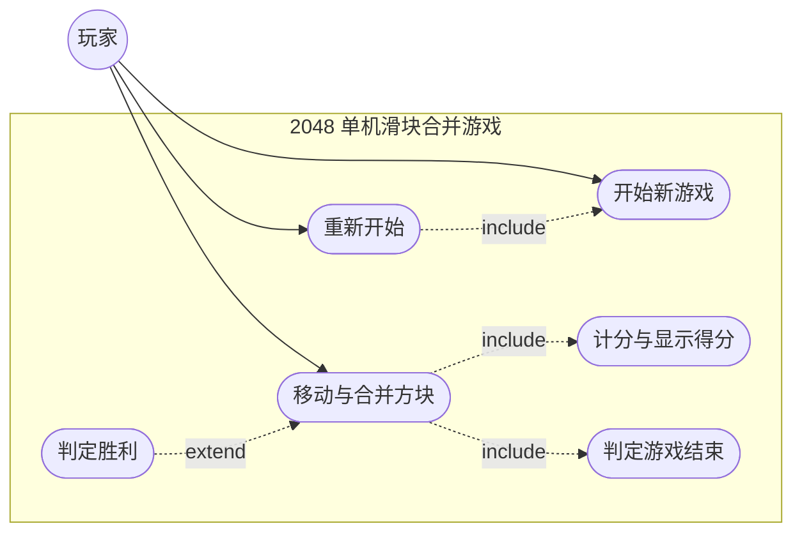

# 实验二  UML用例图及用例叙述

## 一、实验目的

1. 理解 UML 用例及用例图，理解参与者的概念。
2. 练习使用 StarUML 绘制出项目的系统 UML 用例图。
3. 理解用例图之间的各种关系（包括关联关系、包含关系、扩展关系以及泛化关系），并在图中标示出来。
4. 编写系统用例叙述。

## 二、实验要求

1. 按“识别参与者、识别用例、确定参与者与用例之间的关系”三个步骤构建 2048 项目的系统用例图。
2. 使用 StarUML 7 绘制参与者、用例，并建立它们之间的关联、包含、扩展、泛化关系（本项目无泛化关系，须在报告中说明原因）。
3. 根据系统业务流程和系统用例简述写出项目的用例叙述，用例叙述按模板的 12 栏填写，基本流程逐步编号，例外流程写出具体分支。
4. 提交实验报告。

## 三、主要实验工具

StarUML 7。

## 四、实验内容及实验数据记录

本实验依据《2048 项目建模规范（唯一口径）》第 2、4 节编写，内容包括参与者识别、用例清单、用例图、用例关系清单、UC01~UC06 六份用例叙述与筛选修正过程的记录。用例编号、用例名称、参与者与关系均取自规范第 4 节。

### 4.1 参与者识别

识别参与者按实验指导书给出的三条判据进行：参与者是位于系统之外的某人或某物；只有使用系统、跟系统交互、跟系统交换信息的才是参与者；参与者会启动、参与用例。

按上述判据识别，本系统参与者唯一：

| 参与者 | 英文名 | 参与的用例 | 说明 |
|---|---|---|---|
| 玩家 | Player | UC01、UC02、UC06 | 唯一参与者，通过方向键与“开始新游戏”“重新开始”操作与系统交互 |

- **玩家（Player）**：位于系统之外，通过方向键与“开始新游戏”“重新开始”操作与系统交换信息，启动并参与 UC01、UC02、UC06，是本系统唯一的参与者。
- 系统内部的随机生成方块、判定胜负、累计分数等行为发生在系统边界之内，不作为参与者；因此 UC03、UC04、UC05 的操作者记为“系统（由 UC02 触发）”，它们不与玩家建立关联，而是通过包含关系与扩展关系连接到 UC02。
- 无账号体系，不涉及注册、登录、密码、权限，因此不存在“注册用户”“管理员”一类的第二参与者。

**本系统参与者唯一。**

### 4.2 用例清单

| 用例编号 | 用例名称 | 对应功能 | 参与者 |
|---|---|---|---|
| UC01 | 开始新游戏 | F01 | 玩家 |
| UC02 | 移动与合并方块 | F02 | 玩家 |
| UC03 | 计分与显示得分 | F03 | 系统（由 UC02 触发） |
| UC04 | 判定胜利 | F04 | 系统（由 UC02 触发） |
| UC05 | 判定游戏结束 | F05 | 系统（由 UC02 触发） |
| UC06 | 重新开始 | F06 | 玩家 |

### 4.3 用例图

用例图如图 1 所示。

图 1 用例图

如图 1 所示，参与者“玩家”与 UC01、UC02、UC06 建立关联；UC02 通过 `«include»` 指向 UC03 与 UC05，UC06 通过 `«include»` 指向 UC01；UC04 通过 `«extend»` 指向 UC02，扩展点为“棋盘出现数值 2048 的方块”。图中 6 个用例分布在系统边界（`subgraph`）之内，参与者位于边界之外。

图 1 的读法如下：

- 参与者“玩家”位于系统边界之外，与 UC01 开始新游戏、UC02 移动与合并方块、UC06 重新开始建立关联关系。
- 系统边界内共 6 个用例，即 UC01~UC06，与功能表 F01~F06 一一对应。
- UC02 通过 `«include»` 指向 UC03 与 UC05；UC06 通过 `«include»` 指向 UC01。
- UC04 通过 `«extend»` 指向 UC02，扩展点为“棋盘出现数值 2048 的方块”。
- 图中不出现泛化关系（见第 4.4.5 节）。

### 4.4 用例关系清单

#### 4.4.1 关系汇总

| 关系类别 | 条数 | 具体关系 |
|---|---|---|
| 关联 | 3 | 玩家—UC01、玩家—UC02、玩家—UC06 |
| 包含 `«include»` | 3 | UC02→UC03（每次有效移动后必计分）、UC02→UC05（每次有效移动后必判定是否还有可行移动）、UC06→UC01（重新开始即执行一次开始新游戏） |
| 扩展 `«extend»` | 1 | UC04→UC02，扩展点“棋盘出现数值 2048 的方块” |
| 泛化 | 0 | 本项目无泛化关系 |

#### 4.4.2 关联关系（3 条）

| 序号 | 关系 | 参与者 | 用例 | 说明 |
|---|---|---|---|---|
| 1 | 关联 | 玩家 | UC01 开始新游戏 | 玩家主动启动一局新的对局 |
| 2 | 关联 | 玩家 | UC02 移动与合并方块 | 玩家按方向键驱动每一次有效移动 |
| 3 | 关联 | 玩家 | UC06 重新开始 | 对局结束后玩家选择重新开始 |

UC03、UC04、UC05 的操作者为系统（由 UC02 触发），系统内部行为不是参与者，故这三条用例不与玩家建立关联。

#### 4.4.3 包含关系 `«include»`（3 条）

| 序号 | 包含用例 | 被包含用例 | 说明 |
|---|---|---|---|
| 1 | UC02 移动与合并方块 | UC03 计分与显示得分 | 每次有效移动后必计分 |
| 2 | UC02 移动与合并方块 | UC05 判定游戏结束 | 每次有效移动后必判定是否还有可行移动 |
| 3 | UC06 重新开始 | UC01 开始新游戏 | 重新开始即执行一次开始新游戏 |

三条包含关系都是“每次执行都必然发生”的关系，被包含用例没有独立的执行条件，因此用包含而不用扩展。

#### 4.4.4 扩展关系 `«extend»`（1 条）

| 序号 | 扩展用例 | 基用例 | 扩展点 | 说明 |
|---|---|---|---|---|
| 1 | UC04 判定胜利 | UC02 移动与合并方块 | 棋盘出现数值 2048 的方块 | 只有棋盘出现 2048 时才发生的附加行为 |

UC04 不是每次移动都发生，它在特定条件下才插入到 UC02 的流程中，因此用扩展而不用包含。

#### 4.4.5 泛化关系（0 条）

本系统参与者唯一、用例之间不存在父子关系，故未使用泛化关系。

### 4.5 用例叙述

以下 6 份用例叙述，每份按实验指导书模板的 12 栏记录：用例名称、用例标识符、参与者、用例简述、前置条件、后置条件、基本流程、例外流程、被泛化的用例、被包含的用例、被扩展的用例、修改历史。

#### 4.5.1 UC01 开始新游戏

| 栏目 | 内容 |
|---|---|
| 用例名称 | 开始新游戏 |
| 用例标识符 | UC01 |
| 参与者 | 玩家 |
| 用例简述 | 玩家启动一局新的对局，系统清空棋盘并在随机空位生成两个初始方块（2 或 4） |
| 前置条件 | 系统已启动；当前没有进行中的对局，对局状态为“未开始”或“已结束” |
| 后置条件 | 4×4 共 16 格的棋盘已清空，棋盘上只有两个数值为 2 或 4 的初始方块；本局得分为 0；对局状态为“进行中”；棋盘与得分显示已刷新 |
| 基本流程 | 1) 玩家选择“开始新游戏” 2) 系统清空棋盘的 16 个格子 3) 系统在随机空位生成第一个初始方块，数值取 2 或 4 4) 系统在另一个随机空位生成第二个初始方块，数值取 2 或 4 5) 系统把本局得分置为 0，把对局状态置为“进行中” 6) 系统显示清空后的棋盘、两个初始方块与得分 0 |
| 例外流程 | 1) 若系统取到的随机数值不在 2 与 4 之内，系统放弃该数值并重新取值，直到取到 2 或 4 才放置方块，然后继续步骤 4) 2) 若玩家在步骤 2) 之前取消本次操作，系统不改变棋盘与对局状态，本用例结束，对局仍停留在“未开始”或“已结束”状态 |
| 被泛化的用例 | 无 |
| 被包含的用例 | 无（UC01 自身被 UC06 包含） |
| 被扩展的用例 | 无 |
| 修改历史 | 建立于实验二；用例名称与功能 F01 统一，未再修改 |

#### 4.5.2 UC02 移动与合并方块

| 栏目 | 内容 |
|---|---|
| 用例名称 | 移动与合并方块 |
| 用例标识符 | UC02 |
| 参与者 | 玩家 |
| 用例简述 | 玩家按上/下/左/右方向键，系统将全部方块向该方向滑动，相邻同值方块合并为一个双倍数值方块，同一方块每步只合并一次 |
| 前置条件 | 对局状态为“进行中”，棋盘上至少有一个方块 |
| 后置条件 | 全部方块已向该方向完成滑动与合并；若本次为有效移动，随机空位已生成一个数值为 2 或 4 的新方块，得分已按合并数值累加；对局状态可能因 UC04 变为“胜利”或因 UC05 变为“失败”；棋盘与得分显示已刷新 |
| 基本流程 | 1) 玩家按下上/下/左/右方向键 2) 系统把全部方块向该方向滑动到最远的空位 3) 系统把滑动方向上相邻且数值相同的两个方块合并为一个双倍数值的方块，同一次移动中每个方块最多只参与一次合并 4) 系统在随机空位生成一个数值为 2 或 4 的新方块 5) 系统按合并所得数值累加本局得分，并显示得分与最高分（包含 UC03） 6) 系统判断棋盘是否已出现数值 2048 的方块，满足时执行 UC04 的判定胜利 7) 系统判断棋盘是否已满且任意方向都无法再移动，满足时执行 UC05 的判定游戏结束 8) 系统刷新棋盘显示，等待玩家下一次按键 |
| 例外流程 | 1) 若该方向上所有方块都无法滑动且没有任何方块可以合并，本次按键为无效移动：系统不合并、不计分、不生成新方块，棋盘保持不变，用例结束 2) 若本次有效移动后棋盘已无空位，系统跳过步骤 5)，不生成新方块，直接进入步骤 6) 与步骤 7) 的判定 3) 若步骤 6) 判定本局胜利，系统按 UC04 置状态为“胜利”并提示玩家，不再执行步骤 7)，也不再接受方向键输入 4) 若步骤 7) 判定本局失败，系统按 UC05 置状态为“失败”并提示玩家，不再接受方向键输入 |
| 被泛化的用例 | 无 |
| 被包含的用例 | UC03 计分与显示得分、UC05 判定游戏结束 |
| 被扩展的用例 | UC04 判定胜利（扩展点为“棋盘出现数值 2048 的方块”） |
| 修改历史 | 建立于实验二；初稿把计分写成 UC02 内部的一步，改为包含 UC03 后重写步骤 4) |

#### 4.5.3 UC03 计分与显示得分

| 栏目 | 内容 |
|---|---|
| 用例名称 | 计分与显示得分 |
| 用例标识符 | UC03 |
| 参与者 | 系统（由 UC02 触发） |
| 用例简述 | 系统在每次合并后按合并所得数值累加本局得分，本局得分超过历史最高分时更新最高分记录 |
| 前置条件 | UC02 的一次有效移动已经完成合并，本次合并所得数值已确定 |
| 后置条件 | 本局得分已累加本次合并所得数值；若本局得分高于历史最高分，最高分记录已更新为本局得分；得分与最高分已显示在界面上 |
| 基本流程 | 1) 系统取得本次移动中所有合并所得数值之和 2) 系统把该和累加到本局得分 3) 系统读取最高分记录，与本局得分比较 4) 若本局得分高于最高分，系统把最高分更新为本局得分 5) 系统显示本局得分与最高分，返回 UC02 继续执行 |
| 例外流程 | 1) 若本次移动没有任何方块合并，系统取得的合并数值之和为 0，本局得分与最高分均不变化，只刷新显示后返回 UC02 2) 若最高分记录为空或不可读，系统以 0 作为最高分初值参与比较，并在本次比较完成后写回新的最高分 |
| 被泛化的用例 | 无 |
| 被包含的用例 | 无 |
| 被扩展的用例 | 无 |
| 修改历史 | 建立于实验二；用例名称取“计分与显示得分”，与功能 F03“计分与最高分”对应 |

#### 4.5.4 UC04 判定胜利

| 栏目 | 内容 |
|---|---|
| 用例名称 | 判定胜利 |
| 用例标识符 | UC04 |
| 参与者 | 系统（由 UC02 触发） |
| 用例简述 | 棋盘出现数值 2048 的方块时，系统判定本局胜利并提示玩家 |
| 前置条件 | UC02 的一次有效移动已完成合并与计分；对局状态为“进行中” |
| 后置条件 | 棋盘出现数值 2048 时，对局状态为“胜利”，系统已提示玩家，且不再接受方向键输入；否则对局状态保持“进行中”，控制权返回 UC02 |
| 基本流程 | 1) 系统遍历棋盘的 16 个格子 2) 系统检查是否存在数值等于 2048 的方块 3) 存在时系统把对局状态置为“胜利” 4) 系统提示玩家本局胜利 5) 系统停止接受方向键输入，等待玩家选择重新开始（UC06） |
| 例外流程 | 1) 若遍历结束后不存在数值为 2048 的方块，系统不改变对局状态，返回 UC02 继续执行后续步骤 2) 若棋盘上同时存在多个数值为 2048 的方块，系统只判定一次胜利并只提示一次，不重复触发本用例 3) 若对局状态已为“胜利”或“失败”，系统不再执行本用例，直接返回 |
| 被泛化的用例 | 无 |
| 被包含的用例 | 无 |
| 被扩展的用例 | 无（UC04 自身扩展 UC02） |
| 修改历史 | 建立于实验二；初稿作为 UC02 的包含用例，因“只在出现 2048 时发生”改为扩展用例 |

#### 4.5.5 UC05 判定游戏结束

| 栏目 | 内容 |
|---|---|
| 用例名称 | 判定游戏结束 |
| 用例标识符 | UC05 |
| 参与者 | 系统（由 UC02 触发） |
| 用例简述 | 一次有效移动后棋盘已满且任意方向都无法再移动时，系统判定本局失败并提示玩家 |
| 前置条件 | 一次有效移动已完成合并、计分与随机生成；对局状态为“进行中” |
| 后置条件 | 棋盘已满且任意方向都无法再移动时，对局状态为“失败”，系统已提示玩家，且不再接受方向键输入；否则对局状态保持“进行中” |
| 基本流程 | 1) 系统检查棋盘 16 个格子是否全部非空 2) 全部非空时，系统逐格检查上、下、左、右四个方向是否存在相邻且数值相同的方块 3) 四个方向都不存在相邻同值方块时，系统把对局状态置为“失败” 4) 系统提示玩家本局失败 5) 系统停止接受方向键输入，等待玩家选择重新开始（UC06） |
| 例外流程 | 1) 若棋盘仍有空格，系统判定仍可移动，对局状态保持“进行中”，返回 UC02，不提示失败 2) 若棋盘虽已填满但仍存在相邻且数值相同的方块，系统判定仍可移动，对局状态保持“进行中”，返回 UC02，不提示失败 3) 若本次有效移动后棋盘已无空位而未能生成新方块，系统直接以当前棋盘执行步骤 1) 的检查 4) 若对局状态已为“胜利”，系统跳过本用例，胜利优先于失败 |
| 被泛化的用例 | 无 |
| 被包含的用例 | 无 |
| 被扩展的用例 | 无 |
| 修改历史 | 建立于实验二；判定条件按规范第 1 节写为“已满且任意方向都无法移动”，未再修改 |

#### 4.5.6 UC06 重新开始

| 栏目 | 内容 |
|---|---|
| 用例名称 | 重新开始 |
| 用例标识符 | UC06 |
| 参与者 | 玩家 |
| 用例简述 | 对局结束后玩家可清空棋盘并开始新的一局 |
| 前置条件 | 对局状态为“胜利”或“失败”，即对局已结束并已向玩家提示结果 |
| 后置条件 | 棋盘已清空并生成两个初始方块，本局得分为 0，对局状态为“进行中”，最高分记录保持不变 |
| 基本流程 | 1) 玩家在结果提示界面选择“重新开始” 2) 系统保留最高分记录的当前值 3) 系统执行 UC01 开始新游戏：清空棋盘、生成两个初始方块、本局得分置 0、对局状态置“进行中”（包含 UC01） 4) 系统显示新的棋盘，重新接受方向键输入 |
| 例外流程 | 1) 若玩家不选择“重新开始”而结束本次会话，系统不再执行本用例，对局状态停留在“胜利”或“失败”，最高分记录保持为最近一次更新后的值 2) 若对局状态为“未开始”，即玩家在开局之前就选择“重新开始”，系统不执行步骤 2)，直接按步骤 3) 执行 UC01 3) 若 UC01 在生成初始方块时取到不在 2 与 4 之内的随机数值，系统按 UC01 的例外流程重新取值，本用例的后续步骤顺序不变 |
| 被泛化的用例 | 无 |
| 被包含的用例 | UC01 开始新游戏 |
| 被扩展的用例 | 无 |
| 修改历史 | 建立于实验二；初稿把重新开始写成重复描述一遍开局步骤，改为包含 UC01 后精简为 4 步 |

### 4.6 用例图与用例叙述的筛选与修正过程

本实验先在纸上确定参与者与用例，再在 StarUML 7 中落图，绘图过程中共做了四处修改，逐条记录如下。

第一处修改是关于参与者的数量。初稿为了让“判定胜利”“判定游戏结束”有用例可挂，画了两个参与者：玩家与系统。检查指导书对参与者的定义后确认，参与者必须位于系统之外，而系统自身的判定与计分行为发生在边界之内，把系统画成参与者等于承认“系统和系统自己交互”，与实验要求矛盾。修改后删去“系统”这个参与者，UC03、UC04、UC05 不画参与者连线，操作者在用例叙述里记为“系统（由 UC02 触发）”，用例图（图 1）只保留玩家一个参与者。

第二处修改是关系类型的选择。初稿把 UC04 判定胜利画成 UC02 的包含用例，理由是“每次移动都要判断有没有到 2048”。对照指导书对包含与扩展的区分后改为扩展：包含是无条件、每次执行都必然发生的行为，而出现 2048 才是 UC04 的触发条件，绝大多数移动都不发生，属于在特定条件下插入基用例的行为，因此应画成 `«extend»` 并由 UC04 指向 UC02，同时把扩展点标注为“棋盘出现数值 2048 的方块”。相应地，UC02 与 UC03、UC02 与 UC05、UC06 与 UC01 三对关系保留为 `«include»`，因为计分与结束判定在每次有效移动后必然发生，重新开始也必然先执行一次开始新游戏。

第三处修改是重复描述的消除。初稿在 UC06 重新开始里把“清空棋盘、生成两个方块、得分归零”又写了一遍，用例图中 UC06 与 UC01 之间只有一条关联线，造成同一个行为有两处定义。修改后把这段行为统一收敛到 UC01，UC06 通过 `«include»` 指向 UC01，UC06 的基本流程精简为 4 步，第三步直接写“执行 UC01 开始新游戏”。用例叙述同步修改，避免两处描述不一致。

第四处修改是泛化关系的取舍。初稿曾设想抽出一个父用例“操作棋盘”，让 UC02 移动与合并方块与 UC06 重新开始泛化自它，以求图中关系“齐全”。但这样做之后，父用例既没有自己的执行者也没有独立的流程，属于为画关系而造用例；同时本系统参与者唯一，用例之间不存在“一般—特殊”的父子语义。最终删除该父用例，图中不出现泛化关系，并在报告中写明“本系统参与者唯一、用例之间不存在父子关系，故未使用泛化关系”。

此外，绘图工具的使用上也做了一次调整。用例图在 StarUML 7 中直接绘制参与者、用例与关系连线；为保证草稿可复现，本报告内联的图 同时以 Mermaid 记录了同一套元素与关系（参与者用 `((玩家))`、用例用 `([名称])`、系统边界用 `subgraph`），本报告图 1 即由该源码内联呈现，若 StarUML 导出的排版需要重画，可先按草稿还原元素与关系，再在 StarUML 中微调位置，确保两种表达的元素与关系完全一致。

## 五、实验数据分析与讨论

### 5.1 参与者判据的落地结果

指导书的三条判据在本项目中收敛为一条结论：参与者只有玩家。把三条判据逐条对照可以看到，“位于系统之外”这一条直接排除了系统自身——随机生成方块、累计分数、判定胜负都发生在系统边界之内，属于系统的内部处理，不能既是被建模的系统又是与系统交互的外部角色。“使用系统、跟系统交互、跟系统交换信息”这一条排除了棋盘、方块、得分记录等被动数据，它们只被系统读写，不会主动启动用例。“会启动、参与用例”这一条则把关联关系的落点限定清楚：只有玩家能启动 UC01、UC02、UC06。三条判据的结论一致，所以用例图（图 1）中只有玩家一个参与者，UC03、UC04、UC05 没有参与者连线，其操作者在用例叙述中记为“系统（由 UC02 触发）”，与图中的包含、扩展连线互相印证。

### 5.2 包含与扩展的判据

从 4.4 的关系清单可以看出，本项目对包含与扩展的取舍只依赖一个判据：该行为是否在每一次基用例执行中都必然发生。UC02 与 UC03、UC02 与 UC05、UC06 与 UC01 三对关系满足“必然发生”，因此是 `«include»`；UC04 与 UC02 只在棋盘出现 2048 时才发生，绝大多数移动都不触发，属于在特定条件下插入基用例的附加行为，因此是 `«extend»`，并且扩展点必须写明“棋盘出现数值 2048 的方块”，否则扩展关系没有可观察的触发条件。这个判据也解释了为什么图中不出现“反向”的包含箭头：UC03、UC05 由 UC02 的流程调用，箭头方向体现的是调用方的依赖，而不是被调用方的主动行为。

### 5.3 用例叙述与关系清单的一致性检查

把 4.5 的六份叙述与 4.4 的关系清单逐项对照，可以检查出三处必须保持一致的对应点，本报告均已对齐。第一处是“被包含的用例”栏：UC02 填 UC03 与 UC05，UC06 填 UC01，与三条 `«include»` 一一对应；UC03、UC04、UC05 该栏填“无”，因为它们不被任何用例包含。第二处是“被扩展的用例”栏：只有 UC02 填了“UC04 判定胜利（扩展点为‘棋盘出现数值 2048 的方块’）”，UC04 自身的该栏注明“UC04 自身扩展 UC02”，避免读者误以为 UC04 又被别人扩展。第三处是前置条件与后置条件的衔接：UC03 的前置条件是“UC02 的一次有效移动已经完成合并”，UC04 的前置条件是“已完成合并与计分”，UC05 的前置条件是“已完成合并、计分与随机生成”，三者的前置条件依次加严，正好对应 UC02 基本流程的步骤 3)~5)；UC06 的后置条件写明“最高分记录保持不变”，与 UC01 后置条件中不含最高分处理相区分，说明最高分只在 UC03 中被更新。

条数上也可以互相校验：6 个用例对应 6 条功能（F01~F06），3 条关联对应 3 个玩家参与的用例，3 条包含、1 条扩展、0 条泛化相加共 4 条用例间关系，与 3 条关联合计 7 条关系记录，正好对应图 1 中的 7 条连线（3 条关联实线、3 条 `«include»` 虚线、1 条 `«extend»` 虚线），没有出现“清单里有、图上没有”或“图上有、清单里没有”的关系。

### 5.4 尚待改进之处

本实验的用例叙述已按 12 栏模板完整填写，但仍有两处可以在后续实验中补强。其一，UC02 的例外流程只覆盖“无效移动”“棋盘已满无法生成”“胜利”“失败”四种分支，没有单独描述玩家在动画播放过程中连续按键的情形，该情形属于交互细节，本实验按指导书要求只记录可观察的业务分支，未展开。其二，用例图只表达参与者、用例与三类关系，无法表达“一次移动内部的处理次序”，这一部分信息由 UC02 的基本流程 8 个步骤承载，并将在后续实验的活动图与时序图中进一步细化，届时需保持与图 1 及 4.5.2 的步骤编号口径一致。
