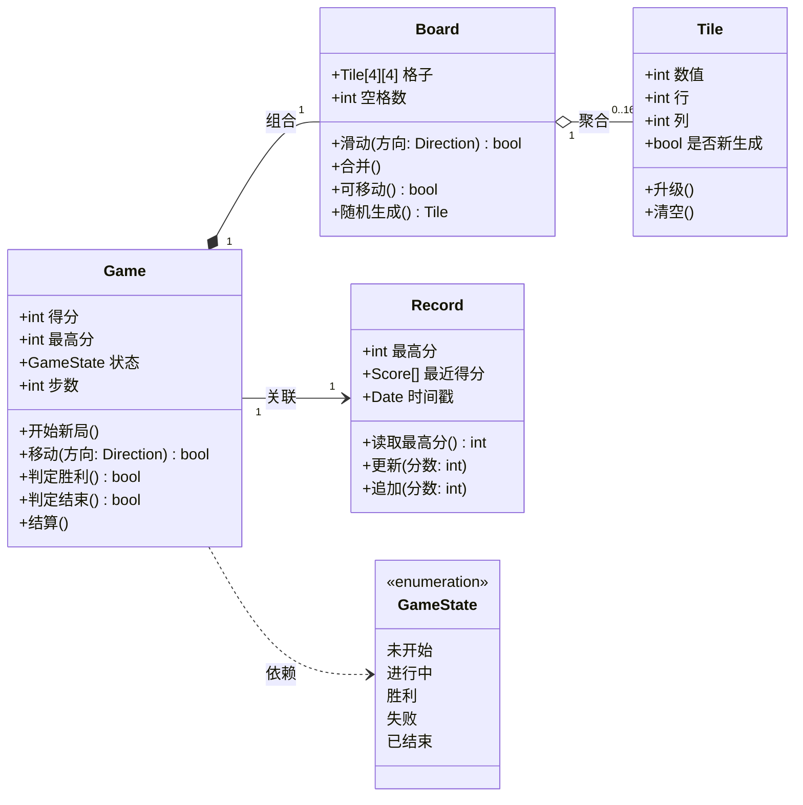

# 实验三  UML类图

## 一、实验目的

1. 掌握类图的基本概念：类图描述系统的静态结构，既表示类之间的联系（关联、依赖、聚合、组合、泛化），也描述类的内部结构（属性与操作）。
2. 掌握从需求文本中寻找分析类的方法，即指导书给出的 11 步建模分析步骤。
3. 掌握用 StarUML 绘制类图并为类补充属性、操作与类间关系的方法。
4. 通过为 2048 项目建立静态结构模型，理解“需求名词 → 分析类 → 属性与操作 → 类间关系”的建模链条。

## 二、实验要求

1. 分析系统业务流程和系统功能，定义系统的初步静态结构，找出其中重要的类和对象。
2. 使用 StarUML 建模工具绘制类图，并描述和建立类间的关系。
3. 提交实验报告。

本实验的类清单以 `docs/00-规范.md` 第 5 节为唯一口径：共 4 个类 `Game`、`Board`、`Tile`、`Record`，类名、属性名、操作名与该节逐字一致，不新增界面类、主程序类等规范外的类。

## 三、主要实验工具

StarUML 7。

## 四、实验内容及实验数据记录

本实验给出 2048 项目的静态结构模型 `cd-01`。类清单与类间关系以 `docs/00-规范.md` 第 5 节为唯一口径：共 4 个类 `Game`、`Board`、`Tile`、`Record`，图中不出现界面类、主程序类等规范外的类。

### 4.1 候选类的筛选过程（指导书 11 步法）

按指导书“类图的建模分析步骤”，先找需求中的名词作为候选对象，再依次合并同义名词、排除范围以外的名词、去掉只能作为类属性的名词，剩下的名词即分析类。指导书 11 步在本实验中的落点如下表。

| 步骤 | 内容 | 本实验的处理与记录位置 |
|---|---|---|
| 1 | 找出需求中的名词（候选对象） | 从 `docs/00-规范.md` 第 1 节项目定义与第 3 节功能表 F01~F06 摘名词，见 4.1 第 1 步 |
| 2 | 合并含义相同的名词 | 见 4.1 第 2 步同义组表 |
| 3 | 排除范围以外的名词 | 见 4.1 第 3 步排除表 |
| 4 | 去掉只能作为类属性的名词 | 见 4.1 第 4 步归属表 |
| 5 | 剩下的名词即分析类 | 得到 `Game`、`Board`、`Tile`、`Record` 4 个分析类 |
| 6~10 | 确定属性、补充状态与联系属性、从动词与功能中找候选操作、合并筛选操作、在类间分配职责 | 结果即 `docs/00-规范.md` 第 5 节的属性与操作清单，逐项落在本报告 4.4 类说明表 |
| 11 | 编写类分析文档 | 即本报告 4.2 类图、4.3 类间关系逐条说明、4.4 类说明表 |

**第 1 步 找出需求中的名词（候选对象）。** 从项目定义与 F01~F06 的功能描述中可摘出下列名词：对局、本局、游戏、棋盘、4×4 共 16 格、格子、方块、数值、行、列、新生成、方向键、上/下/左/右（方向）、相邻、同值、得分、本局得分、最高分、历史最高分、步数、状态、胜利、失败、记录、最近得分、时间戳、玩家、提示。

**第 2 步 合并含义相同的名词。**

| 同义组 | 合并后 | 依据 |
|---|---|---|
| 对局、本局、游戏 | 对局（`Game`） | 三者均指“玩家正在进行的一盘 2048” |
| 棋盘、4×4 共 16 格、格子 | 棋盘（`Board`） | “16 格”是棋盘的容量描述，不是独立事物 |
| 方块、数值块 | 方块（`Tile`） | 同一实体，功能表中统一称“方块” |
| 得分、本局得分 | 得分（`Game` 的属性） | 同一数据，作用域为本局 |
| 最高分、历史最高分 | 最高分（`Game`、`Record` 的属性） | 同一数据，两处各存一份以各负其责 |
| 记录、最高分记录 | 记录（`Record`） | 功能 F03 中“最高分记录”的载体 |

**第 3 步 排除范围以外的名词。**

| 被排除的名词 | 排除理由 |
|---|---|
| 玩家 | 是本系统唯一参与者（Actor），属于系统外部，已在用例图 `uc-01` 中建模 |
| 方向键、上/下/左/右 | 是玩家的输入手段，属于系统外部；系统中只保留其抽象“方向”作参数类型 |
| 提示、显示得分 | 是界面表现，规范未设界面类，本项目不建模界面 |
| 网络、账号、多端同步、付费 | 规范第 1 节明确本项目不涉及，直接不在范围内 |

**第 4 步 去掉只能作为类属性的名词。**

| 只能作属性的名词 | 归属 |
|---|---|
| 数值 | `Tile.数值` |
| 行、列 | `Tile.行`、`Tile.列` |
| 新生成 | `Tile.是否新生成` |
| 得分、步数 | `Game.得分`、`Game.步数` |
| 胜利、失败、进行中、未开始、已结束 | `Game.状态` 的取值，归入枚举 `GameState` |
| 空格数 | `Board.空格数` |
| 时间戳、最近得分 | `Record.时间戳`、`Record.最近得分` |
| 方向 | 操作参数类型 `Direction`，本身不承载数据，不单独成类 |

**第 5 步 剩下的名词即分析类。** 经上述四步筛选，得到 4 个分析类：`Game`（对局）、`Board`（棋盘）、`Tile`（方块）、`Record`（记录）。指导书第 5~10 步（确定属性、补充状态与联系属性、从动词与功能中找候选操作、合并筛选操作、在类间分配职责）的结果，即 `docs/00-规范.md` 第 5 节中 4 个类的属性与操作清单；第 11 步的类分析文档即本报告 4.2、4.3、4.4 节。

说明两点口径：

- `GameState` 是规范第 5 节指定的枚举类型（未开始/进行中/胜利/失败/已结束），在图中以 `«enumeration»` 出现，是 `Game.状态` 的类型，不属于“新增的分析类”。
- `Direction` 仅作为 `移动`、`滑动` 两个操作的参数类型出现，不单独建类。

### 4.2 类图

类图如图 1 所示，源码取自 本报告内联的图。

图 1 类图

如图 1 所示，类图包含 4 个分析类与 1 个枚举类型，类间共 4 条关系：`Game` 组合 `Board`、`Board` 聚合 `Tile`、`Game` 关联 `Record`、`Game` 依赖 `GameState`。草稿为 本报告内联的图，图号为本报告图 1。

### 4.3 类间关系逐条说明

| 序号 | 关系 | 两端与重数 | 为什么是这种关系 |
|---|---|---|---|
| 1 | 组合（composition） | `Game` 1 — 1 `Board` | 棋盘是每局对局专属的整体—部分结构，棋盘随对局的创建而创建、随对局的销毁而销毁，脱离对局无独立意义，符合组合“部分不可共享、生命周期由整体决定”的判定标准 |
| 2 | 聚合（aggregation） | `Board` 1 — 0..16 `Tile` | 方块被棋盘容纳并参与滑动合并，但方块自身持有数值、行列、是否新生成等状态与升级、清空等操作，可独立于某一次棋盘布局存在，棋盘清空后仍可作为对象被保留，故用弱整体—部分的聚合 |
| 3 | 关联（association） | `Game` 1 — 1 `Record` | 对局需要长期读写最高分与最近得分，故与记录之间是持久的静态结构联系；记录不是对局的组成部分（对局结束后记录仍须保留），故用普通关联而非组合 |
| 4 | 依赖（dependency） | `Game` — `GameState` | `Game` 的状态属性的类型是枚举 `GameState`，`Game` 的操作（判定胜利、判定结束、结算）要读写该枚举的取值；改变枚举的取值集合会影响 `Game`，而 `Game` 并不持有 `GameState` 的独立实例，故用虚线依赖 |
| 5 | 泛化（generalization） | 无 | 本项目的 4 个类职责互不重叠，不存在可提取公共父类的多个子类，也无父子替代关系，故类图中不使用泛化关系；规范第 4 节对用例图同样给出“本系统参与者唯一、用例之间不存在父子关系，故未使用泛化关系”的既定取舍 |

`Game` 与 `Board`、`Board` 与 `Tile` 两处关系的区别在于生命周期归属：前者整体销毁必然销毁部分，后者部分可脱离整体存在，因此一处用实心菱形、一处用空心菱形。指导书要求中列出的“包含关系、扩展关系”是面向用例图的关系，在类图中的对应物是整体—部分的两档强弱，本实验用组合与聚合分别表达。

### 4.4 类说明表

#### 4.4.1 `Game` 对局

| 属性名 | 类型 | 可见性 | 说明 |
|---|---|---|---|
| 得分 | int | public（+） | 本局累计得分，每次合并后按合并所得数值累加 |
| 最高分 | int | public（+） | 历史最高分，本局得分超过时更新 |
| 状态 | GameState | public（+） | 对局状态，取值为未开始/进行中/胜利/失败/已结束 |
| 步数 | int | public（+） | 本局已发生的有效移动次数 |

| 操作名 | 参数 | 返回值 | 可见性 | 说明 |
|---|---|---|---|---|
| 开始新局 | 无 | 无 | public（+） | 清空棋盘并生成两个初始方块，进入“进行中”状态 |
| 移动 | 方向: Direction | bool | public（+） | 按方向驱动棋盘滑动与合并，返回本次移动是否有效 |
| 判定胜利 | 无 | bool | public（+） | 棋盘出现数值 2048 的方块时返回真 |
| 判定结束 | 无 | bool | public（+） | 棋盘已满且任意方向都无法移动时返回真 |
| 结算 | 无 | 无 | public（+） | 更新最高分、追加最近得分并落在最终状态 |

#### 4.4.2 `Board` 棋盘

| 属性名 | 类型 | 可见性 | 说明 |
|---|---|---|---|
| 格子 | Tile[4][4] | public（+） | 4×4 共 16 个格位，每格容纳一个方块或为空 |
| 空格数 | int | public（+） | 当前空位数量，用于判断能否随机生成与是否已满 |

| 操作名 | 参数 | 返回值 | 可见性 | 说明 |
|---|---|---|---|---|
| 滑动 | 方向: Direction | bool | public（+） | 使全部方块向指定方向滑动，返回是否发生位移 |
| 合并 | 无 | 无 | public（+） | 合并滑动后相邻同值方块，同一方块每步只合并一次 |
| 可移动 | 无 | bool | public（+） | 判断是否还存在任一可行方向 |
| 随机生成 | 无 | Tile | public（+） | 在随机空位生成数值 2 或 4 的方块并返回该方块 |

#### 4.4.3 `Tile` 方块

| 属性名 | 类型 | 可见性 | 说明 |
|---|---|---|---|
| 数值 | int | public（+） | 方块当前数值，初始为 2 或 4，合并后翻倍 |
| 行 | int | public（+） | 所在格位的行号 |
| 列 | int | public（+） | 所在格位的列号 |
| 是否新生成 | bool | public（+） | 标记本次移动后新生成的方块，供表现层区分 |

| 操作名 | 参数 | 返回值 | 可见性 | 说明 |
|---|---|---|---|---|
| 升级 | 无 | 无 | public（+） | 被合并时数值翻倍 |
| 清空 | 无 | 无 | public（+） | 释放格位占用，回到空状态 |

#### 4.4.4 `Record` 记录

| 属性名 | 类型 | 可见性 | 说明 |
|---|---|---|---|
| 最高分 | int | public（+） | 历史最高分记录 |
| 最近得分 | Score[] | public（+） | 最近若干局得分的序列 |
| 时间戳 | Date | public（+） | 记录最近一次更新的时间 |

| 操作名 | 参数 | 返回值 | 可见性 | 说明 |
|---|---|---|---|---|
| 读取最高分 | 无 | int | public（+） | 返回已保存的最高分，供对局初始化使用 |
| 更新 | 分数: int | 无 | public（+） | 用本局得分比较并更新最高分 |
| 追加 | 分数: int | 无 | public（+） | 把本局得分追加到最近得分序列 |

#### 4.4.5 枚举 `GameState`

| 取值 | 说明 |
|---|---|
| 未开始 | 已创建对局但尚未开始新局 |
| 进行中 | 对局可接受方向键输入 |
| 胜利 | 棋盘出现数值 2048 的方块 |
| 失败 | 棋盘已满且任意方向都无法移动 |
| 已结束 | 胜负已提示，等待重新开始 |

`GameState` 是 `Game.状态` 的类型，不属于新增的分析类；`Direction` 仅作为 `移动`、`滑动` 的参数类型，不单独建类。

### 4.5 与规范的一致性核对

| 核对项 | 结果 |
|---|---|
| 类名 | `Game`、`Board`、`Tile`、`Record`，与规范第 5 节逐字一致，无新增类 |
| 属性名与类型 | 4 个类的属性名、类型与规范第 5 节逐字一致 |
| 操作名与参数、返回值 | 4 个类的操作名、参数、返回值与规范第 5 节逐字一致 |
| 关系 | 组合、聚合、关联、依赖各 1 条，方向与重数与规范第 5 节一致；泛化关系为无 |
| 图文件名 | 草稿 本报告内联的图，图号为本报告图 1，未改名 |

## 五、实验数据分析与讨论

本实验实际做了两次较大的修改，最终把 4 个类与 4 条关系固定在 `cd-01` 上。

**反复一：曾把“分数”当成独立类。** 因为 F03“计分与最高分”在功能表中是独立的一条，初稿一度为它单独建了一个类，并把它与 `Game` 连成 1 : 多，理由是该功能被单独提出。复核指导书第 4 步“去掉只能作为类属性的名词”时发现，“得分”只有数值、没有自身操作，它的变化由 `Game.结算` 与 `Record.更新` 完成，于是把它并入 `Game.得分`；`Record.最近得分` 保留为 `Score[]` 的元素类型，只作为数值序列的成员类型出现，不再作为类。

**反复二：曾把“状态”当成独立类。** 初稿把对局的五种状态建成一个独立类并与 `Game` 拉一条关联。核对规范第 5 节后改为枚举 `GameState`，关系由关联改为依赖：状态只是类型取值，不会被单独创建和保存，改变取值集合只影响 `Game` 的判定逻辑与表现。

**反复三：`Board` 与 `Tile` 的关系一度画成组合。** 直觉是“棋盘装着方块”，故先用实心菱形。复核生命周期判定标准后改为聚合：方块有 `数值`、`行`、`列`、`是否新生成` 与 `升级`、`清空` 等自身成员，且规范给出重数 0..16，说明部分数量可变、可脱离某次布局存在，因此用空心菱形；同时保留 `Game`—`Board` 的组合，因为棋盘确实随对局销毁。

**反复四：曾想补界面类与主程序类。** 由“提示玩家”“显示得分”想到加界面类，由“启动一局”想到加主程序类。这两个类在规范第 5 节中不存在，属“编造功能”，故删除；“提示”与“显示得分”按规范归为界面表现，不进入类图。

**反复五：关系符号的误用。** `Game`—`Record` 初稿画成虚线依赖，理由是“只读最高分”；但记录在对局期间被持续读写且在局后保留，是持久的结构联系，改为实线关联。初稿又把 `Game`—`GameState` 画成实线关联，改为虚线依赖。指导书要求中列出的“包含关系、扩展关系”是面向用例图的关系，在类图中的对应物是整体—部分的两档强弱，本实验用组合与聚合分别表达；泛化按规范第 9 节的既定取舍为无。

**验证方式。** 草稿 本报告内联的图 先经 `tools/render.sh` 依赖的 Mermaid 解析器校验语法并渲染，确认 4 个类的成员、4 条关系的箭头与重数均能正确成图；随后在 StarUML 7 中按同一结构重绘并导出与图 1 一致的图文件。最后逐项核对类名、属性名、操作名与规范第 5 节的一致性（核对表见本报告 4.5 节），确认无新增类、无遗漏操作。
