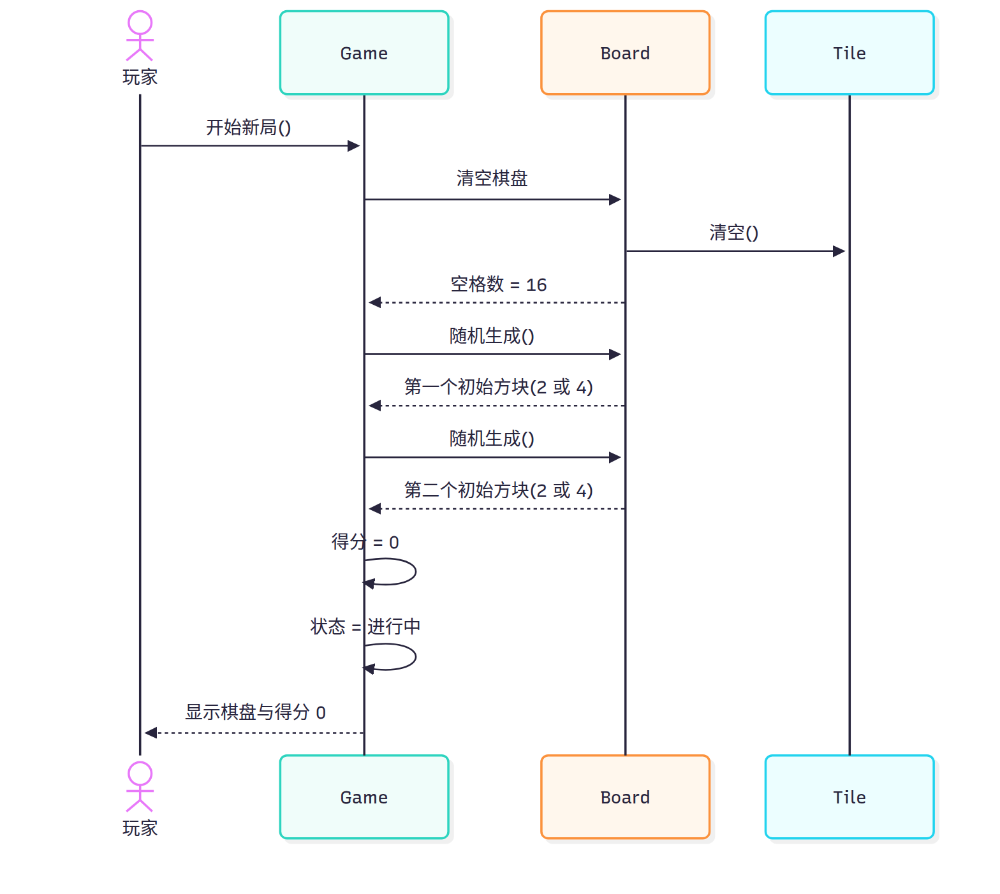
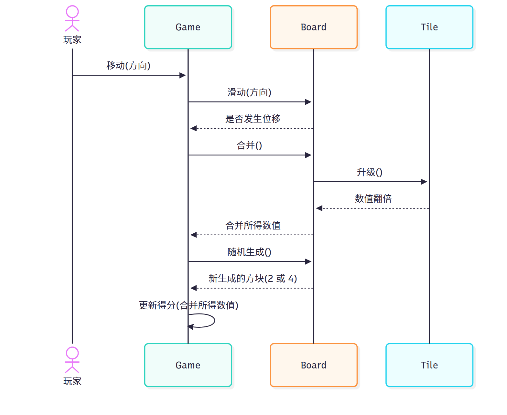
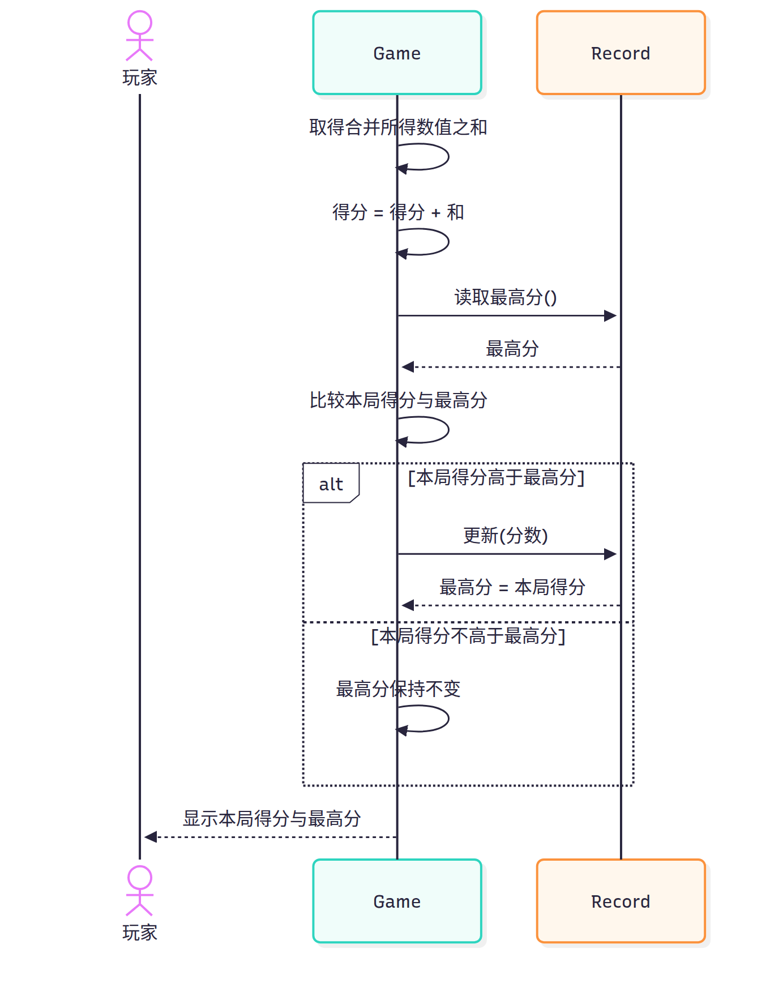
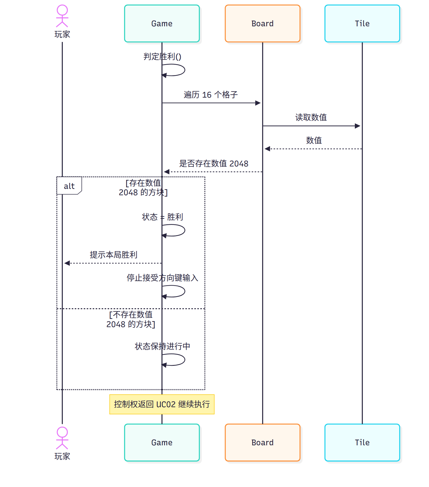
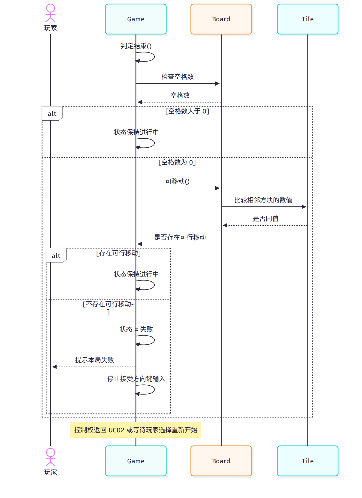
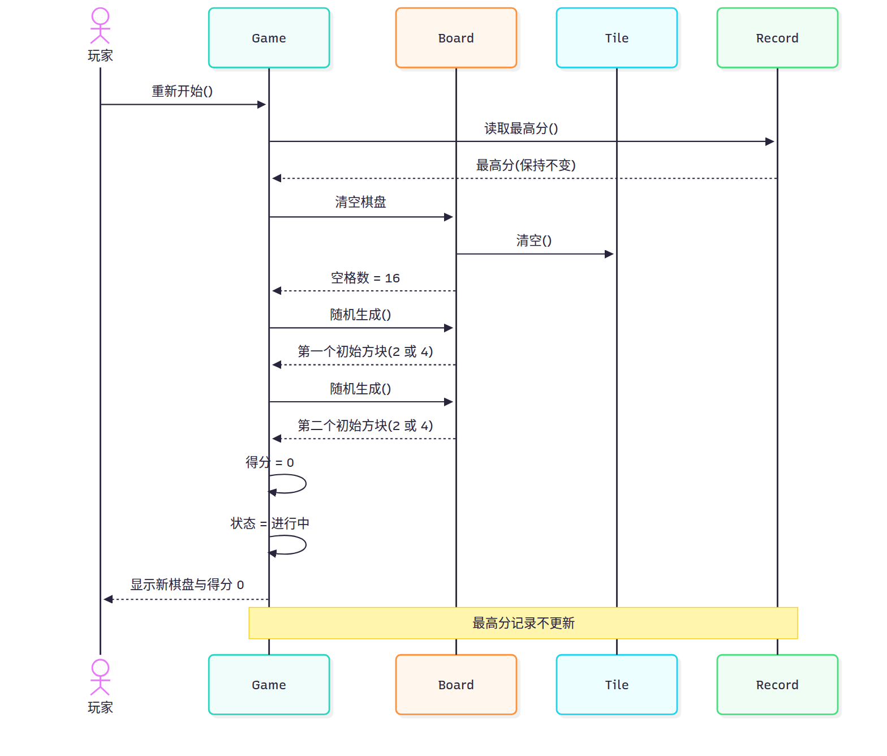

# 实验六  UML时序图

## 一、实验目的

1. 理解时序图的概念与组成：角色、对象、生命线、激活期和消息。
2. 学会分析一个用例所涉及到的类或对象，确定参与交互的对象及其职责。
3. 根据用例中类或对象的关系和行为顺序，用 StarUML 绘制顺序图。
4. 通过时序图核对用例叙述中的步骤顺序，发现并记录叙述与功能描述不一致之处。

## 二、实验要求

1. 六张时序图 `sq-01`~`sq-06` 与用例 UC01~UC06 一一对应，图文件名与 `docs/00-规范.md` 第 6 节一致。
2. 图中角色只使用玩家，对象只使用 `Game`、`Board`、`Tile`、`Record` 四个类，按用例需要取用，不引入规范外的类。
3. 消息顺序必须与规范第 3 节对应功能的描述一致；每条消息写明发送者、接收者与含义。
4. 每张图附消息序列表，表中列为序号、发送者、接收者、消息、说明。
5. 不使用 `Note over` 之外的复杂语法；`alt` 分支嵌套不超过两层。
6. 提交实验报告，报告按“实验目的、实验要求、主要实验工具、实验内容及实验数据记录、实验数据分析与讨论”五段编写。

## 三、主要实验工具

StarUML 7

## 四、实验内容及实验数据记录

### 4.1 对象与参与者的选取

按实验指导书“分析用例所涉及到的类或对象”的要求，从规范第 5 节的 4 个类中选取对象，从规范第 2 节选取角色。选取结果如表 1 所示。

表 1  角色、对象及其出现的图

| 名称 | 类别 | 在交互中的职责 | 出现的图 |
|---|---|---|---|
| 玩家（Player） | 角色 | 启动新局、按方向键、选择重新开始；接收棋盘、得分与结果的显示 | `sq-01`~`sq-06` |
| 对局 `Game` | 对象 | 接收玩家操作，驱动棋盘滑动、合并、生成，累加得分，判定胜负 | `sq-01`~`sq-06` |
| 棋盘 `Board` | 对象 | 清空格子、滑动、合并、随机生成、判断是否可移动 | `sq-01`、`sq-02`、`sq-04`、`sq-05`、`sq-06` |
| 方块 `Tile` | 对象 | 被清空、被合并时数值翻倍、提供数值供判定读取 | `sq-01`、`sq-02`、`sq-04`、`sq-05`、`sq-06` |
| 记录 `Record` | 对象 | 读取与更新最高分 | `sq-03`、`sq-06` |

本系统参与者唯一，六张图都只有玩家一个角色；系统内部的随机生成、判定、计分不作为角色。对象按用例需要取用：`sq-01`、`sq-02` 不涉及最高分记录，故不画 `Record`；`sq-03` 只处理分数与最高分，故不画棋盘与方块；`sq-04`、`sq-05` 需要检查方块数值，故画 `Tile`。六张图均不画界面类或主程序类，因为规范第 5 节只有 4 个类，规范第 7 节也禁止编造规范外的内容。

`方块` 的生命线表示 `Tile` 类在交互中的角色，而不是某一个方块实例：清空与生成只更换实例，不结束生命线。这样处理使一张图可以同时表达“清空 16 格”与“生成两个新方块”，与类图中 `Board` 聚合 `Tile`（1 : 0..16）的关系一致。

### 4.2 sq-01 开始新游戏（UC01 / F01）

`sq-01` 覆盖 UC01 的基本流程。玩家启动新局后，`Game` 要求 `Board` 清空 16 格，`Board` 对各方块调用 `清空()`；随后连续两次 `随机生成()` 得到两个初始方块；`Game` 把得分置 0、状态置为进行中，最后刷新显示。时序图如图 1 所示。

图 1 开始新游戏时序图

`sq-01` 的消息顺序如表 2 所示。

表 2  `sq-01` 的消息序列表

| 序号 | 发送者 | 接收者 | 消息 | 说明 |
|---|---|---|---|---|
| 1 | 玩家 | `Game` | 开始新局() | 玩家启动一局新的对局 |
| 2 | `Game` | `Board` | 清空棋盘 | 清空 4×4 共 16 格 |
| 3 | `Board` | `Tile` | 清空() | 对 16 个格位逐一清空 |
| 4 | `Board` | `Game` | 空格数 = 16 | 返回清空结果 |
| 5 | `Game` | `Board` | 随机生成() | 第一个初始方块 |
| 6 | `Board` | `Game` | 第一个初始方块(2 或 4) | 随机空位，数值 2 或 4 |
| 7 | `Game` | `Board` | 随机生成() | 第二个初始方块 |
| 8 | `Board` | `Game` | 第二个初始方块(2 或 4) | 与第一个方块不同格 |
| 9 | `Game` | `Game` | 得分 = 0 | 本局得分归零 |
| 10 | `Game` | `Game` | 状态 = 进行中 | 对局进入进行中 |
| 11 | `Game` | 玩家 | 显示棋盘与得分 0 | 刷新显示，等待方向键 |

两次生成分别对应 UC01 叙述的步骤 3) 与 4)，没有用循环合并成一条消息，这样表中行号与叙述步骤可以直接核对。例外流程中的“取值不在 2 与 4 之内则重新取值”只影响单个方块，不改变消息顺序，故不单独画分支。

### 4.3 sq-02 移动与合并方块（UC02 / F02）

`sq-02` 覆盖一次有效移动。玩家按键触发 `Game.移动(方向)`，`Game` 调用 `Board.滑动(方向)`；滑动后调用 `合并()`，被合并的 `Tile` 执行 `升级()` 使数值翻倍；`Game` 取得合并所得数值后调用 `随机生成()` 生成新方块，最后累加得分。时序图如图 2 所示。

图 2 移动与合并方块时序图

`sq-02` 的消息顺序如表 3 所示。

表 3  `sq-02` 的消息序列表

| 序号 | 发送者 | 接收者 | 消息 | 说明 |
|---|---|---|---|---|
| 1 | 玩家 | `Game` | 移动(方向) | 按下上/下/左/右方向键 |
| 2 | `Game` | `Board` | 滑动(方向) | 全部方块滑到最远空位 |
| 3 | `Board` | `Game` | 是否发生位移 | 返回滑动结果 |
| 4 | `Game` | `Board` | 合并() | 相邻同值方块合并，每块每步最多一次 |
| 5 | `Board` | `Tile` | 升级() | 被合并方块数值翻倍 |
| 6 | `Tile` | `Board` | 数值翻倍 | 返回合并结果 |
| 7 | `Board` | `Game` | 合并所得数值 | 供累加得分使用 |
| 8 | `Game` | `Board` | 随机生成() | 生成一个新方块 |
| 9 | `Board` | `Game` | 新生成的方块(2 或 4) | 数值取 2 或 4 |
| 10 | `Game` | `Game` | 更新得分(合并所得数值) | 累加本局得分（UC03） |

如图 2 所示，消息顺序是“按键 → `Game.移动(方向)` → `Board.滑动(方向)` → 合并 → `Board.随机生成()` → `Game` 更新得分”，与规范第 3 节 F02 的文字顺序一致，即先生成 2 或 4，再按合并所得数值累加得分。该顺序与 UC02 用例叙述的步骤 4)、5) 不同，取舍与修正见 5.1 节。

无效移动（无位移且无可合并方块）时第 4~10 条消息都不发生，不改变消息顺序，故不画分支。胜利判定与结束判定分别由 `sq-04`、`sq-05` 建模，`sq-02` 不重复。

### 4.4 sq-03 计分与显示得分（UC03 / F03）

`sq-03` 覆盖一次有效移动后的计分。`Game` 取得合并所得数值之和并累加到本局得分，读取 `Record` 中的最高分并比较，高于最高分时调用 `更新(分数)`，否则保持不变，最后刷新得分与最高分显示。时序图如图 3 所示。

图 3 计分与显示得分时序图

`sq-03` 的消息顺序如表 4 所示。

表 4  `sq-03` 的消息序列表

| 序号 | 发送者 | 接收者 | 消息 | 说明 |
|---|---|---|---|---|
| 1 | `Game` | `Game` | 取得合并所得数值之和 | 取本次合并数值之和 |
| 2 | `Game` | `Game` | 得分 = 得分 + 和 | 累加到本局得分 |
| 3 | `Game` | `Record` | 读取最高分() | 读取已保存的最高分 |
| 4 | `Record` | `Game` | 最高分 | 返回最高分 |
| 5 | `Game` | `Game` | 比较本局得分与最高分 | 决定是否更新 |
| 6 | `Game` | `Record` | 更新(分数) | “本局得分高于最高分”分支 |
| 7 | `Record` | `Game` | 最高分 = 本局得分 | 返回更新结果 |
| 8 | `Game` | `Game` | 最高分保持不变 | “本局得分不高于最高分”分支 |
| 9 | `Game` | 玩家 | 显示本局得分与最高分 | 刷新显示，返回 UC02 |

如图 3 所示，该图只有一层 `alt` 分支。没有合并时合并数值之和为 0，得分不变，比较后走第 8 条消息；最高分记录为空或不可读时以 0 为初值，这两种例外都不改变消息顺序，故不画分支。

### 4.5 sq-04 判定胜利（UC04 / F04）

`sq-04` 覆盖胜利判定。`Game` 调用 `判定胜利()`，通过 `Board` 遍历 16 格并从 `Tile` 读取数值；存在数值 2048 的方块时置状态为胜利、提示玩家并停止接受方向键输入，否则状态保持进行中。时序图如图 4 所示。

图 4 判定胜利时序图

`sq-04` 的消息顺序如表 5 所示。

表 5  `sq-04` 的消息序列表

| 序号 | 发送者 | 接收者 | 消息 | 说明 |
|---|---|---|---|---|
| 1 | `Game` | `Game` | 判定胜利() | UC04 入口 |
| 2 | `Game` | `Board` | 遍历 16 个格子 | 遍历棋盘的 16 格 |
| 3 | `Board` | `Tile` | 读取数值 | 读取 `Tile.数值` |
| 4 | `Tile` | `Board` | 数值 | 返回当前数值 |
| 5 | `Board` | `Game` | 是否存在数值 2048 | 返回检查结果 |
| 6 | `Game` | `Game` | 状态 = 胜利 | “存在 2048”分支 |
| 7 | `Game` | 玩家 | 提示本局胜利 | 提示玩家 |
| 8 | `Game` | `Game` | 停止接受方向键输入 | 等待重新开始 |
| 9 | `Game` | `Game` | 状态保持进行中 | “不存在 2048”分支 |

如图 4 所示，该图只有一层 `alt` 分支。多个 2048 方块只判定一次，第一次命中后即结束检查，不增加消息；控制权返回 UC02 以图末 `Note over` 标注，不单独计为一条消息。

### 4.6 sq-05 判定游戏结束（UC05 / F05）

`sq-05` 覆盖结束判定。`Game` 调用 `判定结束()`，先检查空格数；棋盘已满时调用 `Board.可移动()`，由 `Board` 逐格比较相邻方块的数值；四个方向都不存在相邻同值方块时置状态为失败、提示玩家并停止接受方向键输入。时序图如图 5 所示。

图 5 判定游戏结束时序图

`sq-05` 的消息顺序如表 6 所示。

表 6  `sq-05` 的消息序列表

| 序号 | 发送者 | 接收者 | 消息 | 说明 |
|---|---|---|---|---|
| 1 | `Game` | `Game` | 判定结束() | UC05 入口 |
| 2 | `Game` | `Board` | 检查空格数 | 检查 16 格是否全满 |
| 3 | `Board` | `Game` | 空格数 | 返回空格数 |
| 4 | `Game` | `Game` | 状态保持进行中 | “空格数大于 0”分支 |
| 5 | `Game` | `Board` | 可移动() | 棋盘已满，检查四个方向 |
| 6 | `Board` | `Tile` | 比较相邻方块的数值 | 逐格比较上下左右 |
| 7 | `Tile` | `Board` | 是否同值 | 返回比较结果 |
| 8 | `Board` | `Game` | 是否存在可行移动 | 返回检查结果 |
| 9 | `Game` | `Game` | 状态保持进行中 | “存在可行移动”分支 |
| 10 | `Game` | `Game` | 状态 = 失败 | “不存在可行移动”分支 |
| 11 | `Game` | 玩家 | 提示本局失败 | 提示玩家 |
| 12 | `Game` | `Game` | 停止接受方向键输入 | 等待重新开始 |

如图 5 所示，`alt` 嵌套两层，与 UC05“先查空格、再查相邻同值”的顺序一致。嵌套深度控制在两层以内；无空位而未生成新方块、状态已为胜利时跳过本用例等例外不改变消息顺序，写入说明而不展开。

### 4.7 sq-06 重新开始（UC06 / F06）

`sq-06` 覆盖重新开始。玩家选择重新开始后，`Game` 读取 `Record` 的最高分并保持不变，按包含关系执行一次 UC01 的清空棋盘、两次随机生成，得分归零、状态置为进行中，最后刷新显示并恢复输入。时序图如图 6 所示。

图 6 重新开始时序图

`sq-06` 的消息顺序如表 7 所示。

表 7  `sq-06` 的消息序列表

| 序号 | 发送者 | 接收者 | 消息 | 说明 |
|---|---|---|---|---|
| 1 | 玩家 | `Game` | 重新开始() | 玩家选择重新开始 |
| 2 | `Game` | `Record` | 读取最高分() | 读取最高分当前值 |
| 3 | `Record` | `Game` | 最高分(保持不变) | 只读取，不更新 |
| 4 | `Game` | `Board` | 清空棋盘 | 执行 UC01 |
| 5 | `Board` | `Tile` | 清空() | 逐格清空 |
| 6 | `Board` | `Game` | 空格数 = 16 | 返回清空结果 |
| 7 | `Game` | `Board` | 随机生成() | 第一个初始方块 |
| 8 | `Board` | `Game` | 第一个初始方块(2 或 4) | 数值 2 或 4 |
| 9 | `Game` | `Board` | 随机生成() | 第二个初始方块 |
| 10 | `Board` | `Game` | 第二个初始方块(2 或 4) | 与第一个不同格 |
| 11 | `Game` | `Game` | 得分 = 0 | 本局得分归零 |
| 12 | `Game` | `Game` | 状态 = 进行中 | 进入进行中，最高分不变 |
| 13 | `Game` | 玩家 | 显示新棋盘与得分 0 | 刷新显示，恢复输入 |

如图 6 所示，第 4~12 条消息与 `sq-01` 的第 2~10 条消息同序，体现 UC06 包含 UC01。玩家不选择重新开始而结束会话时不发生任何消息；状态为“未开始”时跳过第 2、3 条，其余顺序不变。

### 4.8 六张图的汇总

六张图与用例、功能、参与对象的对应关系如表 8 所示。

表 8  时序图汇总

| 图文件 | 用例 | 功能 | 参与对象 | 消息条数 |
|---|---|---|---|---|
| `sq-01` | UC01 开始新游戏 | F01 | 玩家、`Game`、`Board`、`Tile` | 11 |
| `sq-02` | UC02 移动与合并方块 | F02 | 玩家、`Game`、`Board`、`Tile` | 10 |
| `sq-03` | UC03 计分与显示得分 | F03 | 玩家、`Game`、`Record` | 9 |
| `sq-04` | UC04 判定胜利 | F04 | 玩家、`Game`、`Board`、`Tile` | 9 |
| `sq-05` | UC05 判定游戏结束 | F05 | 玩家、`Game`、`Board`、`Tile` | 12 |
| `sq-06` | UC06 重新开始 | F06 | 玩家、`Game`、`Board`、`Tile`、`Record` | 13 |

六份 Mermaid 草稿位于 `models/drafts/sq-01.mmd`~`sq-06.mmd`。为保证草稿可复现，六份草稿已用 Mermaid 解析器逐份校验语法并渲染检查，确认 `alt`、`Note over` 与中文消息均能正确成图；交付图按同一消息顺序在 StarUML 7 中重绘并导出为 `models/exports/sq-01.png`~`sq-06.png`，报告按规范第 7 节的相对路径引用。

## 五、实验数据分析与讨论

### 5.1 消息顺序与用例叙述不一致时的修正

绘制 `sq-02` 时发现一处实质冲突：`docs/02-用例与用例叙述.md` 中 UC02 的基本流程是“步骤 4) 系统按合并所得数值累加本局得分……步骤 5) 系统在随机空位生成一个数值为 2 或 4 的新方块”，即先计分、后生成；而规范第 3 节 F02 写的是“每次有效移动后系统在随机空位生成一个 2 或 4，并按合并所得数值累加本局得分”，即先生成、后计分。两种顺序都能自圆其说，但同一项目只能有一个口径。

判定以规范第 3 节为准，理由有三点。第一，规范开头已声明本文件是全部实验文档、图、报告的唯一真相源，功能表是其中对功能行为的直接定义，用例叙述是下游文档。第二，`sq-01` 与 `sq-06` 的开局消息都是“生成两个初始方块”在“得分 = 0”之前，若 `sq-02` 采用先计分后生成，六张图内部会出现两种相反的“生成—计分”先后关系。第三，按“生成→计分”绘制后，`sq-02` 第 10 条消息正好是 `sq-03` 的触发点，即“随机生成完成之后才执行计分”，两张图可以首尾相接；按叙述顺序则 `sq-03` 必须插在 `sq-02` 的第 8 条消息之前，`sq-02` 将无法作为一条独立的时间轴阅读。

由此确定三条修正规则。其一，功能表与用例叙述冲突时，消息顺序以规范第 3 节功能表的文字顺序为准，时序图按此绘制。其二，修正只改消息先后，不改操作归属与用例关系，计分仍由 UC03 承担、UC03 仍被 UC02 包含，`sq-02` 的最后一条消息“更新得分(合并所得数值)”只是 UC03 的入口，详细消息在 `sq-03`。其三，需要同步修订的是实验二 UC02 叙述的步骤 4) 与 5)，两者对调后与 F02、`sq-02` 一致；本实验只在本报告记录该结论，没有改动 `docs/02-用例与用例叙述.md`，待文档统一修订时执行。除 UC02 外，`sq-01`、`sq-03`~`sq-06` 的消息顺序与对应用例叙述的步骤编号逐条对应，未作调整。

同一轮核对还发现另外三处“叙述不是消息顺序、但容易被误画成消息”的地方，处理如下。

1. UC06 的“系统保留最高分记录的当前值”不是类操作，`Record` 没有“保留”操作。`sq-06` 用 `读取最高分()` 表示读取，再用 `Note over` 写明“最高分记录不更新”，不把“保留”画成 `更新(0)` 之类的假消息。
2. UC03 的“系统读取最高分记录，与本局得分比较”是两步：读取是一次跨对象消息，比较是 `Game` 内部动作。`sq-03` 把读取画成第 3、4 条消息，把比较画成第 5 条自消息，避免把比较画成发给 `Record` 的消息。
3. UC04、UC05 的“提示玩家”“显示得分”没有对应的类操作，因为规范第 5 节不设界面类。六张图把这些步骤画成发往角色“玩家”的消息，并在说明栏注明其来源是叙述步骤；它们不计入 4 个类的操作清单，也不为它们编造界面类。

此外，规范第 9 节第 3 条已确定“时序图的激活期由工具生成，覆盖整条生命线，报告只描述消息顺序，不强调激活期粒度”。因此草稿不逐条标注激活与去激活，本报告也不对窄矩形的起止位置作逐条说明，激活期由 StarUML 导出时统一生成。

### 5.2 对象粒度与分支取舍

对象的粒度按“一个类一条生命线”处理。最明显的取舍是 `Tile`：一次开局会清空 16 个方块再生成 2 个，一次合并会移除两个方块并产生一个新方块，若按实例画生命线，`sq-01` 需要 16 条销毁消息，`sq-02` 还要画方块的创建与销毁，图面无法阅读。改为用一条 `Tile` 生命线表示该类在交互中的角色，清空与生成只作为消息出现，生命线贯穿全图；这样既保留了“谁给谁发消息”，也与类图中 `Board` 聚合 `Tile`（1 : 0..16）的静态关系一致。

分支只保留会影响消息集合的分支。`sq-03` 的“是否更新最高分”、`sq-04` 的“是否存在 2048”、`sq-05` 的“空格数是否为 0”与“是否存在可行移动”会决定后续是否还有消息，故用 `alt` 画出；无效移动、随机取值不在 2 与 4 之内、最高分记录为空、多个 2048 方块只提示一次等情形只改变某条消息的取值或执行次数，不改变消息顺序，故写入说明栏而不画分支。`sq-05` 因“先查空格、再查相邻同值”需要两层判断，是六张图中唯一嵌套两层的图，未超过“嵌套不超过两层”的限制。

`sq-02` 不画胜利与结束判定。F02 的描述到“累加本局得分”为止，判定分属 F04、F05；若把两条判定塞进 `sq-02`，`sq-02` 将同时承担三个功能的消息，与“一图对一用例”的对应关系冲突。同样，`sq-04`、`sq-05` 不重复画滑动、合并与生成，它们的入口是 `sq-02` 完成后的棋盘状态。

### 5.3 存在问题与解决

第一个问题是 `alt` 分支条件的文字在窄图上换行。`sq-05` 内层条件“不存在可行移动”在 Mermaid 渲染时被折成两行，虽不影响语义，但与 StarUML 的单行显示不一致。解决方式是条件文字保持短句、不使用标点，并在 StarUML 中重绘时按同一文字输入，保证草稿与导出图的条件文字一致。

第二个问题是控制权返回无法用消息表达。UC03、UC04、UC05 执行完毕后要把控制权交回 UC02，但“返回”不是 4 个类中任何一个的操作，若画成 `Game -> Game` 的消息会与真实操作混淆。解决方式是用图末 `Note over 对局` 标注“控制权返回 UC02”，并在消息序列表之外单独说明，不计入消息条数。

第三个问题是 `结算()` 的调用时机尚未统一。`st-01` 把“结算本局得分、更新最高分”作为胜利、失败两个状态的进入动作，对应 `Game.结算()`；而 UC04、UC05 的用例叙述只写“置状态、提示、停止输入”，没有列出结算，`sq-04`、`sq-05` 因此按叙述绘制，没有加入 `结算()` 消息。本实验的处理是保持时序图与用例叙述一致，把差异记录在此；后续统一口径时需要二选一：或在 UC04、UC05 的叙述中补上“结算”，并在 `sq-04`、`sq-05` 中加一条 `Game` 自消息；或明确结算由 UC02 结束时的 `Game` 收尾完成，`st-01` 的进入动作改为“提示”。在该结论确定之前，不在图中单方面加入该消息。

验证方面，六份草稿逐份通过 Mermaid 语法解析与渲染检查，确认消息条数与表 2~表 7 一致（分别为 11、10、9、9、12、13 条），六张图的角色只有玩家、对象只有 4 个类、`alt` 最深两层。图与用例的对应关系、消息名与规范第 5 节操作名的一致性，另见 `docs/06-时序图.md` 第 9 节的一致性核对表。
