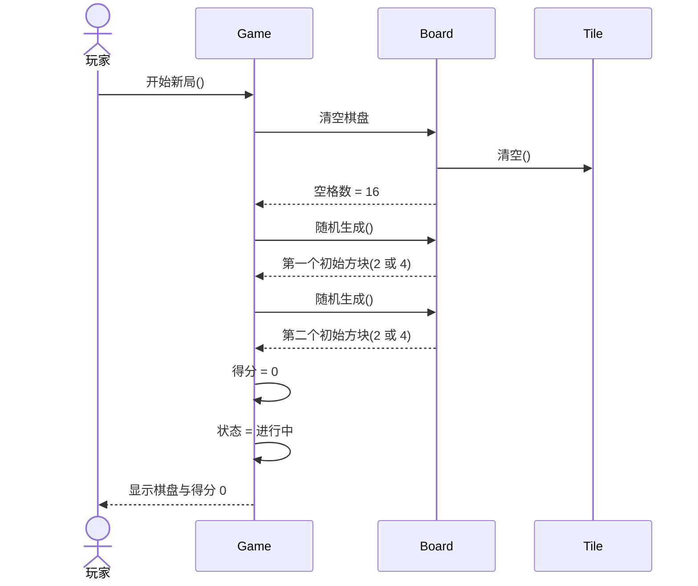
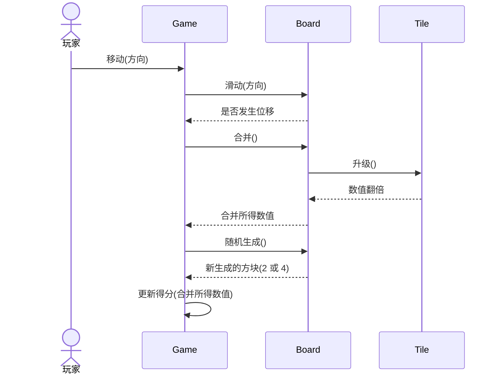
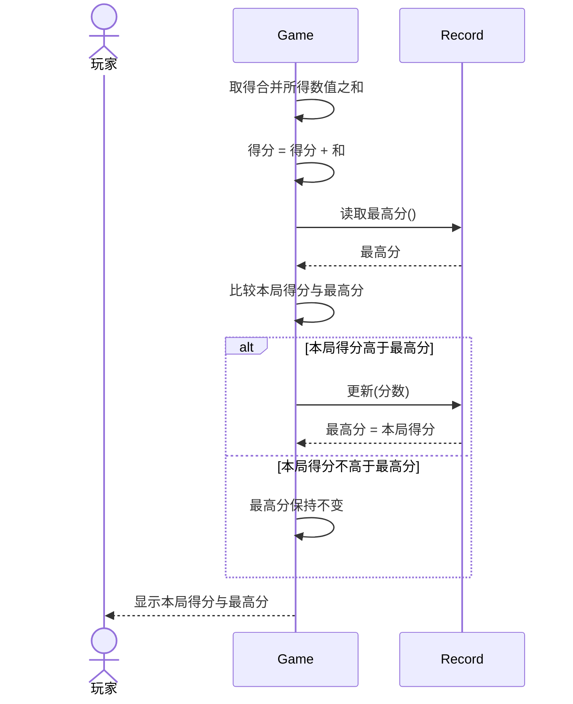
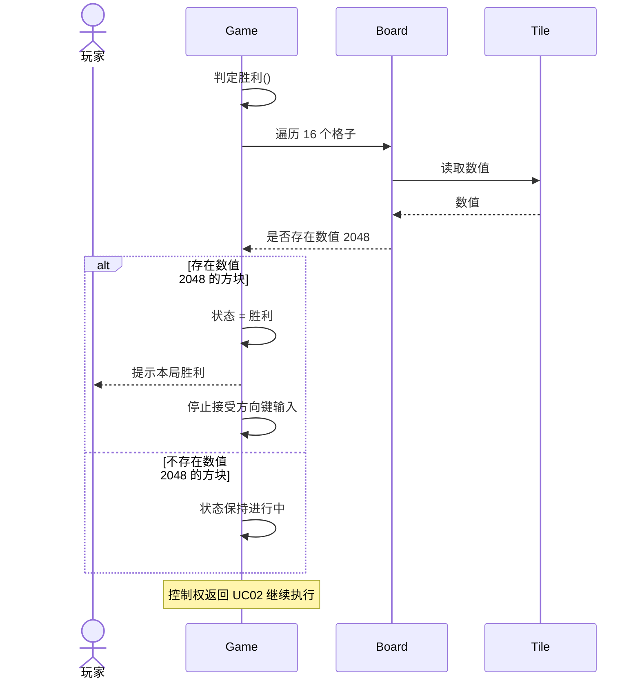
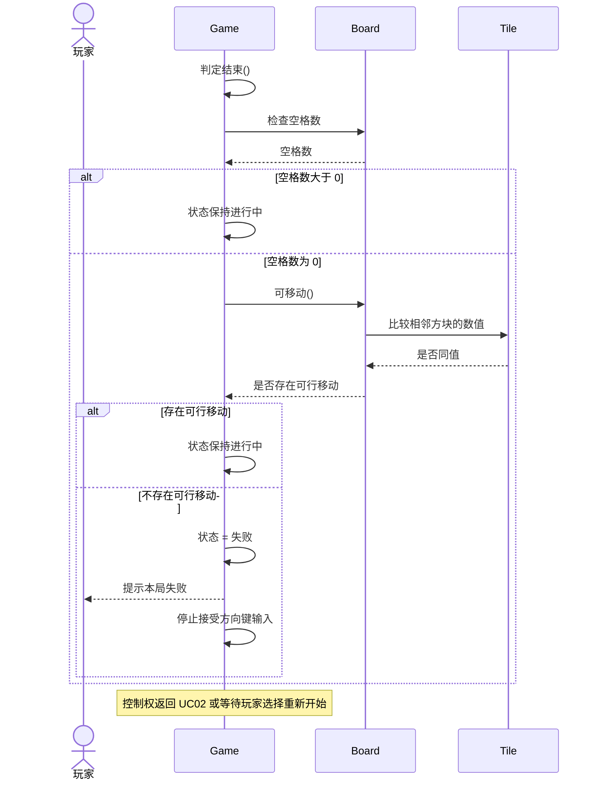
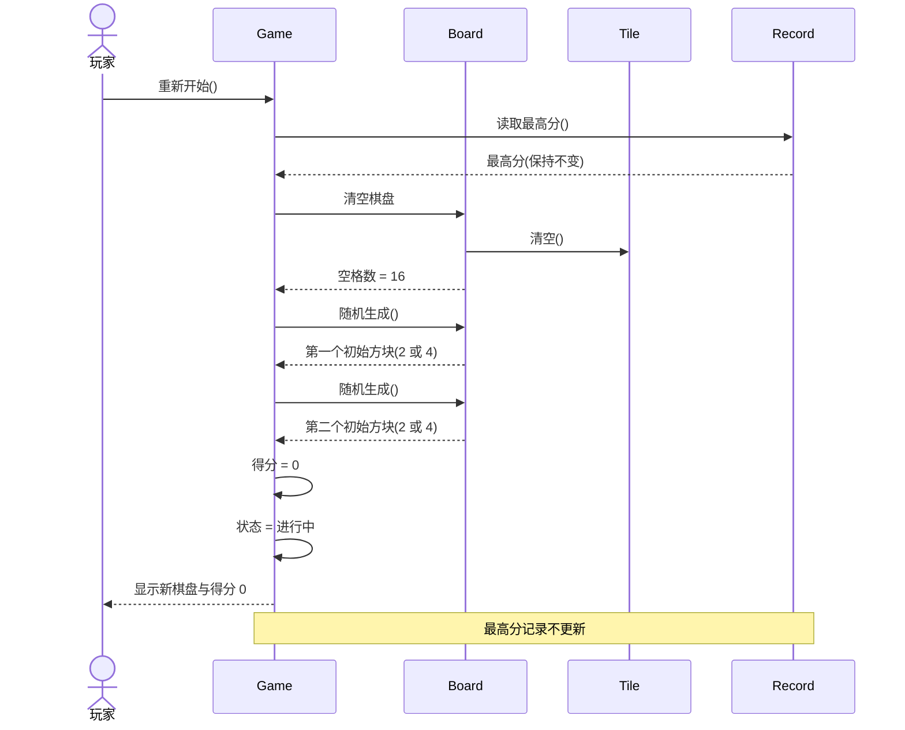

# 实验六  UML时序图

## 一、实验目的

1. 理解时序图的概念与组成：角色、对象、生命线、激活期和消息。
2. 学会分析一个用例所涉及到的类或对象，确定参与交互的对象及其职责。
3. 根据用例中类或对象的关系和行为顺序，用 StarUML 绘制顺序图。
4. 通过时序图核对用例叙述中的步骤顺序，发现并记录叙述与功能描述不一致之处。

## 二、实验要求

1. 六张时序图 `sq-01`~`sq-06` 与用例 UC01~UC06 一一对应，图文件名与 `docs/00-规范.md` 第 6 节一致。
2. 图中角色只使用玩家，对象只使用 `Game`、`Board`、`Tile`、`Record` 四个类，按用例需要取用，不引入规范外的类。
3. 消息顺序必须与规范第 3 节对应功能的描述一致；每条消息写明发送者、接收者与含义。
4. 每张图附消息序列表，表中列为序号、发送者、接收者、消息、说明。
5. 不使用 `Note over` 之外的复杂语法；`alt` 分支嵌套不超过两层。
6. 提交实验报告，报告按“实验目的、实验要求、主要实验工具、实验内容及实验数据记录、实验数据分析与讨论”五段编写。

## 三、主要实验工具

StarUML 7

## 四、实验内容及实验数据记录

本实验给出 2048 项目的六张时序图 `sq-01`~`sq-06`，与用例 UC01~UC06、功能 F01~F06 一一对应。时序图强调对象之间消息发送的顺序，因此本实验只记录对象、消息与顺序，不描述算法实现，也不描述活动图那样的控制流。图的口径与命名一律以 `docs/00-规范.md` 为准：图文件为 `sq-01` 开始新游戏、`sq-02` 移动与合并方块、`sq-03` 计分与显示得分、`sq-04` 判定胜利、`sq-05` 判定游戏结束、`sq-06` 重新开始；源码取自 本报告的六张图。六张图在 4.4~4.9 节全部内联，每张图后紧跟其消息序列表，正文与表内图号连续编号为图 1~图 6。

### 4.1 时序图要素

时序图显示对象之间的动态合作关系，强调对象之间消息发送的顺序。按实验指导书的概述，时序图包括角色、对象、生命线、激活期和消息五类要素。本项目的六张图对五类要素的使用如表 1 所示。

表 1  时序图要素及其在本项目中的体现

| 要素 | 含义 | 在六张图中的体现 |
|---|---|---|
| 角色 | 系统之外与系统交互的人或其他系统 | 玩家（Player），本系统唯一参与者。六张图均以 `actor 玩家` 绘制，位于图顶最左侧；图中不出现第二个角色 |
| 对象 | 交互中承担角色的事物，命名方式为“对象名 + 类名” | 对局 `Game`、棋盘 `Board`、方块 `Tile`、记录 `Record`，全部取自规范第 5 节的 4 个类；按用例需要取用，不引入界面类或主程序类 |
| 生命线 | 对象在一段时期内的存在，UML 中画为对象下方的垂直虚线 | 六张图的对象生命线均从对象顶部延伸到图底，表示对象在整个交互期间存在；`方块` 的生命线表示 `Tile` 类在交互中承担的角色，清空与生成只更换方块实例，不结束该生命线 |
| 激活期 | 对象执行一项操作的时期，图中为生命线上的窄矩形 | 在 StarUML 导出图中由工具生成并覆盖整条生命线；草稿不逐条标注激活与去激活。按规范第 9 节第 3 条，本项目激活期由工具生成，报告只描述消息顺序，不强调激活期粒度 |
| 消息 | 对象之间交换的信息，对应类操作或引起状态转换的触发事件 | 使用同步消息（实线实心箭头，`->>`）、返回消息（虚线箭头，`-->>`）与自消息（`对局->>对局`）三类；每条消息对应规范第 5 节的一个类操作、一次属性读写，或用例叙述中的一步 |

六张图只使用 `actor`、`participant`、同步消息、返回消息、自消息、`alt` 分支与 `Note over` 标注，不使用 `loop`、`par`、`ref` 等其他语法；`alt` 分支只在 `sq-03`、`sq-04`、`sq-05` 中出现，嵌套最多两层（`sq-05`）。消息顺序以规范第 3 节功能表的文字描述为准。

对象按“对象名 as 类名”的方式声明，例如 `对局 as Game` 表示对象名“对局”、类名 `Game`；消息序列表的“发送者”“接收者”列使用“对象名 + 类名”的写法，类名与规范第 5 节一致。

### 4.2 角色与对象的选取

按实验指导书“分析用例所涉及到的类或对象”的要求，从规范第 5 节的 4 个类中选取对象，从规范第 2 节选取角色。选取结果如表 2 所示。

表 2  角色、对象及其出现的图

| 名称 | 类别 | 在交互中的职责 | 出现的图 |
|---|---|---|---|
| 玩家（Player） | 角色 | 启动新局、按方向键、选择重新开始；接收棋盘、得分与结果的显示 | `sq-01`~`sq-06` |
| 对局 `Game` | 对象 | 接收玩家操作，驱动棋盘滑动、合并、生成，累加得分，判定胜负 | `sq-01`~`sq-06` |
| 棋盘 `Board` | 对象 | 清空格子、滑动、合并、随机生成、判断是否可移动 | `sq-01`、`sq-02`、`sq-04`、`sq-05`、`sq-06` |
| 方块 `Tile` | 对象 | 被清空、被合并时数值翻倍、提供数值供判定读取 | `sq-01`、`sq-02`、`sq-04`、`sq-05`、`sq-06` |
| 记录 `Record` | 对象 | 读取与更新最高分 | `sq-03`、`sq-06` |

本系统参与者唯一，六张图都只有玩家一个角色；系统内部的随机生成、判定、计分不作为角色。对象按用例需要取用：`sq-01`、`sq-02` 不涉及最高分记录，故不画 `Record`；`sq-03` 只处理分数与最高分，故不画棋盘与方块；`sq-04`、`sq-05` 需要检查方块数值，故画 `Tile`。六张图均不画界面类或主程序类，因为规范第 5 节只有 4 个类，规范第 7 节也禁止编造规范外的内容。

`方块` 的生命线表示 `Tile` 类在交互中的角色，而不是某一个方块实例：清空与生成只更换实例，不结束生命线。这样处理使一张图可以同时表达“清空 16 格”与“生成两个新方块”，与类图中 `Board` 聚合 `Tile`（1 : 0..16）的关系一致。

### 4.3 图与用例的对应关系

六张图与用例、功能、参与对象的对应关系如表 3 所示。

表 3  时序图与用例的对应关系

| 图文件 | 用例 | 对应功能 | 参与的角色与对象 |
|---|---|---|---|
| `sq-01` | UC01 开始新游戏 | F01 | 玩家、`Game`、`Board`、`Tile` |
| `sq-02` | UC02 移动与合并方块 | F02 | 玩家、`Game`、`Board`、`Tile` |
| `sq-03` | UC03 计分与显示得分 | F03 | 玩家、`Game`、`Record` |
| `sq-04` | UC04 判定胜利 | F04 | 玩家、`Game`、`Board`、`Tile` |
| `sq-05` | UC05 判定游戏结束 | F05 | 玩家、`Game`、`Board`、`Tile` |
| `sq-06` | UC06 重新开始 | F06 | 玩家、`Game`、`Board`、`Tile`、`Record` |

`sq-02` 的第 10 条消息是 `sq-03` 的入口，计分的详细消息由 `sq-03` 展开；`sq-04` 与 `sq-05` 分别对应 UC02 之后的两种判定；`sq-06` 通过包含关系复用 `sq-01` 的开局消息。六张图的对象取用遵循“按需取用”原则：`sq-01` 与 `sq-02` 不涉及最高分记录，故不画 `Record`；`sq-03` 不涉及棋盘与方块，故只画 `Game` 与 `Record`。

### 4.4 sq-01 开始新游戏（UC01 / F01）

`sq-01` 覆盖 UC01 的完整基本流程：玩家启动新局，系统清空 16 格棋盘，在两个随机空位各生成一个数值为 2 或 4 的初始方块，本局得分归零，对局进入进行中并刷新显示。源码如下：

图 1 开始新游戏时序图 sq-01

`sq-01` 的消息顺序如表 4 所示。

表 4  `sq-01` 的消息序列表

| 序号 | 发送者 | 接收者 | 消息 | 说明 |
|---|---|---|---|---|
| 1 | 玩家 | 对局 `Game` | 开始新局() | 玩家启动一局新的对局（UC01 步骤 1） |
| 2 | 对局 `Game` | 棋盘 `Board` | 清空棋盘 | 系统清空 4×4 共 16 格（UC01 步骤 2） |
| 3 | 棋盘 `Board` | 方块 `Tile` | 清空() | 棋盘对 16 个格位逐一调用方块的清空操作 |
| 4 | 棋盘 `Board` | 对局 `Game` | 空格数 = 16 | 返回清空结果，空格数供随机生成使用 |
| 5 | 对局 `Game` | 棋盘 `Board` | 随机生成() | 生成第一个初始方块（UC01 步骤 3） |
| 6 | 棋盘 `Board` | 对局 `Game` | 第一个初始方块(2 或 4) | 在随机空位放置，数值取 2 或 4 |
| 7 | 对局 `Game` | 棋盘 `Board` | 随机生成() | 生成第二个初始方块（UC01 步骤 4） |
| 8 | 棋盘 `Board` | 对局 `Game` | 第二个初始方块(2 或 4) | 与第一个方块位于不同的随机空位 |
| 9 | 对局 `Game` | 对局 `Game` | 得分 = 0 | 本局得分归零（UC01 步骤 5） |
| 10 | 对局 `Game` | 对局 `Game` | 状态 = 进行中 | 对局状态置为进行中 |
| 11 | 对局 `Game` | 玩家 | 显示棋盘与得分 0 | 刷新显示并等待方向键输入（UC01 步骤 6） |

如图 1 所示，两次 `随机生成()` 分别对应 UC01 基本流程的步骤 3) 与步骤 4)，不使用循环语法，以便消息序列表与叙述步骤逐条对应。UC01 例外流程中的“随机数值不在 2 与 4 之内则重新取值”不在图中展开，避免把一次生成画成多层分支；该例外只影响单个方块的取值次数，不改变消息顺序。

### 4.5 sq-02 移动与合并方块（UC02 / F02）

`sq-02` 覆盖玩家按方向键后的一次有效移动：`Game.移动(方向)` 驱动 `Board.滑动(方向)` 与 `Board.合并()`，合并结果通过 `Tile.升级()` 产生，随后 `Board.随机生成()` 生成新方块，最后由 `Game` 累加得分。源码如下：

图 2 移动与合并方块时序图 sq-02

消息顺序如表 5 所示。

表 5  `sq-02` 的消息序列表

| 序号 | 发送者 | 接收者 | 消息 | 说明 |
|---|---|---|---|---|
| 1 | 玩家 | 对局 `Game` | 移动(方向) | 玩家按下上/下/左/右方向键，触发 `Game.移动(方向)` |
| 2 | 对局 `Game` | 棋盘 `Board` | 滑动(方向) | 全部方块向该方向滑到最远的空位（F02） |
| 3 | 棋盘 `Board` | 对局 `Game` | 是否发生位移 | 返回本次滑动是否改变棋盘 |
| 4 | 对局 `Game` | 棋盘 `Board` | 合并() | 合并滑动方向上相邻的同值方块，每块每步最多合并一次 |
| 5 | 棋盘 `Board` | 方块 `Tile` | 升级() | 被合并的方块数值翻倍 |
| 6 | 方块 `Tile` | 棋盘 `Board` | 数值翻倍 | 返回合并结果 |
| 7 | 棋盘 `Board` | 对局 `Game` | 合并所得数值 | 本次移动的合并所得数值，供累加得分使用 |
| 8 | 对局 `Game` | 棋盘 `Board` | 随机生成() | 有效移动后在随机空位生成一个新方块 |
| 9 | 棋盘 `Board` | 对局 `Game` | 新生成的方块(2 或 4) | 新方块数值取 2 或 4 |
| 10 | 对局 `Game` | 对局 `Game` | 更新得分(合并所得数值) | 按合并所得数值累加本局得分（UC03） |

如图 2 所示，消息顺序是“按键 → `Game.移动(方向)` → `Board.滑动(方向)` → 合并 → `Board.随机生成()` → `Game` 更新得分”，与规范第 3 节 F02 的文字顺序一致：先生成 2 或 4，再按合并所得数值累加得分。该顺序与 UC02 用例叙述的步骤 4)、5) 不同，取舍与修正见 5.1 节。

UC02 例外流程中的无效移动（无位移且无可合并方块）不单独画分支：该情形下第 4~10 条消息都不发生，棋盘保持不变。胜利判定与结束判定分别由 `sq-04`、`sq-05` 单独建模，不在本图中重复。

### 4.6 sq-03 计分与显示得分（UC03 / F03）

`sq-03` 覆盖一次有效移动后的计分：`Game` 取得合并所得数值之和并累加到本局得分，读取最高分记录并比较，必要时更新最高分，最后刷新得分显示。源码如下：

图 3 计分与显示得分时序图 sq-03

消息顺序如表 6 所示。

表 6  `sq-03` 的消息序列表

| 序号 | 发送者 | 接收者 | 消息 | 说明 |
|---|---|---|---|---|
| 1 | 对局 `Game` | 对局 `Game` | 取得合并所得数值之和 | 取本次移动中所有合并所得数值之和（UC03 步骤 1） |
| 2 | 对局 `Game` | 对局 `Game` | 得分 = 得分 + 和 | 把和累加到本局得分（UC03 步骤 2） |
| 3 | 对局 `Game` | 记录 `Record` | 读取最高分() | 读取已保存的最高分（UC03 步骤 3） |
| 4 | 记录 `Record` | 对局 `Game` | 最高分 | 返回最高分记录 |
| 5 | 对局 `Game` | 对局 `Game` | 比较本局得分与最高分 | 比较结果决定是否更新最高分 |
| 6 | 对局 `Game` | 记录 `Record` | 更新(分数) | 分支条件“本局得分高于最高分”成立时更新（步骤 4） |
| 7 | 记录 `Record` | 对局 `Game` | 最高分 = 本局得分 | 返回更新后的最高分 |
| 8 | 对局 `Game` | 对局 `Game` | 最高分保持不变 | 分支条件“本局得分不高于最高分”成立时的落点 |
| 9 | 对局 `Game` | 玩家 | 显示本局得分与最高分 | 刷新显示（步骤 5），之后控制权返回 UC02 |

如图 3 所示，该图只用一层 `alt` 分支区分“更新最高分”与“保持最高分”。UC03 例外流程中的“本次没有任何合并，合并数值之和为 0”落在第 1、2 条消息上：和为 0，得分不变，比较后进入第 8 条消息；“最高分记录为空或不可读时以 0 为初值”不改变消息顺序，图中不展开。控制权返回 UC02 不是 4 个类中任何一个的操作，故不画成消息，处理办法见 5.3 节。

### 4.7 sq-04 判定胜利（UC04 / F04）

`sq-04` 覆盖一次有效移动后的胜利判定：`Game.判定胜利()` 遍历棋盘 16 格，读取各方块数值，存在数值 2048 的方块时置状态为胜利、提示玩家并停止接受方向键输入。源码如下：

图 4 判定胜利时序图 sq-04

消息顺序如表 7 所示。

表 7  `sq-04` 的消息序列表

| 序号 | 发送者 | 接收者 | 消息 | 说明 |
|---|---|---|---|---|
| 1 | 对局 `Game` | 对局 `Game` | 判定胜利() | UC04 的入口操作 |
| 2 | 对局 `Game` | 棋盘 `Board` | 遍历 16 个格子 | 遍历棋盘的 16 个格位（UC04 步骤 1） |
| 3 | 棋盘 `Board` | 方块 `Tile` | 读取数值 | 读取每个非空格位上 `Tile.数值` |
| 4 | 方块 `Tile` | 棋盘 `Board` | 数值 | 返回方块当前数值 |
| 5 | 棋盘 `Board` | 对局 `Game` | 是否存在数值 2048 | 返回检查结果（UC04 步骤 2） |
| 6 | 对局 `Game` | 对局 `Game` | 状态 = 胜利 | 分支条件“存在数值 2048 的方块”成立（步骤 3） |
| 7 | 对局 `Game` | 玩家 | 提示本局胜利 | 提示玩家（步骤 4） |
| 8 | 对局 `Game` | 对局 `Game` | 停止接受方向键输入 | 等待玩家选择重新开始（步骤 5） |
| 9 | 对局 `Game` | 对局 `Game` | 状态保持进行中 | 分支条件“不存在数值 2048 的方块”成立（例外流程 1） |

如图 4 所示，该图只用一层 `alt` 分支。例外流程中的“同时存在多个 2048 方块只判定一次”不增加消息，因为第 2~8 条消息在第一次命中后即结束；“状态已为胜利或失败时不再执行本用例”由 UC02 的调用条件保证，图中不画第二层判断。判定结束后控制权返回 UC02，以图末 `Note over` 标注，不作为消息计入表 7。

### 4.8 sq-05 判定游戏结束（UC05 / F05）

`sq-05` 覆盖一次有效移动后的结束判定：先检查棋盘是否有空格，棋盘已满时再逐格检查四个方向是否存在相邻同值方块，四个方向都不存在时置状态为失败、提示玩家并停止接受方向键输入。源码如下：

图 5 判定游戏结束时序图 sq-05

消息顺序如表 8 所示。

表 8  `sq-05` 的消息序列表

| 序号 | 发送者 | 接收者 | 消息 | 说明 |
|---|---|---|---|---|
| 1 | 对局 `Game` | 对局 `Game` | 判定结束() | UC05 的入口操作 |
| 2 | 对局 `Game` | 棋盘 `Board` | 检查空格数 | 检查 16 格是否全部非空（UC05 步骤 1） |
| 3 | 棋盘 `Board` | 对局 `Game` | 空格数 | 返回当前空格数 |
| 4 | 对局 `Game` | 对局 `Game` | 状态保持进行中 | 分支条件“空格数大于 0”成立（例外流程 1） |
| 5 | 对局 `Game` | 棋盘 `Board` | 可移动() | 棋盘已满时逐格检查四个方向（步骤 2） |
| 6 | 棋盘 `Board` | 方块 `Tile` | 比较相邻方块的数值 | 比较上下左右相邻方块的 `Tile.数值` |
| 7 | 方块 `Tile` | 棋盘 `Board` | 是否同值 | 返回相邻比较结果 |
| 8 | 棋盘 `Board` | 对局 `Game` | 是否存在可行移动 | 返回四个方向的检查结果 |
| 9 | 对局 `Game` | 对局 `Game` | 状态保持进行中 | 分支条件“存在可行移动”成立（例外流程 2） |
| 10 | 对局 `Game` | 对局 `Game` | 状态 = 失败 | 分支条件“不存在可行移动”成立（步骤 3） |
| 11 | 对局 `Game` | 玩家 | 提示本局失败 | 提示玩家（步骤 4） |
| 12 | 对局 `Game` | 对局 `Game` | 停止接受方向键输入 | 等待玩家选择重新开始（步骤 5） |

如图 5 所示，`alt` 嵌套两层：外层按“空格数是否为 0”分叉，内层按“是否存在可行移动”分叉，与 UC05 基本流程“先查空格、再查相邻同值”的顺序一致，嵌套深度未超过两层。例外流程中的“本次有效移动后棋盘已无空位而未能生成新方块”只改变进入判定时的棋盘内容，不改变消息顺序；“状态已为胜利时跳过本用例”由胜利优先的调用顺序保证，图中不展开。

### 4.9 sq-06 重新开始（UC06 / F06）

`sq-06` 覆盖对局结束后的重新开始：玩家选择重新开始，`Game` 读取并保留最高分记录的当前值，按包含关系执行一次 UC01 的清空棋盘与两次随机生成，本局得分归零、状态置为进行中，最后刷新显示并恢复方向键输入。源码如下：

图 6 重新开始时序图 sq-06

消息顺序如表 9 所示。

表 9  `sq-06` 的消息序列表

| 序号 | 发送者 | 接收者 | 消息 | 说明 |
|---|---|---|---|---|
| 1 | 玩家 | 对局 `Game` | 重新开始() | 玩家在结果提示界面选择重新开始（UC06 步骤 1） |
| 2 | 对局 `Game` | 记录 `Record` | 读取最高分() | 读取最高分当前值（步骤 2） |
| 3 | 记录 `Record` | 对局 `Game` | 最高分(保持不变) | 只读取、不调用 `Record.更新()`，最高分记录不变 |
| 4 | 对局 `Game` | 棋盘 `Board` | 清空棋盘 | 执行 UC01：清空 16 格（步骤 3） |
| 5 | 棋盘 `Board` | 方块 `Tile` | 清空() | 棋盘对 16 个格位逐一调用方块的清空操作 |
| 6 | 棋盘 `Board` | 对局 `Game` | 空格数 = 16 | 返回清空结果 |
| 7 | 对局 `Game` | 棋盘 `Board` | 随机生成() | 生成第一个初始方块 |
| 8 | 棋盘 `Board` | 对局 `Game` | 第一个初始方块(2 或 4) | 数值取 2 或 4 |
| 9 | 对局 `Game` | 棋盘 `Board` | 随机生成() | 生成第二个初始方块 |
| 10 | 棋盘 `Board` | 对局 `Game` | 第二个初始方块(2 或 4) | 与第一个方块位于不同的随机空位 |
| 11 | 对局 `Game` | 对局 `Game` | 得分 = 0 | 本局得分归零 |
| 12 | 对局 `Game` | 对局 `Game` | 状态 = 进行中 | 对局状态置为进行中，最高分记录不变 |
| 13 | 对局 `Game` | 玩家 | 显示新棋盘与得分 0 | 刷新显示并重新接受方向键输入（步骤 4） |

如图 6 所示，第 4~12 条消息与 `sq-01`（图 1）的第 2~10 条消息同序，体现 UC06 `«include»` UC01 的关系；重新开始没有重复定义开局步骤，而是按同一顺序执行一次开始新游戏。例外流程中的“玩家不选择重新开始而结束会话”不发生任何消息；“对局状态为未开始”时跳过第 2、3 条消息，其余顺序不变。

### 4.10 六张图的汇总

六张图与用例、功能、参与对象的对应关系与消息条数如表 10 所示。

表 10  时序图汇总

| 图号 | 图文件 | 用例 | 功能 | 参与对象 | 消息条数 |
|---|---|---|---|---|---|
| 图 1 | `sq-01` | UC01 开始新游戏 | F01 | 玩家、`Game`、`Board`、`Tile` | 11 |
| 图 2 | `sq-02` | UC02 移动与合并方块 | F02 | 玩家、`Game`、`Board`、`Tile` | 10 |
| 图 3 | `sq-03` | UC03 计分与显示得分 | F03 | 玩家、`Game`、`Record` | 9 |
| 图 4 | `sq-04` | UC04 判定胜利 | F04 | 玩家、`Game`、`Board`、`Tile` | 9 |
| 图 5 | `sq-05` | UC05 判定游戏结束 | F05 | 玩家、`Game`、`Board`、`Tile` | 12 |
| 图 6 | `sq-06` | UC06 重新开始 | F06 | 玩家、`Game`、`Board`、`Tile`、`Record` | 13 |

六份 Mermaid 源码已全部内联于 4.4~4.9 节，已逐份通过 Mermaid 语法解析与渲染检查，确认 `alt`、`Note over` 与中文消息均能正确成图。表 10 的消息条数与表 4~表 9 的行数逐一核对一致（11、10、9、9、12、13 条），图 1~图 6 即本报告内联的六张图，正文不再引用其他图片文件。

### 4.11 一致性核对

六张图逐项核对的结果如表 11 所示。

表 11  一致性核对

| 检查项 | 核对结果 |
|---|---|
| 图与用例的对应 | `sq-01`~`sq-06` 与 UC01~UC06 一一对应，无多图、无缺图 |
| 角色数量 | 六张图只出现玩家一个角色，与规范第 2 节“参与者唯一”一致 |
| 对象数量 | 只出现 `Game`、`Board`、`Tile`、`Record` 四个对象，无界面类、无算法辅助对象 |
| 对象取用 | `玩家` 6 张、`Game` 6 张、`Board` 5 张、`Tile` 5 张、`Record` 2 张，均按用例需要取用 |
| 消息与操作 | 消息名使用规范第 5 节的操作名（`开始新局()`、`移动()`、`滑动()`、`合并()`、`随机生成()`、`升级()`、`读取最高分()`、`更新()`、`可移动()`、`判定胜利()`、`判定结束()`），属性读写与显示、提示类消息在说明栏标注归属 |
| 消息顺序 | `sq-02` 按“按键→移动→滑动→合并→随机生成→更新得分”绘制，与规范第 3 节 F02 一致；其余五张按对应功能描述与用例叙述绘制 |
| 分支语法 | 仅使用 `alt`，`sq-05` 嵌套两层，未超过两层；其余分支用 `Note over` 或说明栏表达 |
| 图源码路径 | 六张图的 Mermaid 源码取自 本报告内联的图，全部内联于 4.4~4.9 节，报告正文不引用位图导出文件 |
| 图号 | 图 1~图 6 在本报告内连续编号，与表 10 的图号一列一致 |

## 五、实验数据分析与讨论

### 5.1 消息顺序与用例叙述不一致时的修正

绘制 `sq-02` 时发现一处实质冲突：对应实验的报告 中 UC02 的基本流程是“步骤 4) 系统按合并所得数值累加本局得分……步骤 5) 系统在随机空位生成一个数值为 2 或 4 的新方块”，即先计分、后生成；而规范第 3 节 F02 写的是“每次有效移动后系统在随机空位生成一个 2 或 4，并按合并所得数值累加本局得分”，即先生成、后计分。两种顺序都能自圆其说，但同一项目只能有一个口径。

判定以规范第 3 节为准，理由有三点。第一，规范开头已声明本文件是全部实验文档、图、报告的唯一真相源，功能表是其中对功能行为的直接定义，用例叙述是下游文档。第二，`sq-01` 与 `sq-06` 的开局消息都是“生成两个初始方块”在“得分 = 0”之前，若 `sq-02` 采用先计分后生成，六张图内部会出现两种相反的“生成—计分”先后关系。第三，按“生成→计分”绘制后，`sq-02` 第 10 条消息正好是 `sq-03` 的触发点，即“随机生成完成之后才执行计分”，两张图可以首尾相接；按叙述顺序则 `sq-03` 必须插在 `sq-02` 的第 8 条消息之前，`sq-02` 将无法作为一条独立的时间轴阅读。

由此确定三条修正规则。其一，功能表与用例叙述冲突时，消息顺序以规范第 3 节功能表的文字顺序为准，时序图按此绘制。其二，修正只改消息先后，不改操作归属与用例关系，计分仍由 UC03 承担、UC03 仍被 UC02 包含，`sq-02` 的最后一条消息“更新得分(合并所得数值)”只是 UC03 的入口，详细消息在 `sq-03`。其三，需要同步修订的是实验二 UC02 叙述的步骤 4) 与 5)，两者对调后与 F02、`sq-02` 一致；本实验只在本报告记录该结论，没有改动实验二报告，待文档统一修订时执行。除 UC02 外，`sq-01`、`sq-03`~`sq-06` 的消息顺序与对应用例叙述的步骤编号逐条对应，未作调整。

同一轮核对还发现另外三处“叙述不是消息顺序、但容易被误画成消息”的地方，处理如下。

1. UC06 的“系统保留最高分记录的当前值”不是类操作，`Record` 没有“保留”操作。`sq-06` 用 `读取最高分()` 表示读取，再用 `Note over` 写明“最高分记录不更新”，不把“保留”画成 `更新(0)` 之类的假消息。
2. UC03 的“系统读取最高分记录，与本局得分比较”是两步：读取是一次跨对象消息，比较是 `Game` 内部动作。`sq-03` 把读取画成第 3、4 条消息，把比较画成第 5 条自消息，避免把比较画成发给 `Record` 的消息。
3. UC04、UC05 的“提示玩家”“显示得分”没有对应的类操作，因为规范第 5 节不设界面类。六张图把这些步骤画成发往角色“玩家”的消息，并在说明栏注明其来源是叙述步骤；它们不计入 4 个类的操作清单，也不为它们编造界面类。

此外，规范第 9 节第 3 条已确定“时序图的激活期由工具生成，覆盖整条生命线，报告只描述消息顺序，不强调激活期粒度”。因此草稿不逐条标注激活与去激活，本报告也不对窄矩形的起止位置作逐条说明，激活期由 StarUML 导出时统一生成。

### 5.2 对象粒度与分支取舍

对象的粒度按“一个类一条生命线”处理。最明显的取舍是 `Tile`：一次开局会清空 16 个方块再生成 2 个，一次合并会移除两个方块并产生一个新方块，若按实例画生命线，`sq-01` 需要 16 条销毁消息，`sq-02` 还要画方块的创建与销毁，图面无法阅读。改为用一条 `Tile` 生命线表示该类在交互中的角色，清空与生成只作为消息出现，生命线贯穿全图；这样既保留了“谁给谁发消息”，也与类图中 `Board` 聚合 `Tile`（1 : 0..16）的静态关系一致。

分支只保留会影响消息集合的分支。`sq-03` 的“是否更新最高分”、`sq-04` 的“是否存在 2048”、`sq-05` 的“空格数是否为 0”与“是否存在可行移动”会决定后续是否还有消息，故用 `alt` 画出；无效移动、随机取值不在 2 与 4 之内、最高分记录为空、多个 2048 方块只提示一次等情形只改变某条消息的取值或执行次数，不改变消息顺序，故写入说明栏而不画分支。`sq-05` 因“先查空格、再查相邻同值”需要两层判断，是六张图中唯一嵌套两层的图，未超过“嵌套不超过两层”的限制。

`sq-02` 不画胜利与结束判定。F02 的描述到“累加本局得分”为止，判定分属 F04、F05；若把两条判定塞进 `sq-02`，`sq-02` 将同时承担三个功能的消息，与“一图对一用例”的对应关系冲突。同样，`sq-04`、`sq-05` 不重复画滑动、合并与生成，它们的入口是 `sq-02` 完成后的棋盘状态。

### 5.3 存在问题与解决

第一个问题是 `alt` 分支条件的文字在窄图上换行。`sq-05` 内层条件“不存在可行移动”在 Mermaid 渲染时被折成两行，虽不影响语义，但与 StarUML 的单行显示不一致。解决方式是条件文字保持短句、不使用标点，并在 StarUML 中重绘时按同一文字输入，保证草稿与导出图的条件文字一致。

第二个问题是控制权返回无法用消息表达。UC03、UC04、UC05 执行完毕后要把控制权交回 UC02，但“返回”不是 4 个类中任何一个的操作，若画成 `Game -> Game` 的消息会与真实操作混淆。解决方式是用图末 `Note over 对局` 标注“控制权返回 UC02”，并在消息序列表之外单独说明，不计入消息条数。

第三个问题是 `结算()` 的调用时机尚未统一。实验五的对局状态机把“结算本局得分、更新最高分”作为胜利、失败两个状态的进入动作，对应 `Game.结算()`；而 UC04、UC05 的用例叙述只写“置状态、提示、停止输入”，没有列出结算，`sq-04`、`sq-05` 因此按叙述绘制，没有加入 `结算()` 消息。本实验的处理是保持时序图与用例叙述一致，把差异记录在此；后续统一口径时需要二选一：或在 UC04、UC05 的叙述中补上“结算”，并在 `sq-04`、`sq-05` 中加一条 `Game` 自消息；或明确结算由 UC02 结束时的 `Game` 收尾完成，实验五的进入动作改为“提示”。在该结论确定之前，不在图中单方面加入该消息。

第四个问题是内联图与导出图的一致性。本报告把六张图改为 Mermaid 代码块内联，图 1~图 6 与 本报告内联的图 逐字一致（仅去掉注释行），消息条数与表 4~表 9 的行数逐张核对；如后续在 StarUML 中重绘，需按同一消息顺序输入，避免两处图面出现差异。

验证方面，六份草稿逐份通过 Mermaid 语法解析与渲染检查，确认消息条数与表 4~表 9 一致（分别为 11、10、9、9、12、13 条），六张图的角色只有玩家、对象只有 4 个类、`alt` 最深两层。图与用例的对应关系、消息名与规范第 5 节操作名的一致性，另见表 11 的一致性核对表。
