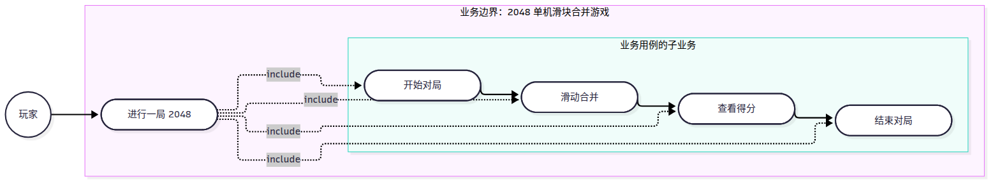
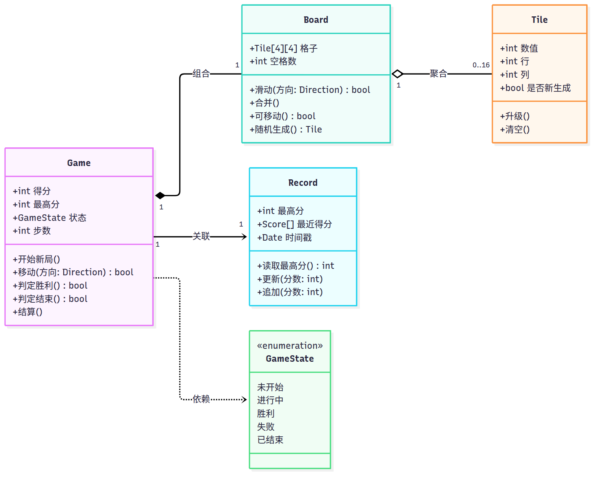

# 实验七  UML建模项目实例

## 一、实验目的

1. 理解模型驱动体系架构（MDA）的分层思想：CIM 聚焦系统环境与需求、不涉及系统内部结构与运作细节；PIM 聚焦系统内部细节、不涉及具体平台；PSM 聚焦具体平台的落实细节；Coding 依据 PSM 编写代码。
2. 掌握 MDA 建模的七个步骤：CIM-1 定义业务流程、CIM-2 分析业务流程、CIM-3 定义系统范围；PIM-1 分析系统流程、PIM-2 分析业务规则、PIM-3 定义静态结构、PIM-4 定义操作及方法。
3. 按七个步骤完成 2048 项目的 CIM 与 PIM 建模，并把各步骤的产物串成一条可追溯的链：业务用例 → 业务活动图 → 系统用例 → 细化用例叙述 → 状态图 → 类图 → 顺序图。

## 二、实验要求

1. 依据系统业务流程与功能编写系统用例叙述，并建立用例之间的关系。
2. 绘制系统活动图、类图、状态图与顺序图，图与正文口径一致。
3. 按 MDA 的两级视角组织建模产物：CIM 阶段回答“玩家在业务上要完成什么”，PIM 阶段回答“系统内部由哪些对象、按什么规则、以什么操作顺序完成它”。
4. 只在指导书要求的 CIM 与 PIM 范围内建模，不涉及 PSM 与 Coding，不写代码、不讨论平台部署。
5. 提交实验报告。

## 三、主要实验工具

StarUML 7。

## 四、实验内容及实验数据记录

### 4.1 七个步骤的产物索引

本实验的七个步骤与产物如表 1 所示。七个步骤全部围绕同一个项目 2048 展开，功能编号 F01~F06、用例编号 UC01~UC06、类名与图文件名取自 `docs/00-规范.md`，七个步骤只新增业务用例图 `bc-01` 一张图，其余图沿用实验二~实验六已成的图。

表 1  七个步骤的产物索引

| 步骤 | 产物 | 图号 | 文件 |
|---|---|---|---|
| CIM-1 定义业务流程 | 业务执行者“玩家”、业务用例“进行一局 2048”及四项子业务、业务用例图 | 图 1 | `models/drafts/bc-01.mmd`、`models/exports/bc-01.png` |
| CIM-2 分析业务流程 | 一局主流程活动图、开始新局活动图、结束处理活动图 | 图 2、图 3、图 4 | `models/exports/ad-01.png`、`ad-02.png`、`ad-03.png` |
| CIM-3 定义系统范围 | 系统用例图（含 include/extend）、6 条用例简述 | 图 5 | `models/exports/uc-01.png`；`docs/07-MDA总报告.md` 表 4 |
| PIM-1 分析系统流程 | 业务规则清单 BR01~BR10、六份细化的用例叙述（基本流程 6~8 步、例外流程含分支） | 无图（表 5~表 11） | `docs/07-MDA总报告.md` 第 4 节 |
| PIM-2 分析业务规则 | 对局状态机、方块状态机、状态说明表 | 图 6、图 7 | `models/exports/st-01.png`、`st-02.png`；`docs/07-MDA总报告.md` 表 12 |
| PIM-3 定义静态结构 | 类图（4 个类 + 枚举 `GameState`）、类说明表 | 图 8 | `models/exports/cd-01.png`；`docs/07-MDA总报告.md` 表 13 |
| PIM-4 定义操作及方法 | 六张顺序图，一张对应一条用例 | 图 9~图 14 | `models/exports/sq-01.png`~`sq-06.png`；`docs/07-MDA总报告.md` 表 15 |

### 4.2 CIM-1 定义业务流程

CIM-1 用业务视角描述“玩家玩一局 2048”这件事。业务执行者只有**玩家**一个：本项目无账号体系，不涉及注册、登录、密码、权限；随机生成方块、判定胜负、累计分数发生在业务内部，不作为业务执行者。业务用例是**“进行一局 2048”**，由四项子业务构成：开始对局（对应 F01）、滑动合并（F02）、查看得分（F03、F04、F05）、结束对局（F04、F05、F06）。业务用例图如图 1 所示。

图 1 CIM-1 业务用例图 bc-01

如图 1 所示，业务执行者“玩家”位于业务边界（`subgraph`）之外，与边界内唯一的业务用例“进行一局 2048”关联；业务用例再用四条 `include` 指向四项子业务，子业务按“开始对局 → 滑动合并 ↔ 查看得分 → 结束对局”的顺序连成一条业务链。

### 4.3 CIM-2 分析业务流程

CIM-2 把业务链展开为可执行的活动流程，拆成三段画三张活动图。一局主流程活动图如图 2 所示。

图 2 一局主流程活动图 ad-01

如图 2 所示，主流程是“等待玩家按键 → 判断是否为有效移动 → 滑动 → 合并 → 计分 → 随机生成方块 → 判断是否出现 2048 → 判断是否还有可行移动 → 回到等待按键”的循环，无效移动直接回到等待按键且不生成新方块。

开始新局活动图如图 3 所示。

图 3 开始新局活动图 ad-02

如图 3 所示，开始新局是“清空棋盘 → 计数器置 0 → 循环生成两个 2 或 4 → 得分归零 → 状态置为进行中”的直线流程。

结束处理活动图如图 4 所示。

图 4 结束处理活动图 ad-03

如图 4 所示，结束处理按判定结果分胜利、失败两支，各自提示后汇合到“等待玩家选择”，再由玩家选择“重新开始”或“退出”。

三张活动图均不使用泳道：本业务只有玩家一个实施者，随机生成、判定胜负由系统在同一业务流程内完成，不存在需要区分实施者的职责移交。

### 4.4 CIM-3 定义系统范围

CIM-3 在 CIM-2 的活动流上划出系统边界：边界之内负责维护 16 格棋盘、滑动与合并、累加得分与记录最高分、生成 2 或 4、判定胜负与显示；边界之外是玩家与按键这一输入手段。因此系统参与者唯一为玩家，UC03、UC04、UC05 记为“系统（由 UC02 触发）”，不与玩家连线。系统用例图如图 5 所示。

图 5 系统用例图 uc-01

如图 5 所示，系统边界内共 6 个用例（UC01~UC06），玩家与 UC01、UC02、UC06 关联；UC02 通过 `«include»` 指向 UC03 与 UC05，UC06 通过 `«include»` 指向 UC01；UC04 通过 `«extend»` 指向 UC02，扩展点为“棋盘出现数值 2048 的方块”。本系统参与者唯一、用例之间不存在父子关系，故未使用泛化关系。

6 条用例的简述记录如下（完整 6 行简述表见 `docs/07-MDA总报告.md` 表 4）。

| 用例名称 | 用例编号 | 参与者 | 用例简述 |
|---|---|---|---|
| 开始新游戏 | UC01 | 玩家 | 清空 16 格棋盘并在随机空位生成两个初始方块（2 或 4），得分归零，对局进入“进行中” |
| 移动与合并方块 | UC02 | 玩家 | 按方向键使全部方块滑动，相邻同值方块合并为双倍数值方块，有效移动后计分并生成一个新方块 |
| 计分与显示得分 | UC03 | 系统（由 UC02 触发） | 按本次合并所得数值累加得分，严格高于历史最高分时更新最高分并刷新显示 |
| 判定胜利 | UC04 | 系统（由 UC02 触发） | 棋盘出现数值 2048 的方块时判本局胜利，结算得分并提示玩家 |
| 判定游戏结束 | UC05 | 系统（由 UC02 触发） | 16 格全满且四个方向都无相邻同值方块时判本局失败，结算得分并提示玩家 |
| 重新开始 | UC06 | 玩家 | 保留最高分，清空棋盘、生成两个初始方块、得分归零并恢复接受方向键输入 |

### 4.5 PIM-1 分析系统流程

PIM-1 把 CIM-3 的一句话简述细化为可执行的用例叙述：基本流程写到 6~8 步并固定动作顺序，例外流程写出具体分支，并把判定条件归纳为可编号的业务规则 BR01~BR10（如 BR04“只有有效移动才计分并生成新方块”、BR07“胜利优先于失败”、BR09“结束后不再接受方向键输入”）。六份叙述的基本流程步数分别为 UC01 8 步、UC02 8 步、UC03 7 步、UC04 6 步、UC05 7 步、UC06 5 步；每份都增加了“业务规则”与“对应图”两栏，把规则编号与 PIM-2~PIM-4 的图对应起来。六份完整叙述见 `docs/07-MDA总报告.md` 表 6~表 11，本报告不重复引用。

### 4.6 PIM-2 分析业务规则

PIM-2 把业务规则落到对象状态上。对局状态机如图 6 所示。

图 6 对局状态机 st-01

如图 6 所示，对局经历未开始 → 进行中 →（胜利 | 失败）→ 已结束五个状态，`进行中 → 进行中` 为自迁移（有效移动不改变对局状态），胜利与失败均可由“玩家选择重新开始”直接回到进行中（UC06 包含 UC01）。

方块状态机如图 7 所示。

图 7 方块状态机 st-02

如图 7 所示，单个方块经历新生 → 静止 → 合并消失，合并消失是终止态，被合并的方块对象从棋盘移除，合并结果由新的方块对象承载。

状态说明表（含义、进入动作、离开事件、相关业务规则）见 `docs/07-MDA总报告.md` 表 12。状态图上的监护条件正是业务规则的落点：`进行中 → 胜利` 的监护条件对应 BR07，`进行中 → 失败` 的监护条件对应 BR08，`胜利 / 失败 → 进行中` 的“玩家选择重新开始”对应 BR10。

### 4.7 PIM-3 定义静态结构

PIM-3 从 PIM-1 的用例叙述中抽取名词作候选类，经合并同义、排除系统外部名词、去掉只能作属性的名词后得到 4 个分析类：`Game`、`Board`、`Tile`、`Record`；`GameState` 作为 `状态` 的枚举类型，`Direction` 仅作操作参数类型，均不单独成类。类图如图 8 所示。

图 8 类图 cd-01

如图 8 所示，`Game` 组合 `Board`（1:1）、`Board` 聚合 `Tile`（1:0..16）、`Game` 关联 `Record`（1:1）、`Game` 依赖枚举 `GameState`；类间不使用泛化关系。4 个类的属性与操作清单见 `docs/07-MDA总报告.md` 表 13，属性名、操作名与规范第 5 节逐字一致。

### 4.8 PIM-4 定义操作及方法

PIM-4 用顺序图把 PIM-1 的基本流程落到对象之间的消息顺序上，六张顺序图与六条用例一一对应，按用例编号顺序记录如下。

UC01 开始新游戏的顺序图如图 9 所示。

图 9 UC01 开始新游戏顺序图 sq-01

如图 9 所示，`sq-01` 实现 UC01：玩家请求开始新局，`Game` 委托 `Board` 清空并在两个空位连续两次随机生成方块，再置得分 0 与状态“进行中”，最后向玩家显示棋盘。

UC02 移动与合并方块的顺序图如图 10 所示。

图 10 UC02 移动与合并方块顺序图 sq-02

如图 10 所示，`sq-02` 实现 UC02：`Game.移动(方向)` 先调用 `Board.滑动(方向)` 取得是否有位移，再调用 `Board.合并()` 由 `Tile.升级()` 完成翻倍，随后调用 `Board.随机生成()` 补一个新方块，最后由 `Game` 按合并所得数值更新得分。

UC03 计分与显示得分的顺序图如图 11 所示。

图 11 UC03 计分与显示得分顺序图 sq-03

如图 11 所示，`sq-03` 实现 UC03：`Game` 累加本次合并所得数值，再用 `Record.读取最高分()` 与 `Record.更新(分数)` 完成最高分的比较与更新并刷新显示。

UC04 判定胜利的顺序图如图 12 所示。

图 12 UC04 判定胜利顺序图 sq-04

如图 12 所示，`sq-04` 实现 UC04：`Game.判定胜利()` 委托 `Board` 遍历格子并读取 `Tile` 数值，检测到 2048 时置状态“胜利”、提示玩家并停止接受方向键输入。

UC05 判定游戏结束的顺序图如图 13 所示。

图 13 UC05 判定游戏结束顺序图 sq-05

如图 13 所示，`sq-05` 实现 UC05：`Game.判定结束()` 先向 `Board` 检查空格数，空格数为 0 时再调用 `Board.可移动()`，四个方向都不可移动时置状态“失败”、提示玩家并停止接受方向键输入。

UC06 重新开始的顺序图如图 14 所示。

图 14 UC06 重新开始顺序图 sq-06

如图 14 所示，`sq-06` 实现 UC06：`Game` 先在 `Record` 上读取并保留最高分，再执行 UC01 的清空、两次 `Board.随机生成()`、得分归零与状态置为“进行中”，最后向玩家显示新棋盘。六张顺序图只描述消息顺序，激活期由工具生成并覆盖整条生命线，报告不强调激活期粒度。

### 4.9 阶段之间的对应关系

七个步骤不是并列的七张图，而是一条单向细化的链。CIM-1 的业务执行者“玩家”一一映射为 CIM-3 的系统参与者“玩家”，映射后参与者数量不变（仍唯一）；CIM-1 的四项子业务分别由 CIM-2 的“开始新局”“一局主流程”“结束处理”承载，再落到 CIM-3 的 UC01、UC02、UC03~UC05、UC06；CIM-2 活动图中的 17 个动作有 16 个能找到归属的用例，只有“退出游戏”落在系统功能 F01~F06 之外，故不设用例，仅作为 `st-01` 中 `已结束` 的迁移事件。完整映射见 `docs/07-MDA总报告.md` 表 16~表 18。

## 五、实验数据分析与讨论

七个步骤中，**信息丢失最多的是 CIM-3 → PIM-1 这一步**，即从“系统用例图 + 一句话用例简述”到“细化的用例叙述”。

判断依据有三条。第一是**顺序信息的丢失**：CIM-3 的用例图只有参与者、用例与 include/extend 关系，图本身不含任何先后次序；一句话简述也只说明“做什么”，不说明“先做什么、后做什么”。例如 UC02 的简述只写到“滑动、合并、有效移动后计分并生成新方块”，而“计分必须在合并之后、生成新方块之前”“生成之后才判 2048，判出 2048 就不再判失败”这类顺序约束，在 CIM-3 的产物里完全没有记录。第二是**条件信息的丢失**：判定条件在 CIM-3 只有 UC04 的扩展点“棋盘出现数值 2048 的方块”一句话，UC05 的失败条件、无效移动的判定、最高分“严格大于才更新”都无处存放，最终只能在 PIM-1 里归纳成 BR01~BR10 十条规则才写得清楚。第三是**状态信息的丢失**：CIM-3 的简述不写前置条件与后置条件，用例执行前后对局处于哪个状态无法确定——“开始新游戏”之后状态是“进行中”还是“未开始”、“重新开始”是否清零最高分，这些都必须靠 PIM-1 补写前置/后置条件才能固定下来，随后才能交给 PIM-2 画 `st-01`。

对比之下，其余几步的丢失较小，可作为反证：CIM-1 → CIM-2 只是把四项子业务展开成活动，动作没有减少，只是增加了判断节点与回环，属于“加信息”而非“丢信息”；CIM-2 → CIM-3 丢掉的是活动图中的回环与判断细节，但这些细节仍留在活动图里，且参与者唯一使得“去掉泳道”不损失任何实施者信息；PIM-2 → PIM-3 丢的是时序，但类图本就不表达时序，且时序由 PIM-4 的顺序图专门补回；PIM-3 → PIM-4 丢的是属性与关系的静态约束，同样由类图保留。

补法分三步，本实验都已落实。第一步是**建立动作到用例的映射**，把 CIM-2 活动图中的每个动作逐一登记归属的用例（`docs/07-MDA总报告.md` 表 18），映射后剩一个“退出游戏”没有用例，反过来证明系统范围划得合适，没有把系统外行为塞进用例，也没有漏掉系统内的动作。第二步是**把判定条件显式化为编号规则**，在 PIM-1 开头列 BR01~BR10，并在六份用例叙述的“业务规则”栏逐条引用，使“哪一步依赖哪条规则”可查；这些规则不是新造的功能，而是从规范的功能描述中归纳出来的判定条件，避免了同一条件在 UC02、UC04、UC05 三处各写一遍且写法不一致。第三步是**用前置/后置条件锁定状态取值**，把每个用例前后的对局状态写成 `st-01` 的五个状态名之一，使 PIM-1 的叙述与 PIM-2 的状态图可以互相校核：`胜利` 与 `失败` 必须能从 `进行中` 到达，`玩家选择重新开始` 必须能从 `胜利`、`失败` 回到 `进行中`，任一处对不上就说明有一份产物写错了。

本实验实际遇到的另一个问题是图的复用与新增的边界。七个步骤中只有 CIM-1 需要新图：CIM-2 复用实验四的三张活动图，CIM-3 复用实验二的 `uc-01`（规范第 6 节明确它同时充当 CIM-3 的系统用例图，不另画），PIM-2 复用实验五的两张状态图，PIM-3 复用实验三的类图，PIM-4 复用实验六的六张顺序图。这样做的好处是七步之间不会出现“同一件事有两种画法”，代价是 PIM 阶段的图必须先由前六个实验画准，否则第七步只能返工改图。本实验在写 PIM-1 时确实发现两处需要在叙述中显式约束、而图上无法表达的内容——一是“无效移动不生成新方块”，二是“胜利后不再接受方向键输入”——处理办法是在用例叙述的例外流程与业务规则中写清，并在 PIM-2 的状态说明表中把“结束后只接受重新开始与退出”作为 `胜利`、`失败` 两状态的离开事件写死，从而保证图与文的口径一致。

遗留问题：本实验只为对局与方块两个对象画了状态图，`Record` 没有状态图。原因是最高分记录只有“读—比较—写”三步，不构成有意义的状态序列；若后续需要建模“记录损坏/不可读”的恢复流程，则须为 `Record` 补一张状态图，并同步修改 UC03 的例外流程 3)。该取舍已在 `docs/07-MDA总报告.md` 第 5 节与第 4.4 节写明。
