# 实验七  UML建模项目实例

## 一、实验目的

1. 理解模型驱动体系架构（MDA）的分层思想：CIM 聚焦系统环境与需求、不涉及系统内部结构与运作细节；PIM 聚焦系统内部细节、不涉及具体平台；PSM 聚焦具体平台的落实细节；Coding 依据 PSM 编写代码。
2. 掌握 MDA 建模的七个步骤：CIM-1 定义业务流程、CIM-2 分析业务流程、CIM-3 定义系统范围；PIM-1 分析系统流程、PIM-2 分析业务规则、PIM-3 定义静态结构、PIM-4 定义操作及方法。
3. 按七个步骤完成 2048 项目的 CIM 与 PIM 建模，并把各步骤的产物串成一条可追溯的链：业务用例 → 业务活动图 → 系统用例 → 细化用例叙述 → 状态图 → 类图 → 顺序图。

## 二、实验要求

1. 依据系统业务流程与功能编写系统用例叙述，并建立用例之间的关系。
2. 绘制系统活动图、类图、状态图与顺序图，图与正文口径一致。
3. 按 MDA 的两级视角组织建模产物：CIM 阶段回答“玩家在业务上要完成什么”，PIM 阶段回答“系统内部由哪些对象、按什么规则、以什么操作顺序完成它”。
4. 只在指导书要求的 CIM 与 PIM 范围内建模，不涉及 PSM 与 Coding，不写代码、不讨论平台部署。
5. 提交实验报告。

## 三、主要实验工具

StarUML 7。

## 四、实验内容及实验数据记录

本报告按《2048 项目建模规范（唯一口径）》整合实验七的 MDA 建模结果：CIM 三阶段（CIM-1 定义业务流程、CIM-2 分析业务流程、CIM-3 定义系统范围）与 PIM 四阶段（PIM-1 分析系统流程、PIM-2 分析业务规则、PIM-3 定义静态结构、PIM-4 定义操作及方法）。文中出现的功能编号 F01~F06、用例编号 UC01~UC06、类名与图文件名，一律取自规范第 3~6 节，不新增功能、不新增参与者、不新增类、不改图名。

本报告是自包含的：全部 14 张图以 Mermaid 源码内联在正文中（源码均已内联，无外部文件），除 `docs/00-规范.md` 作为口径引用外，不再依赖其他报告文件。

### 4.1 项目定义与七个步骤的产物索引

**项目一句话定义**：**2048 是一款纯单机、参与者唯一（玩家）的 4×4 滑块合并益智游戏**：玩家用方向键使全部方块滑动，相邻同值方块合并为双倍数值方块（同一次移动中每个方块最多只参与一次合并），每次有效移动后系统在随机空位生成一个 2 或 4 并按合并所得数值累加本局得分，棋盘出现 2048 时本局胜利，棋盘填满且任意方向都无法移动时本局失败。

实验指导书给出的 MDA 开发过程分四个阶段：CIM 聚焦系统环境与需求、不涉及系统内部结构与运作细节；PIM 聚焦系统内部细节、不涉及具体平台；PSM 聚焦落实于某一具体平台的细节（如某种中间件或应用服务器平台）；Coding 由程序员依据 PSM 按图施工写出代码。指导书的建模要求是“完成 CIM 及 PIM 建模”，因此本报告只交付 CIM 与 PIM 两个阶段的产物，PSM 与 Coding 不在本实验范围内，本报告不给出任何平台相关内容。

从 CIM 到 PIM 的分工是：CIM 回答“玩家在业务上要完成什么”，PIM 回答“系统内部由哪些对象、按什么规则、以什么操作顺序完成它”。七个步骤的产物如表 1 所示。

表 1  七个步骤的产物一览

| 阶段 | 步骤 | 产物 | 图号 | 图源码 |
|---|---|---|---|---|
| CIM | CIM-1 定义业务流程 | 业务执行者“玩家”、业务用例“进行一局 2048”及四项子业务、业务用例图 | 图 1 | 本报告内联的图 |
| CIM | CIM-2 分析业务流程 | 三张活动图（一局主流程、开始新局、结束处理） | 图 2~图 4 | 本报告图 2~图 4 |
| CIM | CIM-3 定义系统范围 | 系统用例图、用例简述表（6 条用例） | 图 5 | 本报告内联的图；本报告表 4 |
| PIM | PIM-1 分析系统流程 | 业务规则清单、六份细化的用例叙述 | 无图 | 本报告表 5~表 11 |
| PIM | PIM-2 分析业务规则 | 对局状态机、方块状态机、状态说明表 | 图 6~图 7 | 本报告图 6~图 7；本报告表 12 |
| PIM | PIM-3 定义静态结构 | 类图、类说明表（4 个类） | 图 8 | 本报告内联的图；本报告表 13 |
| PIM | PIM-4 定义操作及方法 | 六张顺序图 | 图 9~图 14 | 本报告图 9~图 14；本报告表 15 |

本报告复用的图全部已在实验二~实验六中成图，文件名与规范第 6 节的图清单逐字一致；本次实验只新增业务用例图 `bc-01` 一张新图（图 1）。

### 4.2 CIM-1 定义业务流程

#### 4.2.1 业务执行者

业务视角下，位于业务之外、使用业务并从中获得价值的是**玩家（Player）**。玩家在业务上的目标不是“调用某个系统功能”，而是“玩完一局 2048 并看到结果”：他要开局、要按键推进、要知道自己得了多少分、要知道这一局是赢了还是输了。

业务执行者只有玩家一个，理由与规范第 2 节一致：本项目无账号体系，不涉及注册、登录、密码、权限；随机生成方块、判定胜负、累计分数发生在业务内部，不构成业务执行者。

#### 4.2.2 业务用例与子业务

业务用例是业务执行者能感知价值的一件完整的事。本项目的业务用例是**“进行一局 2048”**，它由四项子业务构成，如表 2 所示。

表 2  业务用例的四项子业务

| 子业务 | 业务含义 | 玩家获得的可见结果 | 对应功能 |
|---|---|---|---|
| 开始对局 | 清空棋盘并生成两个初始方块，把对局置为可操作状态 | 看到一块只有两个方块的新棋盘，得分为 0 | F01 |
| 滑动合并 | 按方向键让方块整体滑动，相邻同值方块合并，每次有效移动后补一个新方块 | 看到棋盘布局改变、方块数值翻倍 | F02 |
| 查看得分 | 每次合并后累加本局得分并显示，超过历史最高分时更新最高分 | 看到本局得分与最高分 | F03、F04、F05 |
| 结束对局 | 出现 2048 判胜利，或棋盘填满且任意方向都动不了判失败，然后选择重新开始或退出 | 看到胜/负提示，并可开新的一局 | F04、F05、F06 |

四项子业务之间是顺序关系：开始对局 →（滑动合并 ↔ 查看得分 循环）→ 结束对局。其中“查看得分”在业务上不是玩家单独发起的一件事，而是每次滑动合并之后必然发生的核对行为；把它单列为子业务，是因为它是玩家判断“这一局打得怎么样”的唯一依据，也是后面 CIM-3 中 UC03、UC04、UC05 三条系统内部用例的业务来源。

#### 4.2.3 业务用例图 bc-01

业务用例图如图 1 所示。

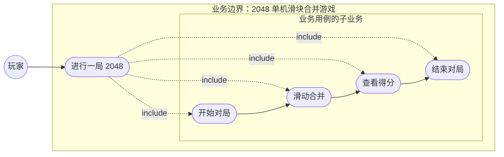

图 1  CIM-1 业务用例图 bc-01

如图 1 所示，业务执行者“玩家”画在业务边界（`subgraph`“业务边界：2048 单机滑块合并游戏”）之外，通过一条关联连线指向业务边界内唯一的业务用例“进行一局 2048”；业务用例再由四条 `include` 虚线分别指向“开始对局”“滑动合并”“查看得分”“结束对局”，这四项子业务按顺序连成一条业务链。图中不出现第二个业务执行者，也不出现系统内部的判定与计数动作——它们属于业务内部细节，按 CIM 的定义不在这一层展开。图源码见 本报告内联的图，本报告 4.2.3 节的 Mermaid 代码块即该文件的正文。

### 4.3 CIM-2 分析业务流程

CIM-2 的任务是把 CIM-1 的业务链展开成可执行的活动流程。业务流程被拆成三段、画成三张活动图：`ad-01` 一局主流程、`ad-02` 开始新局、`ad-03` 结束处理。三张图的绘制口径是：只用初始/终止节点、活动节点与判断节点，转换一律带监护条件；**不使用泳道**，因为本业务只有玩家一个实施者，随机生成、判定胜负等动作都由系统在同一业务流程内完成，不存在跨实施者的职责移交（该取舍见规范第 9 节）。

#### 4.3.1 一局主流程 ad-01

一局主流程活动图如图 2 所示。

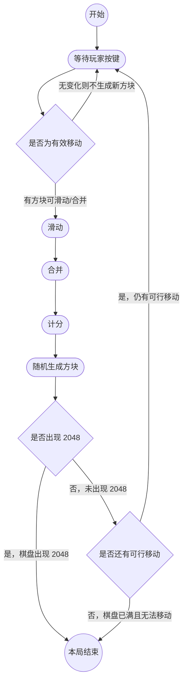

图 2  一局主流程活动图 ad-01

如图 2 所示，主流程是一个带回环的循环：等待玩家按键 → 判断是否为有效移动 →（有效）滑动 → 合并 → 计分 → 随机生成方块 → 判断是否出现 2048 →（未出现）判断是否还有可行移动 →（仍有可行移动）回到等待按键；无效移动直接回到等待按键且不生成新方块；两个判断的“是”分支都收敛到本局结束。

#### 4.3.2 开始新局 ad-02

开始新局活动图如图 3 所示。

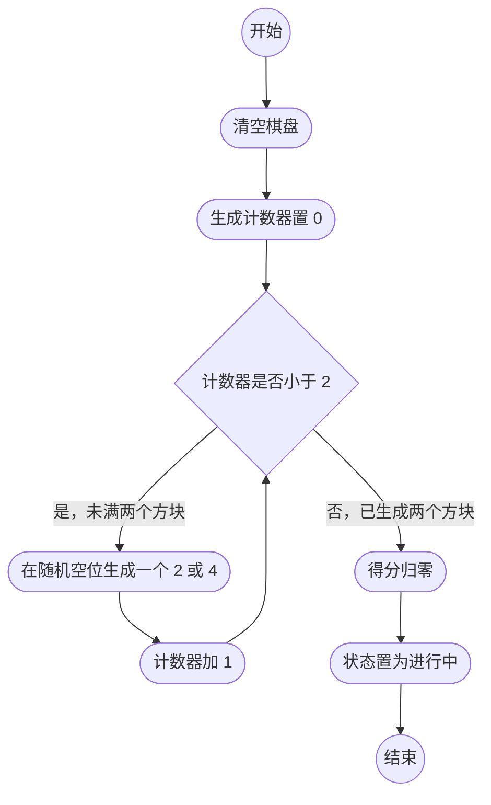

图 3  开始新局活动图 ad-02

如图 3 所示，开始新局是“清空棋盘 → 生成计数器置 0 → 循环生成两个 2 或 4 → 得分归零 → 状态置为进行中”的直线流程，只有一处循环，循环的判断条件是“计数器是否小于 2”。

#### 4.3.3 结束处理 ad-03

结束处理活动图如图 4 所示。

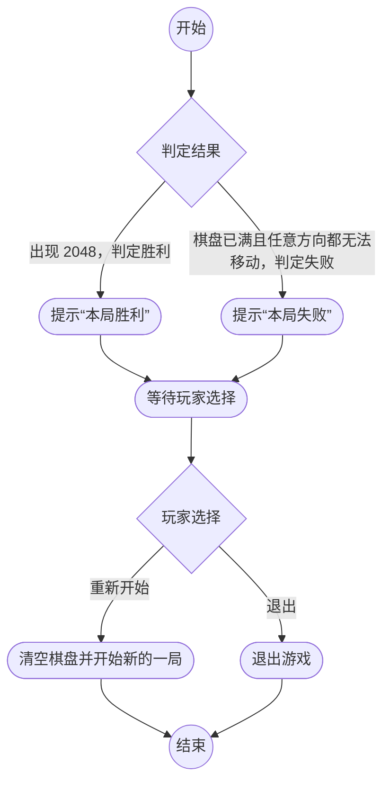

图 4  结束处理活动图 ad-03

如图 4 所示，结束处理先按判定结果分胜利、失败两支，各自提示后汇合到“等待玩家选择”，再由“玩家选择”分出“重新开始”（转回图 3 的初始节点）与“退出”两支。

#### 4.3.4 三张图的分工

表 3  三张活动图的分工

| 图 | 覆盖的业务段 | 起点 | 终点 | 主要动作 |
|---|---|---|---|---|
| `ad-01`（图 2） | 一局的主循环 | 已开局、棋盘上有两个初始方块 | 得出胜/负结果 | 等待玩家按键、滑动、合并、计分、随机生成方块、两个判断 |
| `ad-02`（图 3） | 开局准备 | 玩家启动新游戏或选择重新开始 | 状态置为进行中 | 清空棋盘、计数器置 0、循环生成两个方块、得分归零、状态置为进行中 |
| `ad-03`（图 4） | 结果处理 | 已得出判定结果 | 玩家退出或进入新一局 | 提示“本局胜利”、提示“本局失败”、等待玩家选择、清空棋盘并开始新的一局、退出游戏 |

### 4.4 CIM-3 定义系统范围

#### 4.4.1 系统边界的确定

CIM-2 的活动图是业务视角的，其中的动作分两类：一类由玩家发起（按键、选择重新开始、退出），一类由系统完成（滑动、合并、计分、生成方块、判定胜负）。CIM-3 要把“系统负责做什么”框出来，得到系统边界：

- **边界之内**：把 16 个格子的棋盘维护好、按方向滑动与合并、累加本局得分并记录最高分、在随机空位生成 2 或 4、判定胜利与失败、显示棋盘与得分。这些正是 CIM-2 中系统完成的动作。
- **边界之外**：玩家本身，以及按键这一输入手段。玩家不与系统内部的判定、计数动作直接交互。

因此**系统参与者唯一：玩家**。系统内部的随机生成、判定胜负、累计分数不是参与者；UC03、UC04、UC05 因而记为“系统（由 UC02 触发）”，不与玩家建立关联。本项目无账号体系，不设注册用户、管理员等第二参与者。

#### 4.4.2 系统用例图 uc-01

系统用例图如图 5 所示。

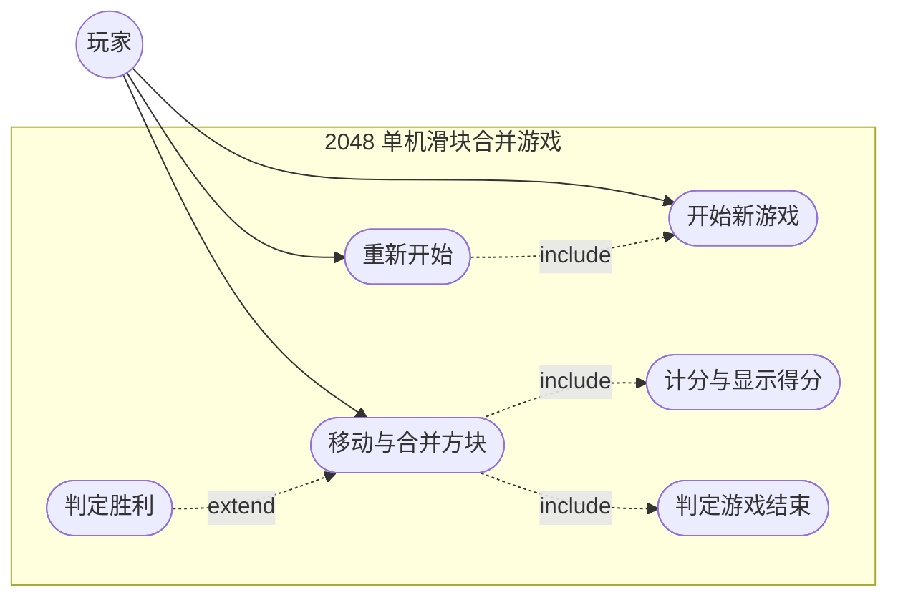

图 5  系统用例图 uc-01

如图 5 所示，系统边界内共 6 个用例，与功能 F01~F06 一一对应；玩家与 UC01、UC02、UC06 建立关联；UC02 通过 `«include»` 指向 UC03（每次有效移动后必计分）与 UC05（每次有效移动后必判定是否还有可行移动），UC06 通过 `«include»` 指向 UC01（重新开始即执行一次开始新游戏）；UC04 通过 `«extend»` 指向 UC02，扩展点为“棋盘出现数值 2048 的方块”。本系统参与者唯一、用例之间不存在父子关系，故未使用泛化关系。

#### 4.4.3 用例简述表

表 4  用例简述表

| 用例名称 | 用例编号 | 参与者 | 用例简述 |
|---|---|---|---|
| 开始新游戏 | UC01 | 玩家 | 玩家启动一局新的对局，系统清空 4×4 共 16 格棋盘并在随机空位生成两个数值为 2 或 4 的初始方块，本局得分置为 0，对局进入“进行中” |
| 移动与合并方块 | UC02 | 玩家 | 玩家按上/下/左/右方向键，系统把全部方块向该方向滑动到最远空位，相邻同值方块合并为一个双倍数值方块（同一次移动中每个方块最多只参与一次合并），有效移动后按合并所得数值累加本局得分并生成一个新方块 |
| 计分与显示得分 | UC03 | 系统（由 UC02 触发） | 每次有效移动完成合并后，系统把本次合并所得数值累加到本局得分，本局得分高于历史最高分时把最高分更新为本局得分，并刷新得分与最高分显示 |
| 判定胜利 | UC04 | 系统（由 UC02 触发） | 一次有效移动后若棋盘上出现数值 2048 的方块，系统判定本局胜利，结算本局得分并提示玩家，此后不再接受方向键输入 |
| 判定游戏结束 | UC05 | 系统（由 UC02 触发） | 一次有效移动后若棋盘 16 格已全部占用且上/下/左/右四个方向都不存在可滑动或可合并的方块，系统判定本局失败，结算本局得分并提示玩家 |
| 重新开始 | UC06 | 玩家 | 对局结束后玩家选择重新开始，系统保留最高分记录，清空棋盘、生成两个初始方块、本局得分归零，对局重新进入“进行中”并恢复接受方向键输入 |

### 4.5 PIM-1 分析系统流程

CIM-3 的用例简述只够画图，不够描述系统内部的处理顺序。PIM-1 把六条用例逐条细化：基本流程写到 5~8 步、例外流程写出具体分支、并把散落在功能描述里的判定条件归纳成可编号的业务规则。与实验二相比，本节的差别有三点：一是把“计分”“生成方块”“判定”的前后顺序固定下来；二是为每条用例指明违反哪条业务规则时走哪个例外分支；三是把用例之间的 `include`/`extend` 关系落到具体步骤号上，而不是只写在关系栏里。

#### 4.5.1 业务规则清单

业务规则从规范第 1、3 节的功能描述中归纳，共 10 条，编号 BR01~BR10，如表 5 所示；后续六份用例叙述均按编号引用。

表 5  业务规则清单

| 编号 | 业务规则 | 来源 |
|---|---|---|
| BR01 | 棋盘固定为 4×4 共 16 格，每格至多容纳一个方块，空位总数为 16 减去方块数 | 规范第 1 节 |
| BR02 | 初始方块固定为两个，每个数值取 2 或 4；随机取值不在 {2, 4} 内时必须重取，不得放置其他数值 | 规范第 1、3 节 |
| BR03 | 同一次移动中每个方块最多只参与一次合并，合并方向上的相邻同值方块两两合并 | 规范第 1 节 |
| BR04 | 一次按键只有在至少一个方块发生位移或发生合并时才算**有效移动**；只有有效移动才计分并生成新方块 | 规范第 1、3 节 |
| BR05 | 得分按本次合并所得数值之和累加；本次无合并则得分增量为 0，不得倒扣 | 规范第 3 节 |
| BR06 | 仅当本局得分严格高于历史最高分时才更新最高分；最高分跨局保留，开局与重新开始都不清零 | 规范第 3 节 |
| BR07 | 棋盘出现数值 2048 的方块即判定胜利，且胜利判定优先于失败判定，同一局不得同时得出胜负两个结论 | 规范第 1 节 |
| BR08 | 棋盘 16 格全满且上/下/左/右四个方向都不存在相邻同值方块时判定失败 | 规范第 1、3 节 |
| BR09 | 对局状态为“胜利”或“失败”后不再接受方向键输入，只接受重新开始与退出 | 规范第 5 节、`st-01` |
| BR10 | 重新开始保留最高分，清空棋盘、本局得分归零、生成两个初始方块并把状态置为“进行中” | 规范第 3 节、第 4 节 UC06 包含 UC01 |

#### 4.5.2 UC01 开始新游戏

表 6  UC01 开始新游戏的用例叙述

| 栏目 | 内容 |
|---|---|
| 用例名称 / 编号 | 开始新游戏 / UC01 |
| 参与者 | 玩家 |
| 前置条件 | 系统已启动；当前对局状态为“未开始”或“已结束”，没有进行中的对局 |
| 后置条件 | 16 格全部为空后重新放入两个数值为 2 或 4 的方块；本局得分为 0，步数为 0；对局状态为“进行中”；最高分显示为 `Record.最高分` 的当前值，未被清零 |
| 基本流程 | 1) 玩家选择“开始新游戏” 2) 系统把 4×4 共 16 个格子全部置为空，空格数恢复为 16 3) 系统把已生成方块计数器置为 0 4) 系统在当前空位中随机取一格，随机取数值 2 或 4，放置第一个初始方块，计数器加 1 5) 系统在剩余空位中再随机取一格，随机取数值 2 或 4，放置第二个初始方块，计数器加 1，此时计数器等于 2，结束生成循环 6) 系统把本局得分与步数置为 0，读取记录中的最高分作为显示值 7) 系统把对局状态置为“进行中” 8) 系统刷新棋盘、得分与最高分显示，开始接受方向键输入 |
| 例外流程 | 1) **随机数值越界**（违反 BR02）：步骤 4) 或 5) 取到的数值不在 {2, 4} 内时，系统丢弃该数值并重新取，直到取到 2 或 4 才放置方块，步骤编号与后续顺序不变 2) **玩家取消**：步骤 2) 之前玩家取消本次操作，系统不改动棋盘、得分与状态，用例结束，对局仍停留在“未开始”或“已结束” 3) **重复开局**：若当前状态已为“进行中”，系统要求先结束或退出本局，不执行步骤 2)，直接结束本用例，避免覆盖正在进行的对局 |
| 业务规则 | BR01（16 格）、BR02（两个初始方块、数值 2 或 4）、BR06（最高分跨局保留） |
| 与其他用例的关系 | 无被包含用例；UC01 自身被 UC06 包含（UC06 的步骤 3) 即本用例） |
| 对应图 | 图 3 `ad-02`、图 9 `sq-01` |

#### 4.5.3 UC02 移动与合并方块

表 7  UC02 移动与合并方块的用例叙述

| 栏目 | 内容 |
|---|---|
| 用例名称 / 编号 | 移动与合并方块 / UC02 |
| 参与者 | 玩家 |
| 前置条件 | 对局状态为“进行中”；棋盘上至少有一个方块；键盘输入被接受（依 BR09，胜利或失败后不接受输入） |
| 后置条件 | 全部方块已向所按方向滑动到位并完成合并；若本次为有效移动，得分已累加、随机空位已生成一个新方块、步数加 1；对局状态可能因 UC04 变为“胜利”或因 UC05 变为“失败”；棋盘与得分显示已刷新 |
| 基本流程 | 1) 玩家按下上/下/左/右方向键中的一个 2) 系统判断该方向上是否存在可滑动的方块或可合并的同值相邻方块 3) 存在时，系统把全部方块沿该方向滑动到最远空位，记录本次是否发生位移 4) 系统在滑动到位后的相邻关系上把同值方块两两合并为一个双倍数值方块，并记录本次每个方块的合并次数不超过 1 次 5) 系统把本次合并所得数值之和交给 UC03 计分并刷新得分与最高分显示（`«include»` UC03） 6) 系统在随机空位生成一个数值为 2 或 4 的新方块，步数加 1 7) 系统检查棋盘是否出现数值 2048 的方块，出现时执行 UC04 判定胜利（`«extend»`，扩展点“棋盘出现数值 2048 的方块”） 8) 系统在未出现 2048 时执行 UC05 判定游戏结束（`«include»` UC05），随后刷新棋盘显示，等待玩家下一次按键 |
| 例外流程 | 1) **无效移动**（BR04）：步骤 2) 判定既无位移也无合并时不执行步骤 3)~8)，系统不合并、不计分、不生成新方块、步数不变，直接回到等待按键 2) **棋盘已满**（BR01）：步骤 6) 时若空格数为 0，系统跳过生成，直接进入步骤 7) 与 8) 的判定 3) **判定胜利后不再判负**（BR07）：步骤 7) 判定胜利时系统置状态为“胜利”并提示，跳过步骤 8) 中的失败判定，不再接受方向键输入（BR09） 4) **判定失败**（BR08）：步骤 8) 判定失败时系统置状态为“失败”并提示，不再接受方向键输入（BR09） 5) **输入被拒绝**（BR09）：若当前状态已为“胜利”或“失败”，系统不执行步骤 2)~8)，直接忽略本次按键 |
| 业务规则 | BR01、BR03（每方块每步最多合并一次）、BR04（有效移动才计分并生成）、BR07（胜利优先）、BR08（失败条件）、BR09（结束后不接受输入） |
| 与其他用例的关系 | 包含 UC03、UC05；被 UC04 扩展（扩展点“棋盘出现数值 2048 的方块”） |
| 对应图 | 图 2 `ad-01`、图 10 `sq-02` |

#### 4.5.4 UC03 计分与显示得分

表 8  UC03 计分与显示得分的用例叙述

| 栏目 | 内容 |
|---|---|
| 用例名称 / 编号 | 计分与显示得分 / UC03 |
| 参与者 | 系统（由 UC02 触发） |
| 前置条件 | UC02 的一次有效移动已完成合并，本次合并所得的全部数值已确定；被 UC02 在步骤 5) 调用 |
| 后置条件 | 本局得分已累加本次合并所得数值之和；若累加后严格高于历史最高分，最高分已更新为该值；得分与最高分已显示 |
| 基本流程 | 1) 系统取得本次移动中所有合并所得数值，求和得到本次得分增量 2) 系统把该增量累加到本局得分，增量可以为 0 3) 系统读取记录中的历史最高分 4) 系统比较本局得分与历史最高分 5) 本局得分严格高于历史最高分时，系统把最高分更新为本局得分，并刷新记录中的最近得分与时间戳 6) 系统刷新本局得分与最高分的显示 7) 系统把控制权返回 UC02 的步骤 6)，继续生成新方块 |
| 例外流程 | 1) **本次无合并**（BR05）：步骤 1) 取得的增量为 0，本局得分与最高分均不变，只刷新显示后返回 UC02 2) **得分与最高分持平**（BR06）：本局得分等于历史最高分时不更新最高分，显示保持不变，返回 UC02 3) **记录为空或不可读**：系统以 0 作为历史最高分参与比较，并在步骤 5) 写回新值；若本局得分也为 0，则最高分保持 0，不写回 4) **非计分来源触发**：若本用例被除 UC02 之外的路径调用，系统不改动得分，直接返回调用方 |
| 业务规则 | BR05（按合并值累加、不倒扣）、BR06（严格大于才更新、跨局保留） |
| 与其他用例的关系 | 被 UC02 包含；自身不包含、不扩展其他用例 |
| 对应图 | 图 11 `sq-03` |

#### 4.5.5 UC04 判定胜利

表 9  UC04 判定胜利的用例叙述

| 栏目 | 内容 |
|---|---|
| 用例名称 / 编号 | 判定胜利 / UC04 |
| 参与者 | 系统（由 UC02 触发） |
| 前置条件 | UC02 的一次有效移动已完成合并、计分与生成；对局状态为“进行中” |
| 后置条件 | 出现数值 2048 时，对局状态为“胜利”，本局已结算、玩家已被提示，且不再接受方向键输入；否则对局状态保持“进行中”，控制权返回 UC02 |
| 基本流程 | 1) 系统遍历棋盘 16 个格子中已占用的格子 2) 系统逐个比较格子中方块的数值与 2048 3) 找到数值为 2048 的方块时，系统把对局状态置为“胜利” 4) 系统结算本局：把本局得分与该局步数写入记录，按 BR06 更新最高分 5) 系统提示玩家“本局胜利” 6) 系统停止接受方向键输入，只接受重新开始（UC06）与退出 |
| 例外流程 | 1) **未出现 2048**：遍历结束后不存在数值 2048 的方块时，系统不改变状态、不结算、不提示，返回 UC02 的步骤 8) 2) **多个 2048 并存**：棋盘上同时存在多个数值 2048 的方块时，系统只置一次“胜利”、只结算一次、只提示一次，不重复触发本用例 3) **状态已定**（BR09）：对局状态已为“胜利”或“失败”时，系统不再执行本用例，直接返回 4) **与失败判定冲突**（BR07）：若同一次移动后棋盘既出现 2048 又已无可行移动，按 BR07 只判胜利，不进入 UC05 |
| 业务规则 | BR06（结算时更新最高分）、BR07（胜利优先）、BR09（结束后只接受重新开始与退出） |
| 与其他用例的关系 | 扩展 UC02（扩展点“棋盘出现数值 2048 的方块”）；自身不被包含 |
| 对应图 | 图 12 `sq-04` |

#### 4.5.6 UC05 判定游戏结束

表 10  UC05 判定游戏结束的用例叙述

| 栏目 | 内容 |
|---|---|
| 用例名称 / 编号 | 判定游戏结束 / UC05 |
| 参与者 | 系统（由 UC02 触发） |
| 前置条件 | 一次有效移动已完成合并、计分与随机生成；对局状态为“进行中”；被 UC02 在步骤 8) 调用 |
| 后置条件 | 棋盘已满且四个方向都无可移动时，对局状态为“失败”，本局已结算、玩家已被提示，且不再接受方向键输入；否则状态保持“进行中” |
| 基本流程 | 1) 系统检查棋盘 16 个格子的空格数是否为 0 2) 空格数为 0 时，系统逐格检查该格的上、下、左、右四个相邻格 3) 系统判断是否存在相邻且数值相同的两个方块 4) 四个方向都不存在相邻同值方块时，系统把对局状态置为“失败” 5) 系统结算本局：把本局得分与步数写入记录，按 BR06 更新最高分 6) 系统提示玩家“本局失败” 7) 系统停止接受方向键输入，只接受重新开始（UC06）与退出 |
| 例外流程 | 1) **仍有空格**（BR01）：步骤 1) 空格数大于 0 时，系统判定仍可移动，状态保持“进行中”，返回 UC02，不提示失败 2) **已满但可合并**：空格数为 0 但存在相邻同值方块时，系统判定仍可移动，状态保持“进行中”，返回 UC02 3) **生成被跳过**：若本次有效移动后棋盘已无空位而未生成新方块（UC02 例外 2)），系统直接以当前棋盘执行步骤 1) 4) **状态已为胜利**（BR07）：对局状态已为“胜利”时系统跳过本用例，胜利优先于失败 5) **状态已为失败**（BR09）：已为“失败”时不再重复判定与提示，直接返回 |
| 业务规则 | BR01（16 格全满）、BR07（胜利优先）、BR08（失败条件）、BR09（结束后只接受重新开始与退出） |
| 与其他用例的关系 | 被 UC02 包含；自身不扩展其他用例 |
| 对应图 | 图 13 `sq-05` |

#### 4.5.7 UC06 重新开始

表 11  UC06 重新开始的用例叙述

| 栏目 | 内容 |
|---|---|
| 用例名称 / 编号 | 重新开始 / UC06 |
| 参与者 | 玩家 |
| 前置条件 | 对局状态为“胜利”或“失败”，结果已提示玩家；若状态为“未开始”，玩家也可直接重新开始 |
| 后置条件 | 棋盘已清空并放入两个初始方块，本局得分与步数为 0，对局状态为“进行中”，最高分记录保持为最近一次更新后的值 |
| 基本流程 | 1) 玩家在结果提示界面选择“重新开始” 2) 系统读取记录中的最高分并保留其当前值，不清零 3) 系统执行 UC01 开始新游戏：清空 16 格、生成两个初始方块、得分与步数归零、状态置为“进行中”（`«include»` UC01） 4) 系统刷新棋盘与得分显示，把最高分显示为步骤 2) 保留的值 5) 系统恢复接受方向键输入，本用例结束 |
| 例外流程 | 1) **玩家不重开**：玩家在结果界面选择退出，系统不执行本用例，对局状态停留在“胜利”或“失败”，最高分保持最近一次更新后的值 2) **状态为未开始**：玩家在开局之前选择重新开始，系统跳过步骤 2)，直接按步骤 3) 执行 UC01 3) **UC01 内部异常**（BR02）：UC01 生成初始方块时取到不在 {2, 4} 内的数值，按 UC01 例外 1) 重取，本用例步骤顺序不变 4) **状态为进行中**：对局正在进行时玩家选择重新开始，系统要求先结束或退出本局，不执行步骤 3)，当前对局与得分不受影响 |
| 业务规则 | BR10（重新开始的四要素）、BR06（最高分保留）、BR02（初始方块数值） |
| 与其他用例的关系 | 包含 UC01；自身不被其他用例包含 |
| 对应图 | 图 4 `ad-03`、图 14 `sq-06` |

### 4.6 PIM-2 分析业务规则

PIM-1 把规则写成了条文，PIM-2 把规则落到对象的状态上：一个对象有哪些状态、状态之间由什么事件迁移、哪些规则充当迁移的监护条件。本项目为两个重要业务对象建模——粗粒度的对局（`Game`）与细粒度的方块（`Tile`）。

#### 4.6.1 对局状态机 st-01

对局状态机如图 6 所示。

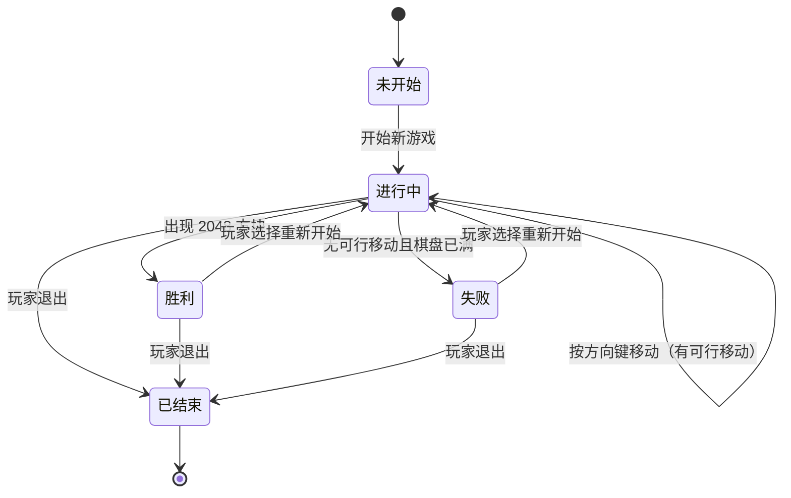

图 6  对局状态机 st-01

如图 6 所示，对局经历未开始 → 进行中 →（胜利 | 失败）→ 已结束，共五个状态；`进行中 → 进行中` 是自迁移，表示一次有效移动不改变对局状态，只改变棋盘、得分与步数；胜利与失败都可通过“玩家选择重新开始”直接回到进行中，因为 UC06 包含 UC01。

#### 4.6.2 方块状态机 st-02

方块状态机如图 7 所示。

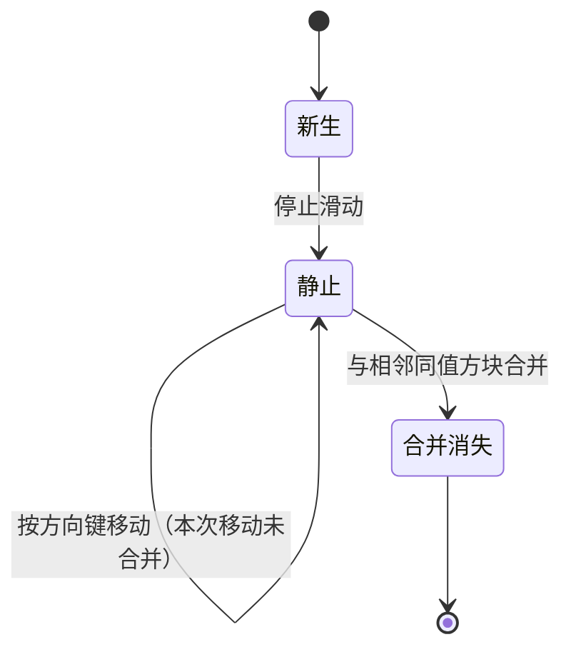

图 7  方块状态机 st-02

如图 7 所示，单个方块经历新生 → 静止 → 合并消失：新生是刚由随机生成或合并产生、尚未完成滑动的状态；静止表示已落位并处理完毕；合并消失是终止态，被合并的方块对象从棋盘移除，合并结果由一个新的方块对象承载，因此不存在“合并消失 → 新生”的迁移。

#### 4.6.3 状态说明表

表 12  状态说明表

| 对象 | 状态 | 含义 | 进入动作 | 离开事件 | 相关业务规则 |
|---|---|---|---|---|---|
| 对局（`Game`） | 未开始 | 对局对象已创建，棋盘为空，尚未生成任何方块 | 得分、步数保持，状态置为未开始，等待玩家操作 | 开始新游戏 | BR01、BR10 |
| 对局（`Game`） | 进行中 | 棋盘上有方块，等待玩家按方向键，或正在处理一次移动 | 清空棋盘并生成两个初始方块（2 或 4），得分与步数归零，最高分取记录值 | 出现 2048 方块；无可行移动且棋盘已满；玩家退出 | BR02、BR04、BR05、BR06 |
| 对局（`Game`） | 胜利 | 棋盘上已存在数值 2048 的方块，本局达成胜利条件 | 结算本局得分与步数，本局得分严格高于最高分时更新最高分，提示玩家胜利 | 玩家选择重新开始；玩家退出 | BR06、BR07、BR09 |
| 对局（`Game`） | 失败 | 棋盘 16 格已满且四个方向均无法移动，本局无法继续 | 结算本局得分与步数，本局得分严格高于最高分时更新最高分，提示玩家失败 | 玩家选择重新开始；玩家退出 | BR06、BR08、BR09 |
| 对局（`Game`） | 已结束 | 本局终止，对象即将销毁，不再响应任何游戏事件 | 释放棋盘与方块占用的资源 | 无（终止态） | BR09 |
| 方块（`Tile`） | 新生 | 方块刚由随机生成或合并产生，尚未完成一次完整滑动 | 确定数值与行、列，把“是否新生成”置为真 | 停止滑动 | BR02、BR03 |
| 方块（`Tile`） | 静止 | 方块位于某格且已处理完毕，等待下一次移动 | 把“是否新生成”置为假 | 与相邻同值方块合并；按方向键移动（未合并，自迁移）；对局结束（随棋盘销毁） | BR01、BR03、BR04 |
| 方块（`Tile`） | 合并消失 | 方块被同值相邻方块合并，正从棋盘移除 | 数值累加到合并结果方块，从棋盘移除并释放格子，空格数加一 | 无（终止态） | BR03、BR05 |

状态图中的监护条件正是业务规则的落点：`进行中 → 胜利` 的监护条件“棋盘上存在数值 2048 的方块”是 BR07，`进行中 → 失败` 的监护条件“16 格全满且四个方向均不可移动”是 BR08，`静止 → 合并消失` 的监护条件“相邻同值且本步内尚未合并”是 BR03，`胜利 / 失败 → 进行中` 的“玩家选择重新开始”是 BR10。由于 BR09 规定结束后不再接受方向键输入，`胜利 → 进行中` 与 `失败 → 进行中` 上不出现“按方向键移动”的迁移。

### 4.7 PIM-3 定义静态结构

PIM-3 从 PIM-1 的用例叙述与 PIM-2 的状态图中抽取名词与动词，得到静态结构。候选名词经合并同义、排除系统外部名词、去掉只能作属性的名词后，剩下 4 个分析类：`Game`（对局）、`Board`（棋盘）、`Tile`（方块）、`Record`（记录）；另有枚举 `GameState` 作为 `状态` 的类型，`Direction` 仅作操作参数类型，二者都不单独成类。

#### 4.7.1 类图 cd-01

类图如图 8 所示。

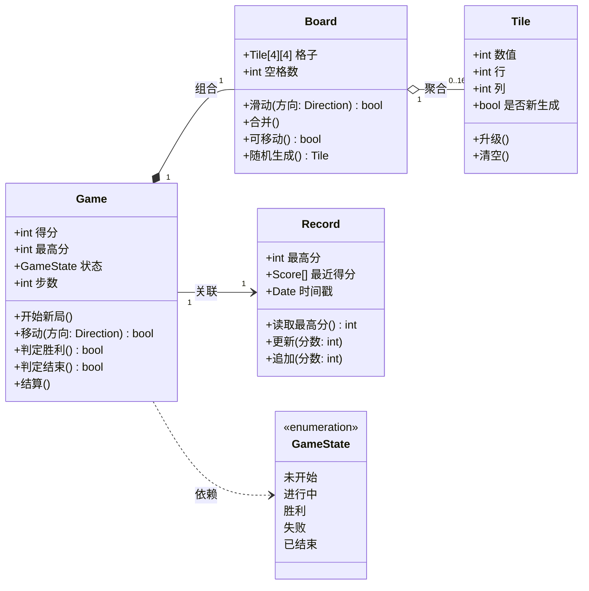

图 8  类图 cd-01

如图 8 所示，`Game` 组合 `Board`（1:1，对局销毁则棋盘销毁），`Board` 聚合 `Tile`（1:0..16，方块可独立于棋盘存在），`Game` 关联 `Record`（1:1，读写最高分与最近得分），`Game` 依赖 `GameState`（枚举：未开始/进行中/胜利/失败/已结束）。类间不使用泛化关系。

#### 4.7.2 类说明表

表 13  类说明表

| 类名 | 属性 | 操作 |
|---|---|---|
| `Game`（对局） | 得分: int；最高分: int；状态: GameState；步数: int | 开始新局()；移动(方向: Direction): bool；判定胜利(): bool；判定结束(): bool；结算() |
| `Board`（棋盘） | 格子: Tile[4][4]；空格数: int | 滑动(方向: Direction): bool；合并()；可移动(): bool；随机生成(): Tile |
| `Tile`（方块） | 数值: int；行: int；列: int；是否新生成: bool | 升级()；清空() |
| `Record`（记录） | 最高分: int；最近得分: Score[]；时间戳: Date | 读取最高分(): int；更新(分数: int)；追加(分数: int) |

#### 4.7.3 状态与静态结构的对应

表 14  状态、业务规则与类成员的对应

| PIM-2 的状态或规则 | 落到的类与成员 |
|---|---|
| 对局的五个状态 | `Game.状态: GameState`（`GameState` 取值恰好是未开始、进行中、胜利、失败、已结束） |
| 胜利、失败的进入动作“结算” | `Game.结算()`，由 `Game.判定胜利()`、`Game.判定结束()` 置状态后调用 |
| BR01 的 16 格与空位 | `Board.格子: Tile[4][4]`、`Board.空格数` |
| BR03 的合并限制、BR04 的有效移动 | `Board.滑动(方向): bool` 返回是否位移、`Board.合并()` 完成两两合并 |
| BR02 的随机生成 | `Board.随机生成(): Tile` |
| BR06 的最高分更新 | `Record.更新(分数: int)`、`Record.读取最高分(): int` |
| 方块的产生与消失 | `Tile.升级()`、`Tile.清空()` |

### 4.8 PIM-4 定义操作及方法

PIM-4 用顺序图把 PIM-1 的每一步基本流程落到对象之间的消息顺序上，六张顺序图与六条用例一一对应。顺序图只描述消息的先后次序；激活期由绘图工具自动生成并覆盖整条生命线，本报告不强调激活期的粒度（该取舍见规范第 9 节）。六张图沿用实验六已成图的消息顺序，图上未展开的消息（如 `Game.结算()` 向 `Record` 写入得分）在用例叙述 PIM-1 中保留，两者不矛盾：图记录的是必须按序交互的消息，叙述记录的是该用例的全部职责。

#### 4.8.1 UC01 开始新游戏（图 9）

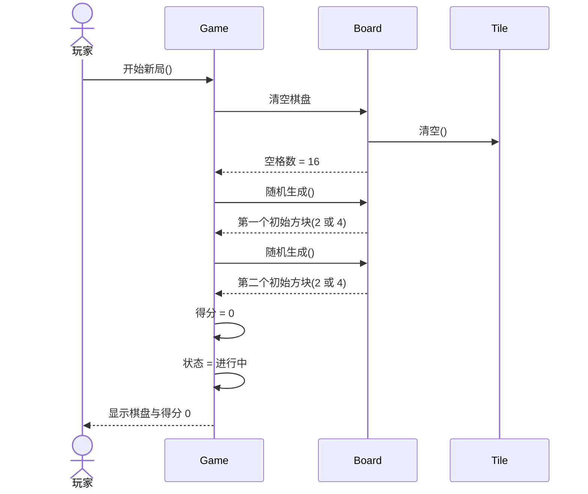

图 9  UC01 开始新游戏顺序图 sq-01

如图 9 所示，`sq-01` 实现了 UC01：玩家向 `Game` 发出“开始新局”，`Game` 委托 `Board` 清空格子（由 `Tile.清空()` 释放格子）并连续两次调用 `Board.随机生成()`，再把得分置 0、状态置为“进行中”，最后向玩家显示棋盘与得分 0。

#### 4.8.2 UC02 移动与合并方块（图 10）

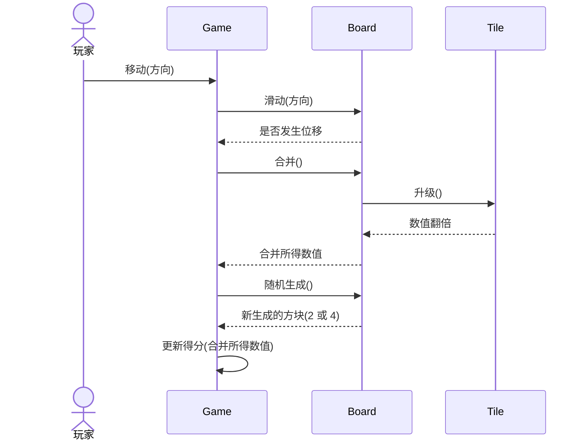

图 10  UC02 移动与合并方块顺序图 sq-02

如图 10 所示，`sq-02` 实现了 UC02：玩家按键后 `Game.移动(方向)` 先调用 `Board.滑动(方向)` 取得本次是否有位移，再调用 `Board.合并()` 由 `Tile.升级()` 完成翻倍并返回合并所得数值，随后调用 `Board.随机生成()` 补一个新方块，最后由 `Game` 按合并所得数值更新得分。该图把“更新得分”排在“生成新方块”之后，与 PIM-1 UC02 的步骤 5)、6) 只差先后位置；计分所用的数值在合并时已经确定、生成动作不改变它，两种次序的结果等价。

#### 4.8.3 UC03 计分与显示得分（图 11）

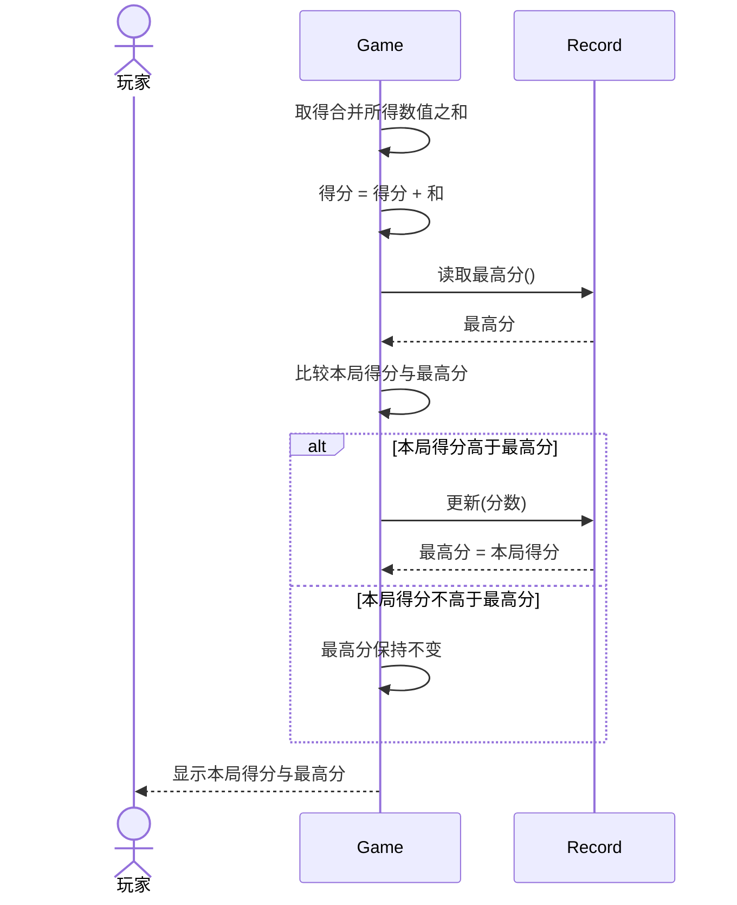

图 11  UC03 计分与显示得分顺序图 sq-03

如图 11 所示，`sq-03` 实现了 UC03：`Game` 取得本次合并所得数值之和后累加到 `得分`，再用 `Record.读取最高分()` 与 `Record.更新(分数)` 完成最高分的比较与更新，并把结果显示给玩家。

#### 4.8.4 UC04 判定胜利（图 12）

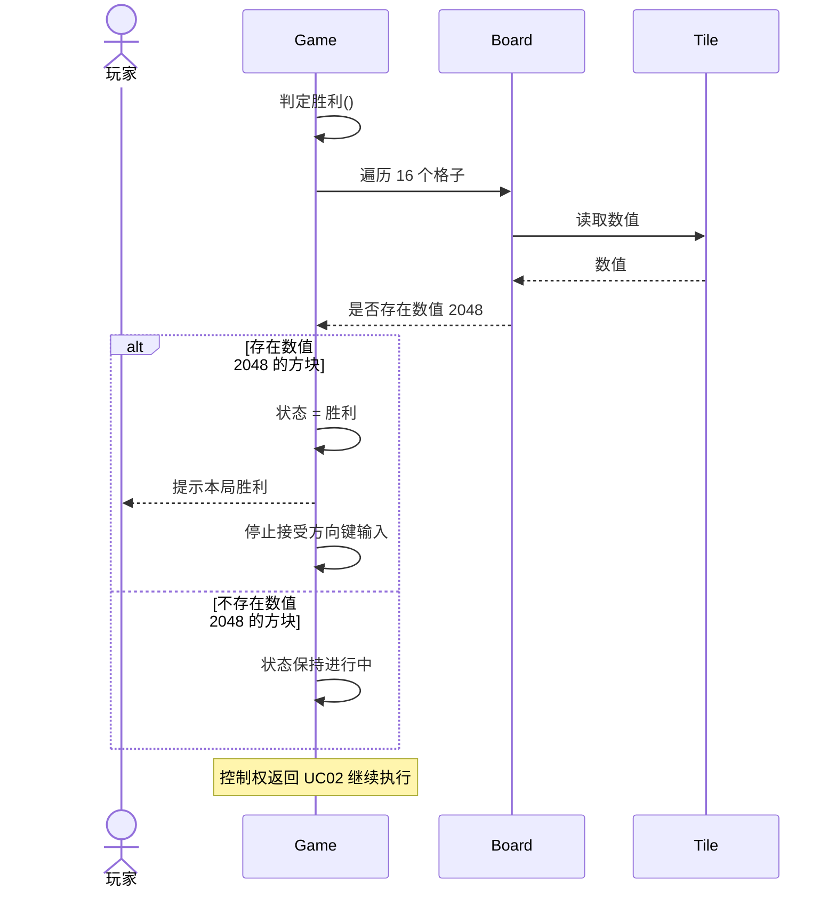

图 12  UC04 判定胜利顺序图 sq-04

如图 12 所示，`sq-04` 实现了 UC04：`Game.判定胜利()` 委托 `Board` 遍历 16 个格子、逐格读取 `Tile` 的数值，为真时把状态置为“胜利”，再向玩家提示本局胜利并停止接受方向键输入；本局结算（把得分写入 `Record`）是 PIM-1 UC04 步骤 4) 的职责，该图未展开这条消息。

#### 4.8.5 UC05 判定游戏结束（图 13）

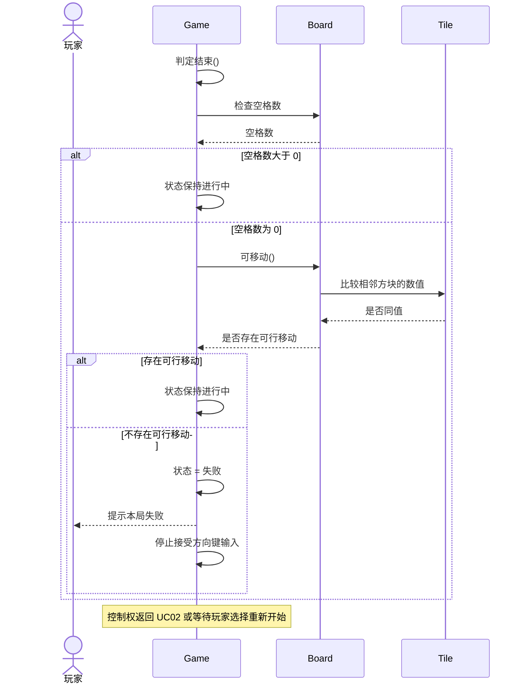

图 13  UC05 判定游戏结束顺序图 sq-05

如图 13 所示，`sq-05` 实现了 UC05：`Game.判定结束()` 先向 `Board` 检查空格数，空格数为 0 时再调用 `Board.可移动()` 比较相邻方块的数值，四个方向都不可移动时把状态置为“失败”，向玩家提示本局失败并停止接受方向键输入；本局结算同样属于 PIM-1 UC05 步骤 5) 的职责，该图未展开这条消息。

#### 4.8.6 UC06 重新开始（图 14）

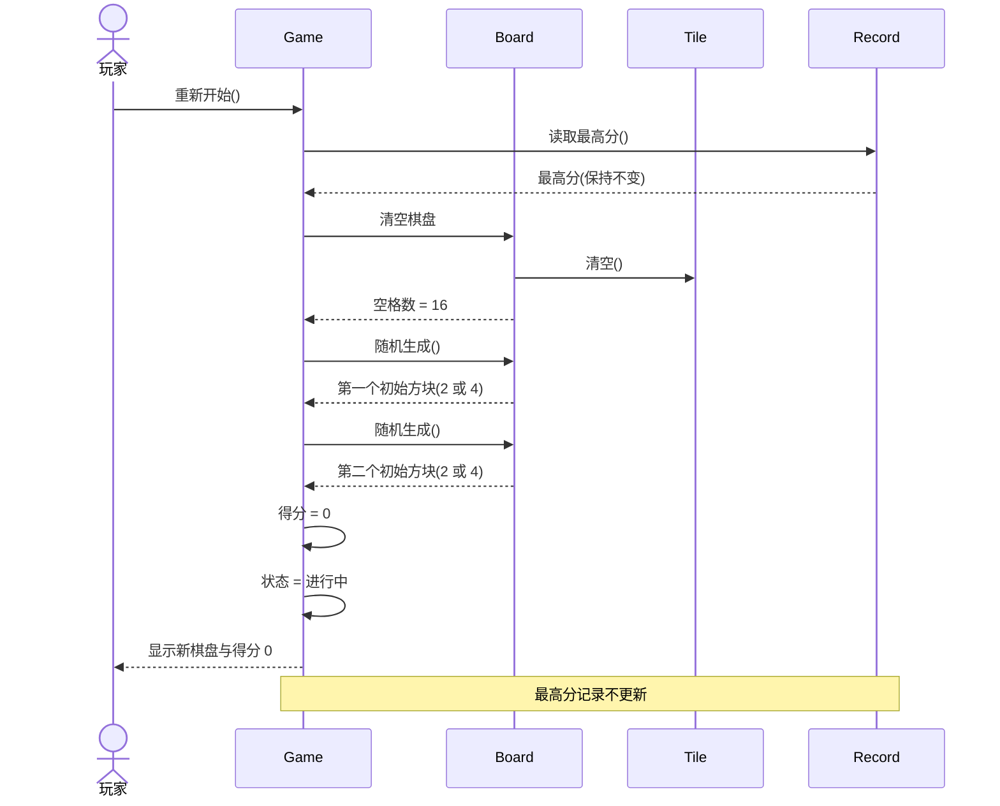

图 14  UC06 重新开始顺序图 sq-06

如图 14 所示，`sq-06` 实现了 UC06：玩家选择重新开始后，`Game` 先在 `Record` 上读取并保留最高分，再直接执行 UC01 的清空、两次 `Board.随机生成()`、得分归零与状态置为“进行中”，最后向玩家显示新棋盘；图中“最高分保持不变”的注释对应 BR06。

#### 4.8.7 顺序图与用例、操作的对应

表 15  顺序图、用例与操作的对应关系

| 图号 | 图源码 | 实现的用例 | 主要操作 |
|---|---|---|---|
| 图 9 | `sq-01` | UC01 开始新游戏 | `Game.开始新局()`、`Board.随机生成()`（两次）、`Tile.清空()` |
| 图 10 | `sq-02` | UC02 移动与合并方块 | `Game.移动(方向)`、`Board.滑动(方向)`、`Board.合并()`、`Board.随机生成()` |
| 图 11 | `sq-03` | UC03 计分与显示得分 | `Record.读取最高分()`、`Record.更新(分数)` |
| 图 12 | `sq-04` | UC04 判定胜利 | `Game.判定胜利()`、`Board` 遍历格子、`Tile.数值` 读取 |
| 图 13 | `sq-05` | UC05 判定游戏结束 | `Game.判定结束()`、`Board.空格数`、`Board.可移动()` |
| 图 14 | `sq-06` | UC06 重新开始 | `Game` 重新开始、`Record.读取最高分()`、`Board.随机生成()`（两次） |

### 4.9 阶段之间的对应关系

#### 4.9.1 CIM-1 业务执行者 → CIM-3 系统参与者

表 16  业务执行者到系统参与者的映射

| CIM-1 业务执行者 | CIM-3 系统参与者 | 映射依据 |
|---|---|---|
| 玩家（Player） | 玩家（Player），唯一参与者 | 业务上只有玩家使用业务并从中获得价值，系统边界框定后玩家仍在边界之外，参与者数量不因细化而增加；规范第 2 节“本系统参与者唯一” |
| 无第二业务执行者 | 无第二参与者 | 本项目无账号体系，不涉及注册、登录、密码、权限；随机生成、判定胜负、累计分数是系统内部行为，不升级为参与者 |

映射结果是“一对一、无新增”：业务用例“进行一局 2048”由玩家触发，细化到系统后仍由玩家触发 UC01、UC02、UC06；UC03、UC04、UC05 的操作者记为“系统（由 UC02 触发）”，它们没有业务执行者意义上的发起人，因此在系统用例图中不与玩家连线。

#### 4.9.2 CIM-1 子业务 → CIM-2 活动图 → CIM-3 系统用例

表 17  子业务到活动图、系统用例的映射

| CIM-1 子业务 | CIM-2 承载图 | CIM-3 系统用例 |
|---|---|---|
| 开始对局 | 图 3 `ad-02` | UC01 开始新游戏 |
| 滑动合并 | 图 2 `ad-01` | UC02 移动与合并方块 |
| 查看得分 | 图 2 `ad-01`、图 4 `ad-03` | UC03 计分与显示得分、UC04 判定胜利、UC05 判定游戏结束 |
| 结束对局 | 图 4 `ad-03` | UC06 重新开始（含 UC01） |

#### 4.9.3 CIM-2 活动图中的动作 → CIM-3 系统用例

表 18  活动图动作到系统用例的映射

| 序号 | 活动图与动作 | 动作性质 | CIM-3 系统用例 | 说明 |
|---|---|---|---|---|
| 1 | 图 3 `ad-02`：清空棋盘 | 系统动作 | UC01 开始新游戏 | 步骤 2) 把 16 格置空 |
| 2 | 图 3 `ad-02`：在随机空位生成一个 2 或 4（循环两次） | 系统动作 | UC01 开始新游戏 | 步骤 4)、5) 生成两个初始方块 |
| 3 | 图 3 `ad-02`：得分归零 | 系统动作 | UC01 开始新游戏 | 步骤 6) 本局得分置 0，最高分保留 |
| 4 | 图 3 `ad-02`：状态置为进行中 | 系统动作 | UC01 开始新游戏 | 步骤 7) 置状态 |
| 5 | 图 2 `ad-01`：等待玩家按键 | 玩家动作 | UC02 移动与合并方块 | 步骤 1) 玩家按方向键启动用例 |
| 6 | 图 2 `ad-01`：是否为有效移动（判断） | 系统判定 | UC02 移动与合并方块 | 步骤 2)，对应 BR04；否则为无效移动分支 |
| 7 | 图 2 `ad-01`：滑动 | 系统动作 | UC02 移动与合并方块 | 步骤 3) `Board.滑动(方向)` |
| 8 | 图 2 `ad-01`：合并 | 系统动作 | UC02 移动与合并方块 | 步骤 4) `Board.合并()`，对应 BR03 |
| 9 | 图 2 `ad-01`：计分 | 系统动作 | UC03 计分与显示得分 | UC02 步骤 5) 的 `«include»` 目标 |
| 10 | 图 2 `ad-01`：随机生成方块 | 系统动作 | UC02 移动与合并方块 | 步骤 6)，对应 BR01 的空位约束 |
| 11 | 图 2 `ad-01`：是否出现 2048（判断） | 系统判定 | UC04 判定胜利 | UC02 步骤 7)，对应扩展点与 BR07 |
| 12 | 图 2 `ad-01`：是否还有可行移动（判断） | 系统判定 | UC05 判定游戏结束 | UC02 步骤 8) 的 `«include»` 目标，对应 BR08 |
| 13 | 图 4 `ad-03`：提示“本局胜利” | 系统动作 | UC04 判定胜利 | 步骤 5) 提示玩家 |
| 14 | 图 4 `ad-03`：提示“本局失败” | 系统动作 | UC05 判定游戏结束 | 步骤 6) 提示玩家 |
| 15 | 图 4 `ad-03`：等待玩家选择 | 玩家动作 | UC06 重新开始 | 步骤 1) 玩家在结果界面选择 |
| 16 | 图 4 `ad-03`：清空棋盘并开始新的一局 | 系统动作 | UC06 重新开始（含 UC01） | 步骤 3) `«include»` UC01，转回 `ad-02` 初始节点 |
| 17 | 图 4 `ad-03`：退出游戏 | 玩家动作 | 无对应用例 | 退出不属于系统功能 F01~F06，故不设用例，仅在 `st-01` 中作为 `已结束` 的迁移事件 |

映射后的核对结论有两条：一是活动图中的每个活动节点都能找到归属的用例，17 个动作中 16 个映射到 UC01~UC06，只有“退出游戏”落在系统功能之外；二是每个用例都能在活动图中找到动作来源，不存在没有流程支撑的用例。三张活动图里没有画泳道，因此活动图到用例的映射不按“实施者分区”进行，而按动作性质（玩家动作/系统动作/系统判定）进行，这与参与者唯一的口径一致。

## 五、实验数据分析与讨论

七个步骤中，**信息丢失最多的是 CIM-3 → PIM-1 这一步**，即从“系统用例图 + 一句话用例简述”到“细化的用例叙述”。

判断依据有三条。第一是**顺序信息的丢失**：CIM-3 的用例图只有参与者、用例与 include/extend 关系，图本身不含任何先后次序；一句话简述也只说明“做什么”，不说明“先做什么、后做什么”。例如 UC02 的简述只写到“滑动、合并、有效移动后计分并生成新方块”，而“计分必须在合并之后、生成新方块之前”“生成之后才判 2048，判出 2048 就不再判失败”这类顺序约束，在 CIM-3 的产物里完全没有记录。第二是**条件信息的丢失**：判定条件在 CIM-3 只有 UC04 的扩展点“棋盘出现数值 2048 的方块”一句话，UC05 的失败条件、无效移动的判定、最高分“严格大于才更新”都无处存放，最终只能在 PIM-1 里归纳成 BR01~BR10 十条规则才写得清楚。第三是**状态信息的丢失**：CIM-3 的简述不写前置条件与后置条件，用例执行前后对局处于哪个状态无法确定——“开始新游戏”之后状态是“进行中”还是“未开始”、“重新开始”是否清零最高分，这些都必须靠 PIM-1 补写前置/后置条件才能固定下来，随后才能交给 PIM-2 画 `st-01`。

对比之下，其余几步的丢失较小，可作为反证：CIM-1 → CIM-2 只是把四项子业务展开成活动，动作没有减少，只是增加了判断节点与回环，属于“加信息”而非“丢信息”；CIM-2 → CIM-3 丢掉的是活动图中的回环与判断细节，但这些细节仍留在活动图里，且参与者唯一使得“去掉泳道”不损失任何实施者信息；PIM-2 → PIM-3 丢的是时序，但类图本就不表达时序，且时序由 PIM-4 的顺序图专门补回；PIM-3 → PIM-4 丢的是属性与关系的静态约束，同样由类图保留。

补法分三步，本实验都已落实。第一步是**建立动作到用例的映射**，把 CIM-2 活动图中的每个动作逐一登记归属的用例（本报告表 18），映射后剩一个“退出游戏”没有用例，反过来证明系统范围划得合适，没有把系统外行为塞进用例，也没有漏掉系统内的动作。第二步是**把判定条件显式化为编号规则**，在 PIM-1 开头列 BR01~BR10，并在六份用例叙述的“业务规则”栏逐条引用，使“哪一步依赖哪条规则”可查；这些规则不是新造的功能，而是从规范的功能描述中归纳出来的判定条件，避免了同一条件在 UC02、UC04、UC05 三处各写一遍且写法不一致。第三步是**用前置/后置条件锁定状态取值**，把每个用例前后的对局状态写成 `st-01` 的五个状态名之一，使 PIM-1 的叙述与 PIM-2 的状态图可以互相校核：`胜利` 与 `失败` 必须能从 `进行中` 到达，`玩家选择重新开始` 必须能从 `胜利`、`失败` 回到 `进行中`，任一处对不上就说明有一份产物写错了。

本实验实际遇到的另一个问题是图的复用与新增的边界。七个步骤中只有 CIM-1 需要新图：CIM-2 复用实验四的三张活动图，CIM-3 复用实验二的 `uc-01`（规范第 6 节明确它同时充当 CIM-3 的系统用例图，不另画），PIM-2 复用实验五的两张状态图，PIM-3 复用实验三的类图，PIM-4 复用实验六的六张顺序图。这样做的好处是七步之间不会出现“同一件事有两种画法”，代价是 PIM 阶段的图必须先由前六个实验画准，否则第七步只能返工改图。本实验在写 PIM-1 时确实发现两处需要在叙述中显式约束、而图上无法表达的内容——一是“无效移动不生成新方块”，二是“胜利后不再接受方向键输入”——处理办法是在用例叙述的例外流程与业务规则中写清，并在 PIM-2 的状态说明表中把“结束后只接受重新开始与退出”作为 `胜利`、`失败` 两状态的离开事件写死，从而保证图与文的口径一致。

为了让本报告自包含，14 张图全部以 Mermaid 源码内联，图号在本报告内从图 1 连续编到图 14，正文中每一处“如图 N 所示”都与紧随其后的图题一一对应；表 1~表 18 亦全部在正文内给出，不再引用外部报告文件。这样做的收益是口径可自证：读图即读到与图源码完全一致的建模结果，不会出现“图在别处、编号对不上”的情况。

遗留问题：本实验只为对局与方块两个对象画了状态图，`Record` 没有状态图。原因是最高分记录只有“读—比较—写”三步，不构成有意义的状态序列；若后续需要建模“记录损坏/不可读”的恢复流程，则须为 `Record` 补一张状态图，并同步修改 UC03 的例外流程 3)。该取舍已在 4.6 节与 4.5.4 节写明。
